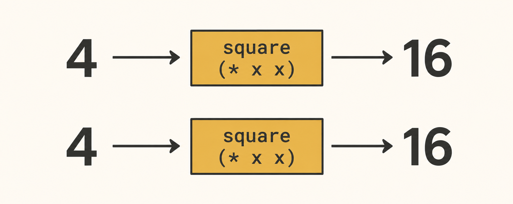
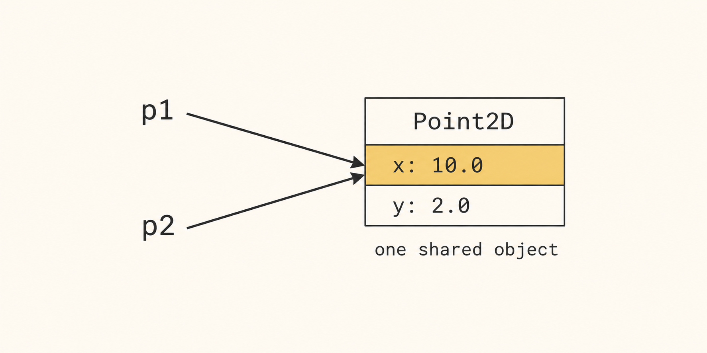
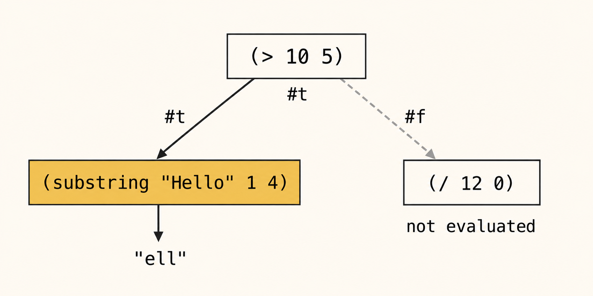

<!-- _class: cover -->
<!-- _paginate: false -->
<!-- _footer: "" -->

<div class="cover-brand" role="img" aria-label="LPP lambda logo"><span class="brand-lambda">λ</span><span class="brand-name">LPP</span></div>
<div class="system-language">SCHEME</div>
<div class="system-week">Week 1</div>

# Programming languages<br>and paradigms

<div class="system-topics">Course overview<br>Functional programming</div>
<div class="system-author">Cristina Pomares Puig</div>
<div class="system-university">Universidad de Alicante</div>

<!--
Say: "Welcome to Programming Languages and Paradigms. We will begin with the course overview and then start functional programming in Scheme."
Ritmo orientativo: 0–12 min: presentación de la asignatura, incluidas preguntas.
-->

---

## Today’s session

<div class="session-agenda">
  <div><b>Topic 0</b><strong>Course overview</strong><span>Course organisation, practical work and assessment.</span></div>
  <div><b>Topic 2 · Part 1</b><strong>Functional programming</strong><span>Functions, expression evaluation and the substitution model in Scheme.</span></div>
</div>

<p class="independent-study"><strong>Independent study:</strong> Topic 1, Programming languages, is covered in the course notes.</p>

<!--
Say: "Today we will introduce the course and start Topic 2. Topic 1 is independent study."
Fuente: Notas de clase, temas 0, 1 y Veremos hoy.
-->

---

<!-- footer: "LPP · Topic 0: Course overview" -->
## Course outline


<div class="course-blocks">
<div><b>1</b><strong>Languages and functional programming</strong><span>Topics 1–2 · Scheme<br>Weeks 1–4</span></div>
<div><b>2</b><strong>Recursive processes and structures</strong><span>Topics 3–4 · Scheme<br>Weeks 5–8</span></div>
<div><b>3</b><strong>Functional programming and advanced OOP</strong><span>Topics 5–6 · Swift<br>Weeks 9–14</span></div>
</div>

<p class="concept-note">Moodle provides the weekly timetable, deadlines and current course information.</p>

<!--
Say: "The course has three blocks. We begin with Scheme and later use Swift. Check Moodle for the detailed schedule."
Fuente: Tema 0: Temario y Planificación.
Docente: contrastar semanas y organización con la planificación del curso nuevo. No se proyectan fechas de años anteriores.
-->

---

## Practical work

<div class="columns equal ">
<div>

### Weekly work

1. Prepare using the notes and examples.
2. Attempt the worksheet in the lab and at home.
3. Submit through Moodle.
4. Review your work against the solution.


</div>
<div>

### Course resources

- **Moodle:** timetable, announcements, questions and submissions.
- **Course notes website:** theory, worked examples, seminar material and worksheets.

Two seminars introduce Scheme and Swift. Twelve worksheets provide practice.


</div>
</div>

> Attempt the exercises before looking at the solutions. Run the examples, explain the results and try variations.

<!--
Say: "Work on the exercises yourself before reading the solutions. Use the notes to prepare, Moodle to submit and the published solutions to review your reasoning."
Fuente: Tema 0: Prácticas, recursos y Consejos para aprender con éxito.
-->

---

<div class="eyebrow">Assessment</div>

## Assessment

<div class="assessment-bars">
  <div><span>Test 1</span><strong>35%</strong><i style="--weight:35%"></i></div>
  <div><span>Test 2</span><strong>30%</strong><i style="--weight:30%"></i></div>
  <div><span>Test 3</span><strong>35%</strong><i style="--weight:35%"></i></div>
</div>

<p class="small">Three written tests cover theory and practical work. No minimum mark is required for an individual test.</p>

<p class="exam-note"><strong>Exam rule:</strong> internet-connected devices remain inside bags placed on the floor.</p>

<p class="assessment-extra">Tests 1 and 2 take place during the course. Test 3 uses the official ordinary examination date.</p>

<!--
Say: "The three tests have weights of thirty-five, thirty and thirty-five percent. Each test covers both theory and practical work."
Fuente: Tema 0: Evaluación.
Docente: confirmar evaluación vigente antes de impartir el curso. Las notas originales también indican calificación 0 si se incumple la norma de dispositivos.
-->

---

<!-- footer: "LPP · Topic 2: Functional programming" -->
<!-- _class: section topic-opening -->

<div class="section-brand" role="img" aria-label="LPP lambda logo"><span class="brand-lambda">λ</span><span class="brand-name">LPP</span></div>
<div class="eyebrow">Topic 2 · Part 1</div>

# Functional programming

<p class="lead">Programs built by defining and composing functions.</p>

<!--
Say: "We now begin Topic 2. Our starting point is a function that transforms arguments into a result without changing external state."
Ritmo orientativo: 12–32 min: fundamentos y comparación con estado mutable.
-->

---

## Today’s topics

<p class="agenda-topic">Topic 2 · Functional programming · Part 1</p>

<ol class="topic-agenda">
<li><strong>The functional programming paradigm</strong></li>
<li><strong>Declarative and imperative programming</strong></li>
<li><strong>Expression evaluation in Scheme</strong></li>
<li><strong>Function definitions and composition</strong></li>
<li><strong>The substitution model of computation</strong><span>Applicative order and normal order</span></li>
<li><strong>Functions and special forms in Scheme</strong><span>define, if, cond, quote, symbols and lists</span></li>
</ol>

<!--
Say: "These six sections follow the same order as the class notes. We will use Scheme expressions throughout."
Fuente: Tema 2: Veremos hoy.
-->

---

<!-- _class: reviewed-definition -->
## Definition of functional programming


<p class="definition-intro">A functional program combines functions that map inputs to results. In the pure model, evaluation has no side effects.</p>
<div class="columns equal definition-review">
<div>

```racket
(define (square x)
  (* x x))

(square 4) ; ⇒ 16
```

For the same arguments, a **pure function** returns the same result and changes no external state.


</div>
<div>



**Same input, same result.** The function neither reads hidden mutable state nor changes it.


</div>
</div>

<!--
Say: "The example is pure: its result depends only on x. Calling it again with four still gives sixteen, and nothing outside the call changes."
Pizarra / editor: Desarrollar (square 4) como (* 4 4), después 16. No repetir una segunda diapositiva con la misma definición.
Pregunta: Would square remain pure if it also incremented a global counter?
Respuesta: No: modificaría estado externo aunque el resultado numérico siguiera siendo 16.
Fuente: Definición de programación funcional.
-->

---

## Main characteristics of functional programming

<div class="columns equal ">
<div>

### The model we use

- Pure functions with no side effects.
- Immutable values rather than destructive updates.
- Recursion to express repeated computation.
- Lists as a fundamental data structure.
- Functions as values that can be passed and returned.


</div>
<div>

### How the ideas connect

Small functions describe transformations. Composition connects those transformations into larger computations.

Recursion and lists will let us apply the same reasoning to recursive data.

Functions as values will later let us parameterise a computation by an operation.


</div>
</div>

<!--
Say: "These are related ideas, rather than five independent rules to memorise. We start with purity and composition; recursion and functions as values come later."
Fuente: Principales características del paradigma funcional.
-->

---

## Functional programming languages


<div class="language-review">
<div><strong>Primarily functional</strong><span>Clojure, Erlang</span></div>
<div><strong>Pure functional</strong><span>Haskell</span></div>
<div><strong>Multiple paradigms</strong><span>Swift, Python, Scala, Ruby, Groovy</span></div>
</div>

<p class="concept-note">We use <strong>Scheme</strong> first and <strong>Swift</strong> later. A language can support functional programming alongside other styles.</p>

<p class="application-note">Pure transformations make dependencies explicit. Composition is useful in data-processing pipelines, including streams and concurrent systems.</p>

<!--
Say: "A programming paradigm is not the same thing as a language. We can use a functional style in languages that also support other paradigms."
Fuente: Lenguajes de programación funcional; ventajas y aplicaciones.
Docente: no presentar Scheme como un lenguaje exclusivamente puro. Los enlaces de lecturas complementarias siguen en las notas originales.
-->

---

<div class="eyebrow">Declarative and imperative programming</div>

## Declarative and imperative programming

<div class="columns equal paradigm-contrast">
<div>

### Declarative

- Declare values and the desired result.
- Do not specify intermediate state changes.
- Express relationships through values and functions.

<strong>Examples:</strong> spreadsheets, Prolog, functional programming, and SwiftUI.

</div>
<div>

### Imperative

- Specify the execution steps.
- Use assignment to update values.
- Allow mutation and mutable local state.

<strong>Examples:</strong> C, Java, and traditional JavaScript.

</div>
</div>

<p class="concept-note">Here the distinction is whether the program explicitly describes changes of state. Both styles still require computation.</p>

<!--
Say: "The declarative style describes values and relationships. The imperative style explicitly describes commands and changes of state."
Pregunta: Does declarative programming mean that the computer performs no evaluation steps?
Respuesta: No. Se abstraen determinados pasos de ejecución; no desaparece el cálculo.
Fuente: Programación declarativa vs. imperativa.
-->

---

## Execution steps

<div class="columns equal ">
<div>

### Intermediate variables

```c
int a = square(8);
int b = doubleValue(a);
int c = square(b);
return c;
```

</div>
<div>

### Function composition

```racket
(square
  (double-value
    (square 8)))
```

</div>
</div>

<p class="concept-note"><code>square</code> multiplies a number by itself. <code>double-value</code> doubles its argument.</p>

<div class="compact-results"><span><code>(square 8)</code><b>64</b></span><span><code>(double-value 64)</code><b>128</b></span><span><code>(square 128)</code><b>16384</b></span></div>

<!--
Say: "Both versions describe the same calculation. In the nested expression, the result of each inner call becomes the argument of the next call."
Pizarra / editor: Conectar cada variable intermedia del ejemplo C con su subexpresión Scheme. Respetar el mismo ejemplo de las notas.
Pregunta: Which call supplies the argument of the outer square?
Respuesta: (double-value (square 8)), cuyo valor es 128.
Fuente: Pasos de ejecución.
-->

---

<!-- _class: mutation-review -->
## Mutation

<div class="columns equal ">
<div>

### Assignment changes stored state

```c
int x = 10;
x = x + 1;
```

The location named `x` first stores `10`, then `11`.


</div>
<div>

### A definition is not an assignment

```racket
#lang racket

(define a 12)
(define a 200)
```

A Racket module rejects the duplicate definition of `a`.


</div>
</div>

<p class="concept-note">Scheme supports mutation, but our functional examples avoid it. The duplicate-definition error above is a rule of Racket modules, not a proof that all Scheme state is immutable.</p>

<!--
Say: "Assignment changes a stored value. Defining a name is a different operation. In our functional style we work with values without mutating them."
Pizarra / editor: Mostrar primero la actualización de x. Si se ejecuta el ejemplo Racket, hacerlo en un archivo de módulo, no como redefiniciones sueltas en el REPL.
Fuente: Mutación.
Referencia: https://docs.racket-lang.org/guide/define.html
-->

---

## Mutation and side effects

<div class="columns equal alias-layout">
<div>

```java
Point2D p1 = new Point2D(3.0, 2.0);
Point2D p2 = p1;

p2.setCoordX(10.0);
p1.getCoordX();       // 10.0
```

</div>
<div>
<div class="alias-figure">

</div>
</div>
</div>

Both variables refer to the same object. A change through `p2` is also visible through `p1`.

<!--
Say: "Both names refer to one object. The update through p2 changes the object that p1 also refers to."
Pizarra / editor: Señalar una única caja de objeto y las dos flechas. Cambiar la coordenada una sola vez.
Pregunta: Does assigning p1 to p2 create a copy of the object?
Respuesta: No. Se copia la referencia; las dos variables observan el mismo objeto.
Fuente: Mutación y efectos laterales.
-->

---

## Mutable local state

<div class="columns equal ">
<div>

```c
int counter() {
  static int c = 0;
  c++;
  return c;
}
```

</div>
<div>

### The result depends on history

Successive calls to `counter()` return `1`, then `2`, then `3`.

The static local variable keeps its value between calls. The arguments alone do not determine the result.

### Referential transparency

A pure call can be replaced by its value without changing the result of the surrounding pure expression.


</div>
</div>

<p class="concept-note"><code>(square 3)</code> can be replaced by <code>9</code>. A call to <code>counter()</code> cannot be replaced by one fixed number in every context.</p>

<!--
Say: "The counter has no arguments, but its result changes because it remembers state. This is why it behaves differently from square."
Pizarra / editor: Anotar el estado c=0, 1, 2, 3; comparar con dos llamadas iguales a square.
Fuente: Estado local mutable; transparencia referencial.
-->

---

<div class="eyebrow">Declarative and imperative models</div>

## Summary

<div class="comparison-table">
  <div class="header"><span></span><b>Functional model used here</b><b>Imperative</b></div>
  <div><strong>Focus</strong><span>Values, relationships, and results</span><span>Commands and state changes</span></div>
  <div><strong>Variable</strong><span>Name for a value</span><span>Name for a memory location</span></div>
  <div><strong>Order</strong><span>Derived from expression dependencies</span><span>Specified by the command sequence</span></div>
</div>

<p class="checkpoint"><strong>Check:</strong> which example can be understood from its arguments alone: <code>square</code>, the shared <code>Point2D</code> update, or <code>counter()</code>?</p>

<!--
Say: "Use the examples to explain the summary. The key question is whether evaluating the expression depends on or changes state."
Pregunta: Justify the choice using the definition of a pure function.
Respuesta: square: depende de su argumento y no tiene efectos laterales; los otros ejemplos utilizan estado mutable.
Fuente: Resumen.
-->

---

<div class="eyebrow">Evaluating expressions</div>

## Expression evaluation in Scheme

<div class="columns equal">
<div>

```racket
2                 ; ⇒ 2
(+ 2 3)           ; ⇒ 5
(+)               ; ⇒ 0
(+ 2 4 5 6)       ; ⇒ 17
(+ (* 2 3) (- 3 1)) ; ⇒ 8
```

</div>
<div class="prefix-anatomy">
  <code>(+ 2 3)</code>
  <div><span>function</span><strong>+</strong></div>
  <div><span>arguments</span><strong>2, 3</strong></div>
</div>
</div>

<p class="concept-note">In a call, the first expression supplies the function and the remaining expressions supply its arguments. Prefix notation places the operator before its operands.</p>

<!--
Say: "We evaluate expressions to obtain values. In a function call, the function comes first and the arguments follow it."
Pregunta: In (+ (* 2 3) (- 3 1)), how many arguments does the outer + receive?
Respuesta: Dos: los valores de (* 2 3) y (- 3 1).
Fuente: Evaluación de expresiones en Scheme.
Ritmo orientativo: 32–55 min: evaluación, definición y composición; incluye trabajo en pizarra.
-->

---

<!-- _class: question -->
## Expression evaluation

```racket
(+ (* 2 3)
   (- 3 (/ 12 3)))
```

1. Identify the function and arguments of the outer call.
2. Find the subexpressions whose values are needed first.
3. Rewrite the expression after each replacement.

<p class="prompt">Predict the result before running the expression. Explain why each replacement is valid.</p>

<!--
Say: "Work through the dependencies rather than reading the expression as a left-to-right sequence of commands."
Pizarra / editor: Dar 60–90 segundos para intentarlo. Resolver en pizarra antes de pasar a la solución.
Respuesta: Resultado 5: (* 2 3)=6, (/ 12 3)=4 y (- 3 4)=-1.
Fuente: Evaluación de expresiones: ejemplo anidado.
-->

---

<div class="eyebrow">Inside-out evaluation</div>

## Expression evaluation

<div class="evaluation-ladder week01-evaluation">
  <code>(+ (* 2 3) (- 3 (/ 12 3)))</code>
  <span>↓ evaluate the innermost division</span>
  <code>(+ (* 2 3) (- 3 4))</code>
  <span>↓ evaluate multiplication and subtraction</span>
  <code>(+ 6 -1)</code>
  <strong>5</strong>
</div>

<p class="concept-note">Each replacement preserves the value of the whole expression. An outer call can run only after its argument values are available.</p>

<!--
Say: "Each step replaces an expression by its value. The last addition receives six and minus one."
Pizarra / editor: Comparar con las reescrituras propuestas por el alumnado. La traza elige un orden válido entre subexpresiones independientes.
Fuente: Evaluación de expresiones.
-->

---

<div class="eyebrow">Defining functions</div>

## Function definitions in Scheme

<div class="columns equal">
<div>

```racket
(define (square x)
  (* x x))
```

There is no `return` statement. The body evaluates to the function result.

</div>
<div>

```racket
(square 10)
; ⇒ 100

(square
  (+ 10
     (square (+ 2 4))))
; ⇒ 2116
```

</div>
</div>

<p class="concept-note"><code>x</code> is a formal parameter. Calling <code>(square 10)</code> supplies the argument value <code>10</code>, so the body becomes <code>(* 10 10)</code>.</p>

<!--
Say: "The definition gives the function a name, a parameter and a body. A call supplies an argument. The value of the body is the result."
Pizarra / editor: Señalar nombre, parámetro y cuerpo. Desarrollar la llamada anidada en pizarra; no leer únicamente el resultado 2116.
Fuente: Definición de funciones en Scheme.
-->

---

<div class="eyebrow">Auxiliary functions</div>

## Helper functions and composition

<div class="columns equal">
<div>

### Repeated implementation

```racket
(define (sum-of-squares x y)
  (+ (* x x)
     (* y y)))
```

</div>
<div>

### Reused abstraction

```racket
(define (square x)
  (* x x))

(define (sum-of-squares x y)
  (+ (square x)
     (square y)))
```

</div>
</div>

<p class="concept-note">The helper function names a reusable idea. Both versions compute the same result, but the second expresses the calculation in terms of <code>square</code>.</p>

<p class="checkpoint"><strong>Check:</strong> explain the two calls made by <code>(sum-of-squares 3 4)</code> before adding their results.</p>

<!--
Say: "The helper function does not change the mathematical result. It lets us describe the larger calculation using a smaller named operation."
Respuesta: (square 3)=9, (square 4)=16; suma=25.
Fuente: Funciones auxiliares y composición.
-->

---

## Function composition

<div class="columns equal ">
<div>

```racket
(define (drive-vehicle images)
  (derive-actions
    (recognise
      (filter-data
        (extract-features images)))))
```

</div>
<div>

### Follow the data

1. `extract-features` consumes the images.
2. `filter-data` consumes those features.
3. `recognise` consumes the filtered result.
4. `derive-actions` consumes what was recognised.

Each result becomes the argument of the enclosing call.


</div>
</div>

<p class="concept-note">This is a conceptual pipeline: the four operations must be defined for a real application. The nesting expresses their dependencies.</p>

<!--
Say: "Read the nested calls from the inside out. The code describes a chain of transformations, with each stage using the previous result."
Pizarra / editor: Relacionar cada llamada con el ejemplo de procesamiento de imágenes de las notas. No ejecutar este esquema sin implementar sus operaciones.
Fuente: Composición de funciones: vehículo autónomo.
-->

---

## The substitution model of computation


<p class="definition-intro">For pure expressions, evaluation can be explained by rewriting terms into simpler terms with the same value.</p>
<div class="rule-list">
  <div><b>1</b><strong>Primitive value</strong><span>A number evaluates to itself.</span></div>
  <div><b>2</b><strong>Identifier</strong><span>Return the value associated with it by <code>define</code>.</span></div>
  <div><b>3</b><strong>Primitive call</strong><span>Evaluate its arguments, then apply the primitive function.</span></div>
</div>

<p class="concept-note"><strong>Rule 4:</strong> a call to a user-defined function uses its body, replacing formal parameters by the corresponding arguments. The evaluation order determines when those arguments are evaluated.</p>

<!--
Say: "The model explains evaluation through rewriting. The first three rules handle values, names and primitive calls. Rule four handles functions that we define."
Fuente: Modelo de computación de sustitución.
Ritmo orientativo: 55–80 min: reglas, trazas y comparación de órdenes.
Referencia: https://sicp.sourceacademy.org/chapters/1.1.5.html
-->

---

<div class="eyebrow">Rule 4</div>

## Applicative order and normal order

<div class="columns equal evaluation-orders">
<div>

### Applicative order

1. Evaluate the arguments.
2. Replace the function call with its body.
3. Replace each formal parameter with the corresponding **evaluated value**.
4. Evaluate the resulting expression with the same rules.

</div>
<div>

### Normal order

1. Replace the function call with its body.
2. Replace each formal parameter with the corresponding **unevaluated argument expression**.
3. Evaluate the resulting expression with the same rules.

</div>
</div>

> Scheme uses applicative order.

<!--
Say: "Applicative order evaluates the arguments before substituting them into the body. Normal order substitutes the argument expressions before evaluating them."
Pizarra / editor: Subrayar valor evaluado frente a expresión sin evaluar. No presentar el orden normal como el comportamiento del intérprete Scheme.
Fuente: Orden aplicativo y orden normal.
-->

---

## The substitution model: example

<div class="columns equal ">
<div>

```racket
(define (double-value x)
  (+ x x))

(define (square y)
  (* y y))

(define a 2)

(double-value (square a))
```

</div>
<div>

### What each name means

- `a` is associated with `2`.
- `square` replaces its parameter `y` in `(* y y)`.
- `double-value` replaces its parameter `x` in `(+ x x)`.

### The same expression, two strategies

Applicative order starts by evaluating `(square a)`. Normal order first expands the outer `double-value` call.


</div>
</div>

<p class="concept-note">Both strategies produce <code>8</code> for this terminating pure example. We will now compare their rewrites.</p>

<!--
Say: "Both strategies use these same definitions. Only the timing of argument evaluation changes."
Pizarra / editor: Mantener las definiciones a la vista en la pizarra durante las dos trazas siguientes.
Fuente: Modelo de sustitución: ejemplo doble/cuadrado.
-->

---

<div class="eyebrow">Applicative order</div>

## Applicative order

```text
(double-value (square a))  ; start
(double-value (square 2))  ; R2: replace a
(double-value (* 2 2))     ; R4: expand square
(double-value 4)           ; R3: apply *
(+ 4 4)                    ; R4: expand double-value
8                          ; R3: apply +
```

<div class="order-caption">The inner call becomes a value before <code>double-value</code> is expanded.</div>

<p class="checkpoint"><strong>Check:</strong> which argument value replaces <code>x</code> in the body of <code>double-value</code>?</p>

<!--
Say: "The argument becomes four before the outer function body is expanded. We then replace both occurrences of x by four."
Pizarra / editor: Pedir cada línea antes de mostrar o escribir la siguiente en la pizarra.
Respuesta: El valor 4; el cuerpo queda (+ 4 4).
Fuente: Traza de orden aplicativo.
-->

---

<div class="eyebrow">Normal order</div>

## Normal order

```text
(double-value (square a))       ; start
(+ (square a) (square a))       ; R4: expand double-value
(+ (* a a) (* a a))             ; R4: expand square
(+ (* 2 2) (* 2 2))             ; R2: replace a
(+ 4 (* 2 2))                    ; R3: apply *
(+ 4 4)                          ; R3: apply *
8                                ; R3: apply +
```

The expression for `square` appears twice before either copy is evaluated.

<p class="concept-note">Here, normal order duplicates the argument expression. Applicative order evaluates it once. When both pure computations terminate, they agree on the value; termination can differ in other examples.</p>

<!--
Say: "The outer call expands first, so the unevaluated square expression appears twice. This trace does more repeated work but still ends at eight."
Pizarra / editor: Rodear ambas copias de (square a). Comparar la primera reescritura de cada traza.
Fuente: Traza de orden normal.
Referencia: https://sicp.sourceacademy.org/chapters/1.1.5.html
Docente: no afirmar que pureza implica siempre la misma terminación. No desarrollar evaluación perezosa en esta semana.
-->

---

<div class="eyebrow">Pure and non-pure functions</div>

## Applicative order and normal order

```racket
(define (zero x)
  (- x x))

(zero (random 10))
```

<div class="columns equal random-orders">
<div><strong>Applicative</strong><span>Evaluate <code>random</code> once, then subtract the value from itself.</span></div>
<div><strong>Normal</strong><span>Substitution can create two separate calls to <code>random</code>.</span></div>
</div>

<p class="concept-note"><strong>Why purity matters:</strong> one random result minus itself is zero. Two separate random calls may produce different numbers. The normal-order column is a model comparison, not what Scheme executes.</p>

<!--
Say: "The example breaks referential transparency. A repeated call to random does not necessarily give the same value."
Pizarra / editor: Contar las llamadas a random. No prometer resultados concretos al ejecutarlas.
Pregunta: Does the Scheme interpreter evaluate random once or twice in this call?
Respuesta: Una vez, por orden aplicativo. El resultado de zero es 0.
Fuente: Funciones no puras y orden de evaluación.
-->

---

## Functions and special forms in Scheme

<div class="columns equal ">
<div>

### Ordinary function call

Evaluate the argument expressions, then apply the function to their values.

For `(+ 2 3)`, the values are `2` and `3`, and the result is `5`.


</div>
<div>

### Special form

Its own rule determines which expressions are evaluated, when and in what context.

- `define` introduces bindings.
- `if` and `cond` select expressions.
- `quote` returns data without evaluating it.


</div>
</div>

<p class="checkpoint"><strong>Check:</strong> why would evaluating both branches before applying <code>if</code> defeat its purpose?</p>

<!--
Say: "A special form is part of the language syntax. Its evaluation rule cannot be reduced to the rule for an ordinary function call."
Respuesta: La rama no elegida puede producir un error o no terminar, aunque su resultado no haga falta.
Fuente: Funciones y formas especiales en Scheme.
Ritmo orientativo: 80–115 min: define, selección, símbolos y listas.
-->

---
<!-- _class: define-review -->

## The `define` special form

<div class="columns equal">
<div>

### Syntax and evaluation

```racket
(define <identifier> <expression>)
```

1. Evaluate the expression.
2. Associate its result with the identifier.

The name being defined is **not** evaluated as an argument.

</div>
<div>

### Example

```racket
(define base 10)
(define height 12)
(define area (/ (* base height) 2)) ; ⇒ 60
```

In the last definition, `base` and `height` supply values used to compute the value associated with `area`.

</div>
</div>

<!--
Say: "Define evaluates the expression and associates its result with the name. It does not first look up the name being defined."
Pregunta: What would happen if an ordinary call tried to evaluate a previously undefined identifier before binding it?
Respuesta: La búsqueda del nombre fallaría; por eso define necesita su propia regla.
Fuente: Forma especial define.
Referencia: https://docs.racket-lang.org/guide/define.html
-->
---

## The `define` special form for function definitions

<div class="columns equal ">
<div>

```racket
(define (<function-name> <arguments>)
  <body>)
```

The function name and formal parameters are syntax. Defining the function does not run its body.


</div>
<div>

### Example definition

```racket
(define (double-value x)
  (+ x x))
```

### A later call

```racket
(double-value 5) ; ⇒ 10
```

Bind the argument value `5` to `x`, then evaluate `(+ x x)`.


</div>
</div>

<!--
Say: "At definition time we create and name a function. At call time we bind its parameters and evaluate its body."
Pregunta: Does defining double-value compute a number immediately?
Respuesta: No: crea la función. El cuerpo se evalúa al llamarla.
Fuente: Forma especial define para definir funciones.
Referencia: https://docs.racket-lang.org/guide/define.html
-->

---

<!-- _class: if-review -->
## The `if` special form

<div class="columns equal if-review-grid">
<div>

```racket
(if <condition>
    <true-expression>
    <false-expression>)
```

1. Evaluate the condition.
2. Evaluate only the selected branch.
3. Return that branch’s value.

Only `#f` counts as false in Scheme.


</div>
<div>



```racket
(if (> 10 5)
    (substring "Hello" 1 4)
    (/ 12 0))
```


</div>
</div>

<!--
Say: "The condition is true, so only the substring expression is evaluated. The other branch is skipped, which prevents division by zero."
Pizarra / editor: Ejecutar el ejemplo concreto. Antes, pedir una predicción y señalar el camino en el dibujo.
Respuesta: "ell"; no se evalúa (/ 12 0).
Fuente: Forma especial if.
Referencia: https://docs.racket-lang.org/guide/conditionals.html
-->

---

<div class="eyebrow">Special form cond</div>

## The `cond` special form

<div class="columns equal">
<div>

```racket
(cond
  ((> 3 4) "first")
  ((< 2 1) "second")
  ((= 3 1) "third")
  (else "no condition is true"))
```

</div>
<div class="cond-flow">
  <span>#f · continue</span>
  <span>#f · continue</span>
  <span>#f · continue</span>
  <strong>else · return its value</strong>
</div>
</div>

<p class="concept-note">Test conditions from top to bottom. Evaluate the result expression of the first true clause and stop. Use <code>else</code> when none of the preceding conditions is true.</p>

<p class="checkpoint"><strong>Check:</strong> if an earlier condition became true, which later conditions and result expressions would be skipped?</p>

<!--
Say: "Cond returns the value of the first selected result expression. It does not evaluate every result expression before making the selection."
Pizarra / editor: Ejecutar el caso de else. Después cambiar en directo la primera comparación para seleccionar la primera cláusula.
Respuesta: Se omiten todas las cláusulas posteriores. En el ejemplo original se devuelve "no condition is true".
Fuente: Forma especial cond.
Referencia: https://docs.racket-lang.org/guide/conditionals.html
-->

---

<!-- _class: quote-review -->
## The `quote` special form and symbols

<div class="columns equal ">
<div>

```racket
(quote x)
; ⇒ x

'hello
; ⇒ hello
```

The apostrophe abbreviates `quote`. The name is returned as symbol data rather than looked up.

</div>
<div>

```racket
(define x 12)

(symbol? 'x) ; ⇒ #t
(symbol? x)  ; ⇒ #f
```

`x` is evaluated to `12`. `'x` produces the symbol `x`, so the two predicates test different values.

</div>
</div>

<div class="symbol-summary"><span><strong>Symbol</strong><code>'hello</code> is an atomic label.</span><span><strong>String</strong><code>"hello"</code> is a sequence of characters.</span></div>

<!--
Say: "An identifier is a name used in code. Quoting it produces a symbol as data. A symbol and a string can look similar but have different types."
Pregunta: Why is (symbol? x) false after (define x 12)?
Respuesta: Primero se evalúa x y se obtiene el número 12; symbol? recibe ese número.
Fuente: Forma especial quote, símbolos y listas; Símbolos como tipos primitivos.
Referencia: https://docs.racket-lang.org/guide/quote.html
-->

---

<div class="eyebrow">Quote and expressions</div>

## The `quote` special form and expressions

```racket
'(1 2 3)
'(a b c)
'(* (+ 1 2) 5)
```

<div class="quoted-expression">
  <span>without quote</span><code>(* (+ 1 2) 5)</code><strong>15</strong>
  <span>with quote</span><code>'(* (+ 1 2) 5)</code><strong>a list</strong>
</div>

<p class="concept-note">The quoted expression has three elements: the symbol <code>*</code>, the list <code>(+ 1 2)</code>, and the number <code>5</code>. The inner addition is data too.</p>

<!--
Say: "Quote preserves the structure as data. It prevents evaluation of the whole quoted expression, including the nested addition."
Pizarra / editor: Marcar los tres elementos exteriores y después los elementos de la lista interior.
Pregunta: Does the nested (+ 1 2) become 3 inside the quoted list?
Respuesta: No. Se conserva como una lista con los elementos +, 1 y 2.
Fuente: Forma especial quote y expresiones; Listas.
Referencia: https://docs.racket-lang.org/guide/quote.html
-->

---

<div class="eyebrow">list and quote</div>

## The `list` function and the `quote` special form

<div class="columns equal">
<div>

### Function `list`

```racket
(list 1
      (/ 2 3)
      (+ 2 3))
; ⇒ (1 2/3 5)
```

</div>
<div>

### Special form `quote`

```racket
'(1
  (/ 2 3)
  (+ 2 3))
; ⇒ (1 (/ 2 3) (+ 2 3))
```

</div>
</div>

<p class="concept-note">Both results have three outer elements. With <code>list</code>, the second and third elements are values. With <code>quote</code>, they remain nested lists representing the original expressions.</p>

<p class="checkpoint"><strong>Check:</strong> identify the type and value of the second element in each result.</p>

<!--
Say: "List evaluates its arguments before building the list. Quote treats the written structure as data without evaluating its elements."
Pizarra / editor: Pedir las predicciones antes de ejecutar. Comparar el segundo elemento de ambas listas.
Respuesta: Con list: número racional 2/3. Con quote: lista (/ 2 3).
Fuente: Función list y forma especial quote.
Referencia: https://docs.racket-lang.org/guide/quote.html
-->

---

<!-- _class: cons-review -->
## The `cons` and `append` functions

<div class="columns equal ">
<div>

### `cons`: prepend one element

```racket
(cons 1 '(2 3 4))
; ⇒ (1 2 3 4)
```

```racket
(cons '(1 2) '(3 4))
; ⇒ ((1 2) 3 4)
```

The first argument remains **one element**, even when that element is a list.


</div>
<div>

### `append`: concatenate lists

```racket
(append '(1 2) '(3 4))
; ⇒ (1 2 3 4)
```

```racket
(append '(1 2) '(3 4))
; ⇒ (1 2 3 4)
```

The elements of the first list join the elements of the second list.


</div>
</div>

<p class="checkpoint"><strong>Check:</strong> why do the nested <code>cons</code> example and <code>append</code> produce lists of different lengths?</p>

<!--
Say: "A list can itself be an element. Cons preserves that first argument as one element; append concatenates the elements of its list arguments."
Pizarra / editor: Dibujar los elementos exteriores. Mantener juntas las expresiones con los mismos argumentos.
Respuesta: cons: tres elementos, (1 2), 3 y 4. append: cuatro elementos, 1, 2, 3 y 4.
Fuente: Funciones cons y append.
Referencia: https://docs.racket-lang.org/guide/Pairs__Lists__and_Racket_Syntax.html
-->

---

<!-- _class: final-check -->
## Today’s topics: check your understanding


<ol class="retrieval-check">
<li>Explain why replacing <code>(square 3)</code> by <code>9</code> preserves a pure computation.</li>
<li>Describe the first rewrite of <code>(double-value (square a))</code> in each evaluation order.</li>
<li>Explain why an unselected <code>if</code> branch can contain a division by zero safely.</li>
<li>Compare <code>(list 1 (+ 2 3))</code> and <code>'(1 (+ 2 3))</code>.</li>
<li>Explain how <code>cons</code> can add a list as a single element.</li>
</ol>

<p class="concept-note">Use the evaluation rules and the structure of the data to justify each answer.</p>

<!--
Say: "Before we finish, explain these ideas in your own words. A correct result matters, but so does the reasoning that produces it."
Pizarra / editor: Elegir dos o tres preguntas según el tiempo. Las demás quedan como repaso al final de clase.
Respuesta: 1: transparencia referencial. 2: aplicativo comienza por square a; normal expande double-value. 3: se evalúa una sola rama. 4: (1 5) frente a (1 (+ 2 3)). 5: el primer argumento completo es un único elemento.
Fuente: Síntesis de los seis apartados de Veremos hoy.
Ritmo orientativo: 115–120 min: comprobación final.
-->
