<!-- _class: cover -->
<!-- _paginate: false -->
<!-- _footer: "" -->

<div class="eyebrow">Programming Languages and Paradigms</div>
<div class="week-marker">Week 5</div>

# Recursive procedures and their cost

<p class="lead">Topic 3 · Cost of recursion, iterative processes, memoization, and recursive figures</p>

<div class="meta">
  <strong>Cristina Pomares Puig</strong>
  Departamento de Ciencia de la Computación e Inteligencia Artificial<br>
  Universidad de Alicante
</div>

<!--
Idea: Present the week as a study of how recursive definitions behave when they run.
Say: "We already know how to write recursive procedures. This week we study the processes they generate and how to reduce their cost."
Bridge: "We will finish by using recursion to construct images."
-->

---

<div class="eyebrow">Today</div>

## Four views of recursion

<div class="sequence week04-roadmap">
  <div><b>1 · OBSERVE</b><span>Trace pending operations on the recursion stack</span></div>
  <div><b>2 · REFORMULATE</b><span>Use accumulators to generate iterative processes</span></div>
  <div><b>3 · REMEMBER</b><span>Cache repeated results with memoization</span></div>
  <div><b>4 · CONSTRUCT</b><span>Build recursive figures from smaller images</span></div>
</div>

<!--
Idea: Give students a map of the class before introducing cost models.
Say: "We will observe recursion, reformulate it, remember repeated results, and apply it to visual structures."
Bridge: "We begin with the stack created by an ordinary recursive list function."
-->

---

<!-- _class: section -->

<div class="eyebrow">01</div>

# The cost of recursion

<p class="lead">Recursive calls may leave work pending. The stack stores each operation that waits for a recursive result.</p>

<!--
Idea: Define the concrete source of space cost before introducing asymptotic notation.
Say: "A recursive call does not automatically finish the current call. If an operation still needs the result, that operation waits on the stack."
Bridge: "The definition of mi-length makes this visible."
-->

---

<div class="eyebrow">Function mi-length</div>

## `+ 1` waits for the recursive result

<div class="columns equal">
<div>

```racket
(define (mi-length items)
  (if (null? items)
      0
      (+ 1
         (mi-length (rest items)))))
```

</div>
<div>

<div class="week05-call-anatomy">
  <code>(mi-length '(a b c d))</code>
  <span>calls the function on a smaller list</span>
  <code>(mi-length '(b c d))</code>
  <strong>Meanwhile, <code>(+ 1 ...)</code> is pending.</strong>
</div>

</div>
</div>

<!--
Idea: Identify the recursive call and the pending addition in one frame.
Say: "The recursive call receives the rest of the list. The current call cannot add one until that smaller call returns."
Bridge: "Repeated calls produce a growing expression."
-->

---

<!-- _class: compact code-small -->

<div class="eyebrow">Growing phase</div>

## Every recursive call adds one pending operation

```text
(mi-length '(a b c d))
(+ 1 (mi-length '(b c d)))
(+ 1 (+ 1 (mi-length '(c d))))
(+ 1 (+ 1 (+ 1 (mi-length '(d)))))
(+ 1 (+ 1 (+ 1 (+ 1 (mi-length '())))))
(+ 1 (+ 1 (+ 1 (+ 1 0))))
```

<div class="week05-trace-conclusion">
  <span>The list has reached the base case <code>'()</code></span>
  <strong>Four additions are still waiting</strong>
</div>

<!--
Idea: Read the trace from top to bottom as stack growth.
Say: "Each line makes the list smaller, but the expression around the recursive call grows. At the empty list, four additions are waiting."
Bridge: "The base case now allows the stored operations to run."
-->

---

<div class="eyebrow">The recursion stack</div>

## At the base case, four earlier calls are still waiting

<div class="week05-waiting-snapshot">
  <div class="waiting-frames">
    <div><span>Call 1</span><code>(mi-length '(a b c d))</code><b>waits to add 1</b></div>
    <div><span>Call 2</span><code>(mi-length '(b c d))</code><b>waits to add 1</b></div>
    <div><span>Call 3</span><code>(mi-length '(c d))</code><b>waits to add 1</b></div>
    <div><span>Call 4</span><code>(mi-length '(d))</code><b>waits to add 1</b></div>
  </div>
  <div class="waiting-base">
    <span>Current call reaches the base case</span>
    <code>(mi-length '())</code>
    <strong>returns 0</strong>
    <p>The four previous calls cannot finish yet. Each waiting call occupies one stack frame.</p>
  </div>
</div>

<!--
Idea: Show one snapshot at the deepest point of the recursion, with every waiting call named explicitly.
Say: "The empty list reaches the base case, but the four earlier calls have not finished. Each one is waiting to add one and therefore occupies a stack frame."
Bridge: "Unwinding the stack produces the final answer."
-->

---

<div class="eyebrow">Returning phase</div>

## Pending operations run from the inside out

<div class="week05-unwind week05-unwind-compact">
  <code>(+ 1 (+ 1 (+ 1 (+ 1 0))))</code>
  <code>(+ 1 (+ 1 (+ 1 1)))</code>
  <code>(+ 1 (+ 1 2))</code>
  <code>(+ 1 3)</code>
  <strong>4</strong>
</div>

<div class="week05-unwind-summary">
  <div><span>For a list of <code>n</code> elements</span><b><code>n</code> calls are waiting at the deepest point</b></div>
  <div><span>Maximum stack space</span><strong>O(n)</strong></div>
</div>

<!--
Idea: Contrast the growing and returning phases, then connect the maximum number of pending calls to the space cost.
Say: "Once the base case returns zero, each waiting addition completes. With n list elements, the deepest point has n waiting calls, so the stack space grows linearly: O(n)."
Bridge: "One recursive call per step gives linear growth. Two calls can behave very differently."
-->

---

<div class="eyebrow">Fibonacci</div>

## One call creates two smaller calls

<div class="columns equal">
<div>

```text
Fibonacci(n) = Fibonacci(n-1)
             + Fibonacci(n-2)

Fibonacci(0) = 0
Fibonacci(1) = 1
```

</div>
<div>

```racket
(define (fib n)
  (cond ((= n 0) 0)
        ((= n 1) 1)
        (else
          (+ (fib (- n 1))
             (fib (- n 2))))))
```

</div>
</div>

<!--
Idea: Place the mathematical recurrence beside its direct Scheme translation.
Say: "The program follows the definition literally. Every non-base call requests two more Fibonacci values."
Bridge: "The resulting evaluation forms a branching tree."
-->

---

<!-- _class: visual -->

<div class="eyebrow">Evaluation tree</div>

## The same Fibonacci values are computed many times

<div class="week05-image-with-caption">
  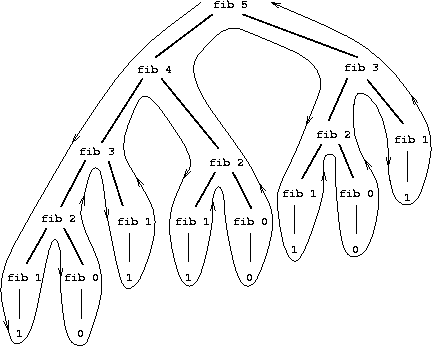
  <div>
    <strong>Each branch creates more work</strong>
    <span>Subproblems such as <code>fib(3)</code> and <code>fib(2)</code> appear repeatedly.</span>
  </div>
</div>

<!--
Idea: Use the tree to make duplication visible.
Say: "The tree repeats identical subproblems. The program forgets every result and recomputes it in another branch."
Bridge: "This duplication makes the cost grow exponentially."
-->

---

<div class="eyebrow">Fibonacci cost</div>

## Two recursive calls produce exponential growth

<div class="week05-growth">
  <div class="week05-growth-formula">
    <span>Time cost</span>
    <strong>O(2<sup>n</sup>)</strong>
  </div>
  <div class="week05-growth-samples">
    <div><code>(fib n)</code><span>calls <code>(fib (- n 1))</code></span></div>
    <div><code>(fib n)</code><span>also calls <code>(fib (- n 2))</code></span></div>
    <div><code>fib(40)</code><span>requires a very large evaluation tree</span></div>
  </div>
</div>

> What happens if we evaluate <code>(fib 40)</code>?

<!--
Idea: Use only the exponential cost stated in the class notes, without adding estimated call counts.
Say: "Every non-base call makes two recursive calls. The evaluation tree grows exponentially, with time cost O(2^n)."
Bridge: "Our first solution changes the process generated by the recursive procedure."
-->

---

<!-- _class: section -->

<div class="eyebrow">02</div>

# Solutions to the cost of recursion: iterative processes

<p class="lead">An accumulator carries the partial result. The recursive call leaves no operation waiting on the stack.</p>

<!--
Idea: Separate recursive syntax from the shape of the running process.
Say: "The procedure remains recursive, but the process can be iterative when every call already contains the current result."
Bridge: "This distinction starts with procedure and process."
-->

---

<div class="eyebrow">Procedure and process</div>

## Source code and execution describe different things

<div class="week05-two-processes">
  <div>
    <b>Recursive procedure</b>
    <span>The source code contains a call to the same procedure.</span>
    <code>(f ...)</code>
  </div>
  <div>
    <b>Recursive process</b>
    <span>Each call leaves an operation waiting for the recursive result.</span>
    <code>(+ 1 (f ...))</code>
    <strong>Pending calls occupy stack space.</strong>
  </div>
  <div>
    <b>Iterative process</b>
    <span>The next call carries the partial result and no operation waits.</span>
    <code>(f ... result)</code>
    <strong>No growing recursion stack.</strong>
  </div>
</div>

<!--
Idea: Avoid equating self-calling syntax with stack growth.
Say: "A procedure is the algorithm we write. A process is what happens when it runs. A self-calling procedure may generate either kind of process."
Bridge: "Tail recursion creates the iterative form."
-->

---

<div class="eyebrow">Tail recursion</div>

## The recursive call is the final operation

<div class="columns equal">
<div>

### Recursive process

```racket
(+ 1
   (mi-length (rest items)))
```

The addition must wait.

</div>
<div>

### Iterative process

```racket
(mi-length-iter
  (rest items)
  (+ result 1))
```

The addition finishes before the call.

</div>
</div>

> A tail call needs no pending operation after it returns.

<!--
Idea: Locate the exact syntactic difference that changes the process.
Say: "In the first expression, plus surrounds the recursive call. In the second, the new result is computed before the call, which is the last operation."
Bridge: "The complete iterative version introduces the accumulator explicitly."
-->

---

<div class="eyebrow">Iterative mi-length</div>

## `result` stores the length counted so far

<div class="columns equal">
<div>

```racket
(define (mi-length lista)
  (mi-length-iter lista 0))

(define (mi-length-iter lista result)
  (if (null? lista)
      result
      (mi-length-iter
        (rest lista)
        (+ result 1))))
```

</div>
<div class="week05-accumulator">
  <div><span>Unprocessed list</span><code>'(a b c d)</code></div>
  <div><span>Accumulated length</span><code>0</code></div>
  <p>Each call moves one element from the remaining work into the accumulated result.</p>
</div>
</div>

<!--
Idea: Give a meaning to every parameter, not just its mechanics.
Say: "Lista tells us what remains. Result tells us how many elements we have already processed. Together they describe the state of the calculation."
Bridge: "The call sequence now stays flat."
-->

---

<div class="eyebrow">Iterative processes</div>

## The accumulator removes pending operations

<div class="week05-iterative-explanation">
  <div><b>Additional parameter</b><span><code>result</code> stores each partial calculation.</span></div>
  <div><b>Before the recursive call</b><span>The procedure updates <code>result</code>.</span></div>
  <div><b>Base case</b><span><code>result</code> already contains the final answer.</span></div>
</div>

<div class="week05-no-waiting">
  <strong>No calls are left waiting</strong>
  <span>The last recursive call returns the accumulated value directly.</span>
</div>

<!--
Idea: Explain the iterative process using the points stated in the class notes, without another trace.
Say: "The extra parameter stores the partial result. We update it before the recursive call, so earlier calls have nothing left to do."
Bridge: "This improvement has a cost in the design of the procedure."
-->

---

<div class="eyebrow">Space cost</div>

## No pending calls means no stack growth

<div class="comparison-table week05-comparison">
  <div class="header"><b></b><b>Recursive process</b><b>Iterative process</b></div>
  <div><span>After the recursive call</span><span>An operation remains pending</span><strong>The call is the final operation</strong></div>
  <div><span>Calls waiting</span><span>They accumulate</span><strong>None</strong></div>
  <div><span>Recursion stack</span><span>It grows with the input</span><strong>It does not increase</strong></div>
</div>

<div class="week05-no-waiting">
  <strong>No calls are waiting</strong>
  <span>This does not mean zero memory. Earlier calls do not accumulate on the stack. The trade-off is a less elegant definition that is harder to understand and debug.</span>
</div>

<!--
Idea: Use the wording from the class notes: no calls remain waiting and the recursion stack does not increase.
Say: "The process still uses memory for the current call. Previous calls do not remain waiting, so they do not accumulate on the recursion stack. The notes warn that iterative versions are less elegant and harder to understand and debug."
Bridge: "The same method applies to other list functions."
-->

---

<!-- _class: code-small -->

<div class="eyebrow">Example: maximum</div>

## The accumulator stores the largest value seen so far

<div class="columns equal">
<div>

```racket
(define (max lista)
  (max-iter (rest lista) (first lista)))

(define (max-iter lista result)
  (if (null? lista)
      result
      (max-iter
        (rest lista)
        (if (> result (first lista))
            result
            (first lista)))))
```

</div>
<div class="week05-reverse-explanation">
  <div><b>Initial value</b><span><code>result</code> starts with the first element. The rest of the list remains to be inspected.</span></div>
  <div><b>Before the next call</b><span>Compare the next element with <code>result</code> and pass the larger value.</span></div>
  <div><b>Base case</b><span>When the list is empty, <code>result</code> is the maximum.</span></div>
  <div class="no-pending"><strong>The comparison finishes before <code>max-iter</code> is called. Nothing remains waiting.</strong></div>
</div>
</div>

<!--
Idea: Use max to show why the tail call leaves no pending operation.
Say: "Result is the maximum of the elements processed so far. We compare it with the next element before calling max-iter, so the current call has no work left to do."
Bridge: "For reverse, the accumulator has a different shape."
-->

---

<div class="eyebrow">Example: reverse</div>

## The accumulator stores the reversed prefix

<div class="columns equal">
<div>

```racket
(define (mi-reverse lista)
  (reverse-iter lista '()))

(define (reverse-iter lista result)
  (if (null? lista)
      result
      (reverse-iter
        (rest lista)
        (cons (first lista) result))))
```

</div>
<div class="week05-reverse-explanation">
  <div><b>Initial value</b><span><code>result</code> starts as the empty list.</span></div>
  <div><b>Partial result</b><span><code>cons</code> adds each processed element to the front.</span></div>
  <div><b>Final call</b><span>The base case returns <code>result</code> directly.</span></div>
  <div class="no-pending"><strong>No operation waits after <code>reverse-iter</code>.</strong></div>
</div>
</div>

<!--
Idea: Explain the role of the accumulator without tracing every call.
Say: "Result starts empty. Cons builds the reversed list before the recursive call, which is the final operation. No call remains waiting."
Bridge: "Fibonacci needs two accumulated values instead of one."
-->

---

<div class="eyebrow">Iterative Fibonacci</div>

## Two accumulators carry consecutive Fibonacci values

<div class="columns equal">
<div>

```racket
(define (fib n)
  (fib-iter 1 0 n))

(define (fib-iter a b count)
  (if (= count 0)
      b
      (fib-iter
        (+ a b)
        a
        (- count 1))))
```

</div>
<div class="week05-fib-state">
  <div><span><code>a</code></span><b>next value</b></div>
  <div><span><code>b</code></span><b>current value</b></div>
  <div><span><code>count</code></span><b>steps remaining</b></div>
</div>
</div>

<div class="week05-invariant"><b>Update</b><span><code>(a, b)</code> becomes <code>(a + b, a)</code>.</span></div>

<!--
Idea: Explain the state transition rather than asking students to memorize the code.
Say: "The pair a and b always contains consecutive Fibonacci values. Every call advances the pair by one position."
Bridge: "Pascal's triangle offers another choice between direct recursion and row-by-row iteration."
-->

---

<!-- _class: compact code-small -->

<div class="eyebrow">Pascal's triangle</div>

## The direct procedure follows the mathematical recurrence

<div class="columns week05-pascal-slide">
<div class="week05-pascal">
  <code>1</code>
  <code>1   1</code>
  <code>1   2   1</code>
  <code>1   3   3   1</code>
  <code>1   4   6   4   1</code>
  <code>1   5  10  10   5   1</code>
  <code>1   6  15  20  15   6   1</code>
  <code>1   7  21  35  35  21   7   1</code>
</div>
<div>

```text
Pascal(row, 0)   = 1
Pascal(row, row) = 1
Pascal(row, col) = Pascal(row-1, col-1)
                   + Pascal(row-1, col)
```

```racket
(define (pascal row col)
  (cond ((= col 0) 1)
        ((= col row) 1)
        (else (+ (pascal (- row 1) (- col 1))
                 (pascal (- row 1) col)))))
```
</div>
</div>

<!--
Idea: Keep the right-angled layout used in the class notes and show the direct translation once.
Say: "The values form a right-angled triangle. The edges are one, and every interior value adds two entries from the previous row."
Bridge: "The iterative version generates complete rows instead of branching for individual cells."
-->

---

<!-- _class: compact code-small -->

<div class="eyebrow">Iterative Pascal</div>

## Each row is generated from the previous row

<div class="columns week05-pascal-iterative">
<div>

<div class="week05-pascal-transition">
  <code>'(1 3 3 1)</code>
  <div><span>1 + 3</span><span>3 + 3</span><span>3 + 1</span></div>
  <strong>'(1 4 6 4 1)</strong>
</div>

<div class="week05-pascal-process-notes">
  <div><b><code>pascal-fila</code></b><span>Iterative process: its recursive call is final, so no calls remain waiting.</span></div>
  <div><b><code>pascal-suma-dos-a-dos</code></b><span>Recursive process: <code>cons</code> waits for the recursive result.</span></div>
</div>

</div>
<div>

```racket
(define (pascal fila col)
  (list-ref (pascal-fila '(1) fila) col))

(define (pascal-fila lista-fila n)
  (if (= n 0)
      lista-fila
      (pascal-fila (pascal-sig-fila lista-fila) (- n 1))))

(define (pascal-sig-fila lista-fila)
  (append '(1) (pascal-suma-dos-a-dos lista-fila) '(1)))

(define (pascal-suma-dos-a-dos lista-fila)
  (if (null? (rest lista-fila))
      '()
      (cons (+ (first lista-fila) (second lista-fila))
            (pascal-suma-dos-a-dos (rest lista-fila)))))
```

</div>
</div>

<!--
Idea: Keep the complete iterative example on one slide instead of spreading it across two more slides.
Say: "Lista-fila contains the current row. Pascal-fila replaces it before making the tail call, so calls to pascal-fila do not remain waiting. Pascal-suma-dos-a-dos is still an ordinary recursive process because cons waits for its recursive result."
Bridge: "Another solution keeps the direct recursive definition and avoids repeated work by remembering results."
-->

---

<!-- _class: section -->

<div class="eyebrow">03</div>

# Solutions to the cost of recursion: memoization

<p class="lead">Store a result the first time it is computed. Later calls with the same argument retrieve that value.</p>

<!--
Idea: Introduce memoization as the second answer to repeated recursive work.
Say: "Memoization preserves the shape of the recursive solution. It changes what happens when the procedure encounters a repeated subproblem."
Bridge: "Fibonacci provides the clearest example."
-->

---

<div class="eyebrow">Repeated subproblems</div>

## `fib(4)` calculates `fib(2)` twice

<div class="week05-memo-repetition">
  <div class="memo-expression"><code>(fib 4)</code><span>needs</span><code>(fib 3)</code><b>+</b><code>(fib 2)</code></div>
  <div class="memo-expansion"><span>But <code>(fib 3)</code> also needs</span><code>(fib 2)</code><b>+</b><code>(fib 1)</code></div>
  <div class="memo-duplicate">
    <code>(fib 2)</code>
    <strong>same input, same result</strong>
    <code>(fib 2)</code>
  </div>
  <div class="memo-solution"><b>Memoization</b><span>Compute <code>(fib 2)</code> once, store its result, and retrieve it on the second request.</span></div>
</div>

<!--
Idea: Make the repeated subproblem explicit with fib(4), avoiding an unexplained pair of identical boxes.
Say: "Fib four asks for fib three and fib two. But fib three also asks for fib two. The second fib two call can retrieve the result computed by the first one."
Bridge: "A dictionary supplies the required storage operations."
-->

---

<div class="eyebrow">Dictionary operations</div>

## Keys identify previously solved subproblems

<div class="week05-dictionary">
  <div><code>(make-dic)</code><span>create an empty dictionary</span></div>
  <div><code>(put key value dic)</code><span>store a result</span></div>
  <div><code>(get key dic)</code><span>retrieve a result</span></div>
  <div><code>(key-exists? key dic)</code><span>test before computing</span></div>
</div>

```racket
(define mi-dic (make-dic))
(put 1 10 mi-dic)          ; ⇒ 10
(get 1 mi-dic)             ; ⇒ 10
(key-exists? 2 mi-dic)     ; ⇒ #f
```

<div class="week05-invariant"><b>Mutation</b><span><code>put</code> changes the dictionary. These dictionary operations do not belong to the functional paradigm.</span></div>

<!--
Idea: Present the four dictionary operations and the exact example from the class notes.
Say: "Make-dic creates the dictionary. Put changes it using mutation, get retrieves a value, and key-exists? checks whether a key is present."
Bridge: "Fib-memo checks the dictionary before entering the recursive branches."
-->

---

<!-- _class: compact code-small -->

<div class="eyebrow">Memoized Fibonacci</div>

## Look up first, compute only when necessary

```racket
(require "lpp.rkt")

(define (fib-memo n dic)
  (cond ((= n 0) 0)
        ((= n 1) 1)
        ((key-exists? n dic)
         (get n dic))
        (else
          (put n
               (+ (fib-memo (- n 1) dic)
                  (fib-memo (- n 2) dic))
               dic))))
```

<div class="week05-memo-flow"><span>check the key</span><b>found: return</b><b>missing: compute and store</b></div>

<!--
Idea: Emphasize the new control path around the original recursion.
Say: "The recurrence is unchanged in the final branch. The extra branch returns a cached value before recursion can expand again."
Bridge: "The improvement changes exponential work into linear work."
-->

---

<div class="eyebrow">Cost comparison</div>

## Memoization changes the time cost to O(n)

<div class="comparison-table week05-comparison">
  <div class="header"><b></b><b>Direct recursion</b><b>Memoization</b></div>
  <div><span>Repeated input</span><span>Recompute its tree</span><strong>Retrieve its value</strong></div>
  <div><span>Time cost</span><span>O(2<sup>n</sup>)</span><strong>O(n)</strong></div>
  <div><span>Stored results</span><span>None</span><strong>Saved in the dictionary</strong></div>
</div>

```racket
(define dic (make-dic))
(fib-memo 200 dic)
; ⇒ 280571172992510140037611932413038677189525
```

<!--
Idea: State the cost comparison given in the class notes.
Say: "Before making the recursive calls, fib-memo checks the dictionary. Reusing stored results changes the time cost from O(2^n) to O(n)."
Bridge: "The final block uses recursion for a different purpose: constructing self-similar images."
-->

---

<!-- _class: section -->

<div class="eyebrow">04</div>

# Recursive figures

<p class="lead">We use recursion to draw fractal figures with Racket's <code>2htdp/image</code> library.</p>

<!--
Idea: Introduce the final example exactly as in the class notes.
Say: "We will use recursion and the 2htdp/image library to draw fractal figures."
Bridge: "We first need constructors and composition operations from 2htdp/image."
-->

---

<div class="eyebrow">Basic image constructors</div>

## `2htdp/image` creates values that can be combined

<div class="columns equal">
<div>

```racket
#lang racket
(require 2htdp/image)

(circle 30 "solid" "blue")
(square 30 "outline" "black")
(rectangle 80 40 "solid" "gray")
(triangle 40 "solid" "red")
```

</div>
<div class="week05-basic-images">
  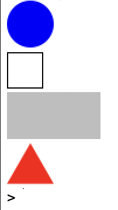
  <div><code>circle</code><code>square</code><code>rectangle</code><code>triangle</code></div>
</div>
</div>

<!--
Idea: Establish that images are ordinary values returned by functions.
Say: "Each constructor returns an image value. Because images are values, functions can rotate them and compose them."
Bridge: "Rotation and spatial composition give us the building blocks for fractals."
-->

---

<div class="eyebrow">Image rotation</div>

## Positive and negative angles rotate in opposite directions

<div class="columns equal week05-rotation-example">
<div>

```racket
(define triangulo
  (isosceles-triangle
    60 30 "outline" "black"))

(rotate 90 triangulo)
(rotate -90 triangulo)
```

<p><code>90</code> rotates counterclockwise.<br><code>-90</code> rotates clockwise.</p>

</div>
<div>
  
</div>
</div>

<!--
Idea: Introduce rotate before it appears in the Hilbert composition.
Say: "Rotate receives an angle and an image. Positive angles rotate counterclockwise, and negative angles rotate clockwise."
Bridge: "We can now combine several image values with above and beside."
-->

---

<!-- _class: compact code-small -->

<div class="eyebrow">Image composition</div>

## `above` and `beside` use centered alignment

<div class="week05-complete-examples">
  <div>

```racket
(above (ellipse 70 20 "solid" "gray")
       (ellipse 50 20 "solid" "darkgray")
       (ellipse 30 20 "solid" "dimgray")
       (ellipse 10 20 "solid" "black"))
```

  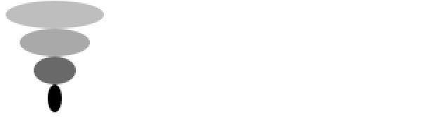
  </div>
  <div>

```racket
(beside (ellipse 20 70 "solid" "gray")
        (ellipse 20 50 "solid" "darkgray")
        (ellipse 20 30 "solid" "dimgray")
        (ellipse 20 10 "solid" "black"))
```

  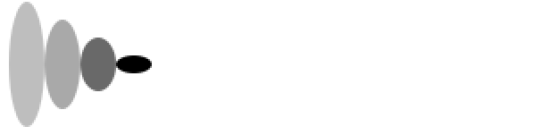
  </div>
</div>

<!--
Idea: Include the complete expressions from the class notes beside their exact output.
Say: "Above stacks the four images and centres them on the same vertical axis. Beside places them horizontally and centres them on the same horizontal axis."
Bridge: "The align variants replace the default centred alignment."
-->

---

<!-- _class: compact code-small -->

<div class="eyebrow">Vertical composition with alignment</div>

## `above/align` fixes the left or right edge

<div class="week05-complete-examples align-examples">
  <div>

```racket
(above/align "left"
  (ellipse 70 20 "solid" "yellowgreen")
  (ellipse 50 20 "solid" "olivedrab")
  (ellipse 30 20 "solid" "darkolivegreen")
  (ellipse 10 20 "solid" "darkgreen"))
```

  
  </div>
  <div>

```racket
(above/align "right"
  (ellipse 70 20 "solid" "gold")
  (ellipse 50 20 "solid" "goldenrod")
  (ellipse 30 20 "solid" "darkgoldenrod")
  (ellipse 10 20 "solid" "sienna"))
```

  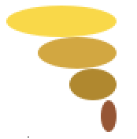
  </div>
</div>

<!--
Idea: Show the complete left and right examples from the notes.
Say: "Above still stacks the images vertically. The alignment string selects the edge that stays fixed."
Bridge: "Beside uses the same idea with the top and bottom edges."
-->

---

<!-- _class: compact code-small -->

<div class="eyebrow">Horizontal composition with alignment</div>

## `beside/align` fixes the top or bottom edge

<div class="week05-complete-examples align-examples">
  <div>

```racket
(beside/align "top"
  (ellipse 20 70 "solid" "mediumorchid")
  (ellipse 20 50 "solid" "darkorchid")
  (ellipse 20 30 "solid" "purple")
  (ellipse 20 10 "solid" "indigo"))
```

  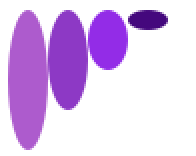
  </div>
  <div>

```racket
(beside/align "bottom"
  (ellipse 20 70 "solid" "lightsteelblue")
  (ellipse 20 50 "solid" "mediumslateblue")
  (ellipse 20 30 "solid" "slateblue")
  (ellipse 20 10 "solid" "navy"))
```

  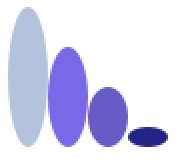
  </div>
</div>

<!--
Idea: Show the complete top and bottom examples from the notes.
Say: "Beside places the images horizontally. The alignment string fixes either their top edge or their bottom edge."
Bridge: "Sierpinski uses centred above and beside composition."
-->

---

<!-- _class: visual -->

<div class="eyebrow">Sierpinski triangle</div>

## The complete figure repeats the same triangular structure

<div class="figure-center week05-sierpinski-hero">
  
</div>

<!--
Idea: Let students inspect the self-similarity before showing code.
Say: "Look for the same structure at different scales. The figure contains three smaller Sierpinski triangles."
Bridge: "That observation gives us the recursive decomposition."
-->

---

<div class="eyebrow">Recursive decomposition</div>

## Three triangles of width `x` form one triangle of width `2x`

<div class="week05-sierpinski-decomposition">
  <div><span>three copies</span></div>
  
  <div><span>one larger figure</span></div>
</div>

<div class="week05-compose-rule"><code>(above small (beside small small))</code></div>

<!--
Idea: Show the composition rule before introducing recursion.
Say: "Place two copies beside each other, then place the third copy above them. Recursion supplies the smaller image used in all three positions."
Bridge: "Every recursive definition also needs a base image."
-->

---

<div class="eyebrow">Sierpinski base case</div>

## A small width produces one outlined right isosceles triangle

<div class="columns equal">
<div>
  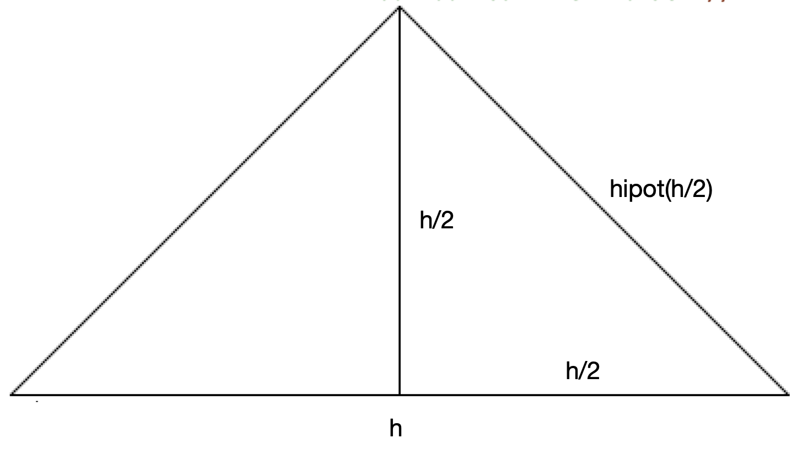
</div>
<div>

```text
hypot(x) = x × √2
```

```racket
(define (hipotenusa x)
  (* x (sqrt 2)))

(define (sierpinski-elem base)
  (isosceles-triangle
    (hipotenusa (/ base 2))
    90 "outline" "black"))
```

</div>
</div>

<!--
Idea: Connect the required base width to the side length expected by isosceles-triangle.
Say: "The constructor receives the equal-side length, not the base. The right-triangle relation converts base divided by two into that length."
Bridge: "The general case halves the requested width."
-->

---

<div class="eyebrow">Sierpinski general case</div>

## Each recursive call draws a triangle at half the width

<div class="columns equal">
<div>

```racket
(define (sierpinski ancho)
  (if (< ancho 10)
      (sierpinski-elem ancho)
      (above
        (sierpinski (/ ancho 2))
        (beside
          (sierpinski (/ ancho 2))
          (sierpinski (/ ancho 2))))))
```

</div>
<div class="week05-output-image">
  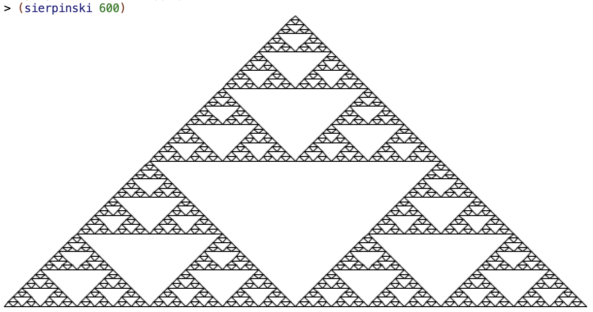
</div>
</div>

<!--
Idea: Read the code directly against the output image.
Say: "The base case stops below the threshold. Otherwise, the function requests three half-width figures and arranges them using the composition rule."
Bridge: "All three calls have exactly the same argument, so they repeat the same work."
-->

---

<!-- _class: compact -->

<div class="eyebrow">Avoiding repeated image construction</div>

## Compute the smaller figure once and reuse its value

```racket
(define (componer-sierpinski figura)
  (above figura
         (beside figura figura)))

(define (sierpinski ancho)
  (if (< ancho 10)
      (sierpinski-elem ancho)
      (componer-sierpinski
        (sierpinski (/ ancho 2)))))
```

<div class="week05-one-call"><b>Before</b><span>three identical recursive calls</span><b>After</b><span>one call, then three uses of its result</span></div>

<!--
Idea: Reconnect the figure example to the week's central concern about repeated work.
Say: "The three recursive calls return identical images. We compute the value once and let the helper use it in three positions."
Bridge: "Hilbert curves also grow by transforming and composing a smaller curve."
-->

---

<!-- _class: visual -->

<div class="eyebrow">Hilbert curves</div>

## Every level transforms four copies of the previous level

<div class="week05-hilbert-levels">
  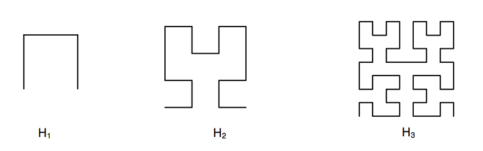
  <div><span><b>H₁</b> base path</span><span><b>H₂</b> four transformed copies</span><span><b>H₃</b> repeats the rule</span></div>
</div>

<!--
Idea: Use the level sequence to reveal the recursive relationship.
Say: "Each new level reuses the previous curve in four orientations and connects the copies with line segments."
Bridge: "The composition function encodes those rotations and alignments."
-->

---

<!-- _class: compact code-small -->

<div class="eyebrow">Hilbert composition</div>

## Rotations, alignment, and line segments connect the copies

<div class="columns equal">
<div>

```racket
(define (trazo-horizontal long)
  (line long 0 "black"))

(define (trazo-vertical long)
  (rotate 90 (trazo-horizontal long)))

(define (componer-hilbert imagen long-trazo)
  (beside
    (above/align "left"
      (beside/align "bottom" imagen (trazo-horizontal long-trazo))
      (trazo-vertical long-trazo)
      (rotate -90 imagen))
    (above/align "right"
      imagen
      (trazo-vertical long-trazo)
      (rotate 90 imagen))))
```

</div>
<div class="week05-output-image hilbert-compose">
  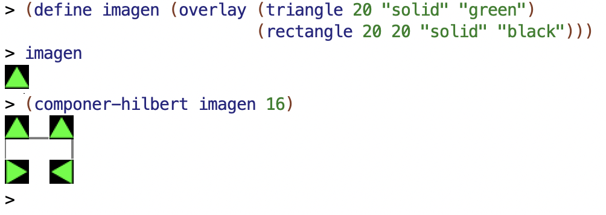
</div>
</div>

<!--
Idea: Pair the dense composition code with its exact visual result.
Say: "The align operations determine where each connector touches a rotated copy. Read the code by locating each segment in the image."
Bridge: "The recursive function only decides whether to draw H1 or compose the previous level."
-->

---

<div class="eyebrow">Recursive Hilbert function</div>

## Higher Hilbert levels compose the previous curve

<div class="columns equal">
<div>

```racket
(define (hilbert nivel long-trazo)
  (if (= nivel 1)
      (beside/align "top"
        (trazo-vertical long-trazo)
        (trazo-horizontal long-trazo)
        (trazo-vertical long-trazo))
      (componer-hilbert
        (hilbert (- nivel 1) long-trazo)
        long-trazo)))
```

</div>
<div class="week05-output-image hilbert-final">
  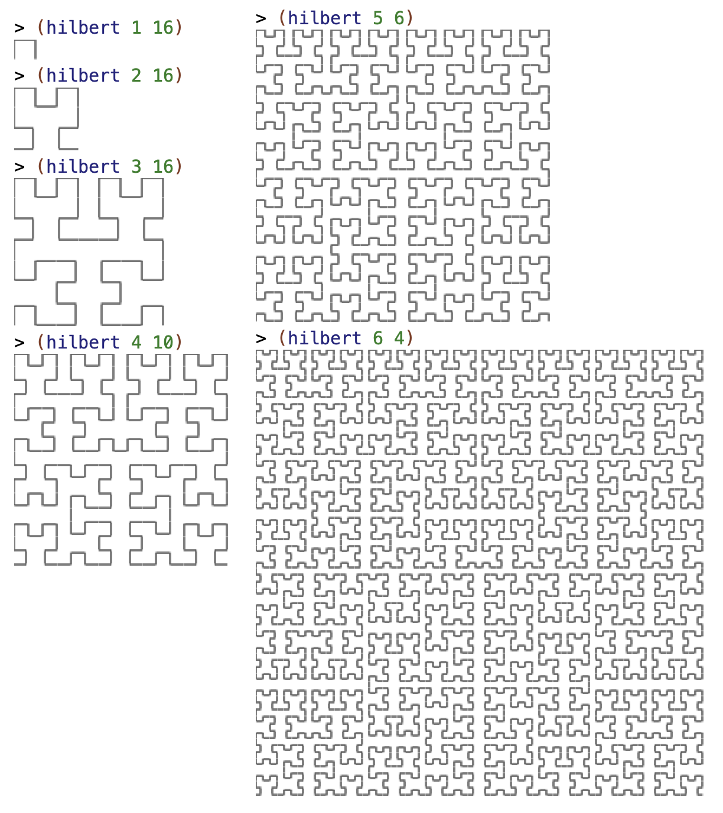
</div>
</div>

<!--
Idea: Finish with the simple recursive controller after explaining the complex composition helper.
Say: "The recursive function has only two cases. Level one draws a U-shaped path. Every other level asks for the previous curve and composes it."
Bridge: "Stop here. The next class returns to recursive data and studies structured lists."
-->
