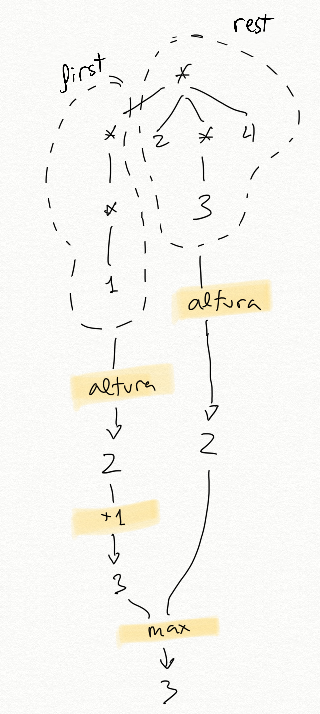

<!-- _class: cover -->
<!-- _paginate: false -->
<!-- _footer: "" -->

<div class="eyebrow">Programming Languages and Paradigms</div>
<div class="week-marker">Week 6</div>

# Structured lists

<p class="lead">Topic 4 · Recursive data structures</p>

<div class="meta">
  <strong>Cristina Pomares Puig</strong>
  Departamento de Ciencia de la Computación e Inteligencia Artificial<br>
  Universidad de Alicante
</div>

<!--
Idea: Introduce structured lists as the first recursive data structure in Topic 4.
Say: "Until now, most lists contained only data. This week a list may also contain other lists, so recursion must follow both the first element and the rest."
Bridge: "We begin by defining the data we will traverse."
-->

---

<div class="eyebrow">Today</div>

## Four views of structured lists

<div class="sequence week04-roadmap">
  <div><b>1 · DEFINE</b><span>Distinguish leaves, flat lists, and structured lists</span></div>
  <div><b>2 · VISUALISE</b><span>Read nested lists as hierarchical levels</span></div>
  <div><b>3 · RECUR</b><span>Process both the first element and the rest</span></div>
  <div><b>4 · GENERALISE</b><span>Express the same traversals with higher-order functions</span></div>
</div>

<!--
Idea: Follow the order of the class notes: definitions, hierarchy, recursive functions, and higher-order versions.
Say: "The key change is that first may return a leaf or another list. Every example today follows from that fact."
Bridge: "First, what exactly is a structured list?"
-->

---

<!-- _class: section -->

<div class="eyebrow">01</div>

# Structured lists

<p class="lead">A structured list contains sublists. Its elements may be atomic data or other lists.</p>

<!--
Idea: State the definition used in the class notes.
Say: "A structured list contains other lists. A flat list contains no sublists, and its non-list elements are leaves."
Bridge: "This changes what first can return."
-->

---

<div class="eyebrow">The key difference</div>

## `first` may return a leaf or another list

<div class="columns equal">
<div>

```racket
(define datos
  '((1 2) 3 4 (5 6)))

(first datos)   ; ⇒ (1 2)
(second datos)  ; ⇒ 3
```

</div>
<div class="week06-first-choice">
  <div><b>Sublist</b><code>(1 2)</code><span>Recursion may descend one level.</span></div>
  <div><b>Leaf</b><code>3</code><span>The value is not another list.</span></div>
</div>
</div>

<!--
Idea: Make the central distinction visible before introducing predicates.
Say: "With an ordinary flat list, first returns data. With a structured list, first may return data or another list."
Bridge: "The terminology lets us describe each case precisely."
-->

---

<div class="eyebrow">Definition and example</div>

## One list can contain leaves and sublists

<div class="week06-structured-example">
  <code>'(a b (c d e) (f (g h)))</code>
  <div><b>1</b><code>'a</code><span>leaf</span></div>
  <div><b>2</b><code>'b</code><span>leaf</span></div>
  <div><b>3</b><code>'(c d e)</code><span>flat sublist</span></div>
  <div><b>4</b><code>'(f (g h))</code><span>structured sublist</span></div>
</div>

<!--
Idea: Use the exact example from the notes and count only its four top-level elements.
Say: "The outer list has four elements. Two are leaves, one is a flat sublist, and one contains another level."
Bridge: "Three related terms describe these structures."
-->

---

<div class="eyebrow">Three definitions</div>

## Leaf, flat list, and structured list

<div class="week06-three-definitions">
  <div><b>Leaf</b><span>A value that is not a list</span><code>3</code><code>'a</code><code>(cons 'a 1)</code></div>
  <div><b>Flat list</b><span>Every element is a leaf</span><code>'(a b c)</code><code>'((a . 3) (b . 5))</code></div>
  <div><b>Structured list</b><span>At least one element is a list</span><code>'(a (b c) d)</code><code>'(a () b)</code></div>
</div>

<!--
Idea: Preserve the definitions and the pair example from the notes.
Say: "A pair is not a list, so a list of pairs counts as flat. The empty list is itself a list, so its presence makes an outer list structured."
Bridge: "The hoja? predicate captures the first definition."
-->

---

<div class="eyebrow">Predicate hoja?</div>

## A leaf is any value that is not a list

<div class="columns equal">
<div>

```racket
(define (hoja? dato)
  (not (list? dato)))
```

```racket
(define lista '((1 2) 3 4 (5 6)))
```

</div>
<div class="week06-predicate-results">
  <div><code>(hoja? (first lista))</code><strong>#f</strong></div>
  <div><code>(hoja? (second lista))</code><strong>#t</strong></div>
  <div><code>(hoja? (third lista))</code><strong>#t</strong></div>
  <div><code>(hoja? (fourth lista))</code><strong>#f</strong></div>
  <div><code>(hoja? '())</code><strong>#f</strong></div>
</div>
</div>

<!--
Idea: Include the empty-list result because it matters in later base cases.
Say: "Hoja? negates list?. Therefore the empty list is not a leaf, because it is a list."
Bridge: "A flat list requires every element to satisfy hoja?."
-->

---

<div class="eyebrow">Predicate plana?</div>

## A list is flat when every element is a leaf

<div class="columns equal">
<div>

> The empty list is flat.

> A non-empty list is flat when its first element is a leaf and its rest is flat.

</div>
<div>

```racket
(define (plana? lista)
  (or (null? lista)
      (and (hoja? (first lista))
           (plana? (rest lista)))))
```

</div>
</div>

<!--
Idea: Translate the recursive definition directly into Scheme.
Say: "The base case accepts the empty list. The general case checks the first element and trusts recursion to check the rest."
Bridge: "For-all? expresses the same definition more directly."
-->

---

<div class="eyebrow">plana? with higher-order functions</div>

## `for-all?` checks the same property for every element

<div class="columns equal">
<div>

```racket
(define (plana-fos? lista)
  (for-all? hoja? lista))
```

</div>
<div class="week06-predicate-results">
  <div><code>(plana? '(a b c d e f))</code><strong>#t</strong></div>
  <div><code>(plana? (list (cons 'a 1) "Hola" #f))</code><strong>#t</strong></div>
  <div><code>(plana? '(a (b c) d))</code><strong>#f</strong></div>
  <div><code>(plana? '(a () b))</code><strong>#f</strong></div>
</div>
</div>

<!--
Idea: Connect the recursive predicate with the higher-order function studied earlier.
Say: "For-all? returns true only when hoja? is true for every element. It also returns true for the empty list."
Bridge: "Structured lists use the complementary condition."
-->

---

<!-- _class: compact -->

<div class="eyebrow">Predicate estructurada?</div>

## A structured list contains at least one list

<div class="columns equal">
<div>

```racket
(define (estructurada? lista)
  (and (not (null? lista))
       (or (list? (first lista))
           (estructurada? (rest lista)))))
```

</div>
<div>

```racket
(define (estructurada-fos? lista)
  (exists? list? lista))

(define (estructurada? lista)
  (not (plana? lista)))
```

</div>
</div>

<div class="week06-inline-examples"><code>'(1 2 3 4) ⇒ #f</code><code>'(a () b) ⇒ #t</code><code>'(a (b c) d) ⇒ #t</code></div>

<!--
Idea: Present the recursive, higher-order, and complementary definitions together.
Say: "The recursive version searches for one list element. Exists? performs that search, and structured? is also the negation of plana?."
Bridge: "Nested lists are useful because they represent hierarchical information."
-->

---

<div class="eyebrow">Hierarchical information</div>

## Structured lists group elements at different levels

<div class="columns equal">
<div>

### Scheme expressions

```racket
(= 4 (+ 2 2))

(if (= x y)
    (* x y)
    (+ (/ x y) 45))
```

</div>
<div>

### Sentence analysis

```racket
((Juan)
 (compró)
 (la entrada
   (de los Miserables))
 (el viernes por la tarde))
```

</div>
</div>

<!--
Idea: Use only the two examples included in the class notes.
Say: "Nesting can represent syntax and other hierarchical groupings. The sublists make the levels explicit."
Bridge: "A level diagram makes that hierarchy visible."
-->

---

<div class="eyebrow">Levels in a structured list</div>

## The data appear only in the leaves

<div class="columns equal">
<div class="figure-center week06-level-image">
  
</div>
<div class="week06-level-explanation">
  <code>'((a b c) d e)</code>
  <div><b>Level 1</b><span>The outer list contains <code>(a b c)</code>, <code>d</code>, and <code>e</code>.</span></div>
  <div><b>Level 2</b><span>The sublist contains the leaves <code>a</code>, <code>b</code>, and <code>c</code>.</span></div>
</div>
</div>

<div class="week06-warning"><strong>A structured list is not a tree.</strong><span>A tree stores data in every node. A structured list stores data only in its leaves.</span></div>

<!--
Idea: Reproduce the warning from the notes beside the supplied diagram.
Say: "Both structures are hierarchical, but they are different. The asterisks represent lists, while only the leaves contain data."
Bridge: "The same level idea applies to Scheme source expressions."
-->

---

<div class="eyebrow">Class question</div>

## Levels in a Scheme expression

```racket
(map (lambda (x) (+ x 10))
     (quote (1 2 3 4)))
```

<div class="week06-question-grid">
  <div><b>Outer list</b><span>Which elements belong to the first level?</span></div>
  <div><b>Nested expressions</b><span>Where do <code>lambda</code>, <code>+</code>, and the quoted list appear?</span></div>
</div>

<!--
Idea: Keep the open question from the notes without supplying a new answer.
Say: "Draw one list node for each pair of parentheses and place atomic values as leaves."
Bridge: "We now use the same recursive structure to define functions."
-->

---

<!-- _class: section -->

<div class="eyebrow">02</div>

# Recursive functions on structured lists

<p class="lead">The recursive call may process the first element as well as the rest of the list.</p>

<!--
Idea: Introduce the traversal pattern from the notes.
Say: "The first element may itself be a list, so many functions recurse in two directions: into first and along rest."
Bridge: "Counting leaves shows the pattern clearly."
-->

---

<div class="eyebrow">Two directions of recursion</div>

## `first` descends and `rest` advances

<div class="week06-two-directions">
  <div><code>(first ld)</code><b>Descend one level</b><span>The first element may be another structured list.</span></div>
  <div><code>(rest ld)</code><b>Continue at the same level</b><span>The rest contains the remaining elements.</span></div>
</div>

<div class="week06-function-goals">
  <code>(num-hojas lista)</code>
  <span>count every leaf</span>
  <code>(aplana lista)</code>
  <span>collect every leaf in a flat list</span>
</div>

<!--
Idea: Name the two recursive movements before writing code.
Say: "The first call explores one component. The second call continues with the remaining components."
Bridge: "Num-hojas combines the results by addition."
-->

---

<div class="eyebrow">Function num-hojas</div>

## Count every atomic value

<div class="columns equal">
<div>

```racket
(num-hojas
  '((1 2) (3 4 (5) 6) (7)))
; ⇒ 7
```

<div class="week06-leaf-list"><code>1</code><code>2</code><code>3</code><code>4</code><code>5</code><code>6</code><code>7</code></div>

</div>
<div class="figure-center week06-count-image">
  
</div>
</div>

<!--
Idea: Pair the exact example with the diagram from the notes.
Say: "The answer counts leaves, not list nodes. The list contains seven atomic values."
Bridge: "The general case splits the structure into first and rest."
-->

---

<div class="eyebrow">General case of num-hojas</div>

## Add the leaves in `first` and `rest`

<div class="week06-recursion-equation">
  <code>(num-hojas ld)</code>
  <div>
    <span><code>(num-hojas (first ld))</code><b>leaves in the first element</b></span>
    <strong>+</strong>
    <span><code>(num-hojas (rest ld))</code><b>leaves in the remaining list</b></span>
  </div>
</div>

```racket
; General case only
(+ (num-hojas (first lisdat))
   (num-hojas (rest lisdat)))
```

<!--
Idea: State the pseudocode rule from the notes before introducing base cases.
Say: "Trust the first call to count one component and the second call to count the remaining components. Add their results."
Bridge: "The two directions reach two different base cases."
-->

---

<div class="eyebrow">Base cases of num-hojas</div>

## Recursion stops at an empty list or a leaf

<div class="week06-base-cases">
  <div><code>'()</code><b>Empty list</b><strong>0 leaves</strong><span>Repeated calls with <code>rest</code> eventually reach it.</span></div>
  <div><code>dato</code><b>Leaf</b><strong>1 leaf</strong><span>Repeated calls with <code>first</code> eventually reach atomic data.</span></div>
</div>

<!--
Idea: Connect each base case to the recursive call that reaches it.
Say: "Rest shortens a list until it is empty. First descends through sublists until it reaches a leaf."
Bridge: "The complete function checks both cases before the general case."
-->

---

<div class="eyebrow">Complete num-hojas</div>

## The parameter may be a list or an atomic value

<div class="columns equal">
<div>

```racket
(define (num-hojas lisdat)
  (cond
    ((null? lisdat) 0)
    ((hoja? lisdat) 1)
    (else
      (+ (num-hojas (first lisdat))
         (num-hojas (rest lisdat))))))
```

</div>
<div class="week06-parameter-types">
  <div><b>List</b><span>Split it into <code>first</code> and <code>rest</code>.</span></div>
  <div><b>Leaf</b><span>Return <code>1</code> without using list selectors.</span></div>
</div>
</div>

<!--
Idea: Highlight the unusual parameter contract described in the notes.
Say: "Lisdat may hold a list or an atomic value. The hoja? test protects the list operations in the general case."
Bridge: "Two recursive calls do not automatically imply exponential cost."
-->

---

<div class="eyebrow">Cost of num-hojas</div>

## The two calls traverse different parts of the structure

<div class="comparison-table week06-cost-comparison">
  <div class="header"><b></b><b>Fibonacci</b><b><code>num-hojas</code></b></div>
  <div><span>Recursive calls</span><span>Overlapping subproblems</span><strong>Different components</strong></div>
  <div><span>Repeated inputs</span><span>The same calls reappear</span><strong>No recursive call repeats the same data</strong></div>
  <div><span>Work</span><span>Exponential evaluation tree</span><strong>Proportional to the elements traversed</strong></div>
</div>

<!--
Idea: Reproduce the warning in the notes: two calls do not make this Fibonacci.
Say: "One call explores first and the other explores rest. They cover different components, so the traversal does not recompute the same subproblem."
Bridge: "Map and foldr can express the same traversal."
-->

---

<!-- _class: compact code-small -->

<div class="eyebrow">num-hojas with higher-order functions</div>

## Recursive `map` counts each component before `foldr` adds

<div class="columns equal">
<div>

```racket
(define (num-hojas-fos ld)
  (if (hoja? ld)
      1
      (foldr + 0
        (map num-hojas-fos ld))))
```

<div class="week06-map-steps">
  <span><b>map</b> produces one count per element</span>
  <span><b>foldr</b> adds those counts</span>
</div>

</div>
<div class="figure-center week06-map-image">
  
</div>
</div>

<!--
Idea: Use the supplied diagram to explain the higher-order version without a long trace.
Say: "Map applies the function we are defining to every element. It returns a list of leaf counts, and foldr adds them."
Bridge: "Apply can replace foldr when the language provides it."
-->

---

<div class="eyebrow">foldr and apply</div>

## Two ways to add the list returned by `map`

<div class="columns equal">
<div>

```racket
(define (num-hojas-fos ld)
  (if (hoja? ld)
      1
      (foldr + 0
        (map num-hojas-fos ld))))
```

</div>
<div>

```racket
(define (num-hojas-fos ld)
  (if (hoja? ld)
      1
      (apply +
        (map num-hojas-fos ld))))
```

</div>
</div>

> Both versions sum the numbers produced by <code>map</code>. Some languages, including Swift, do not define <code>apply</code>.

<!--
Idea: Keep both alternatives and the Swift note from the topic text.
Say: "The recursive mapping is identical. Only the final way of combining the counts changes."
Bridge: "Flattening changes the combination from addition to append."
-->

---

<div class="eyebrow">Function aplana</div>

## Every leaf becomes one element of a flat list

<div class="columns equal">
<div>

```racket
(aplana
  '(1 2 (3 (4 (5))) (((6)))))
; ⇒ (1 2 3 4 5 6)
```

<div class="week06-base-summary">
  <div><code>'()</code><span>returns <code>'()</code></span></div>
  <div><code>leaf</code><span>returns <code>(list leaf)</code></span></div>
</div>

</div>
<div>

```racket
(define (aplana ld)
  (cond
    ((null? ld) '())
    ((hoja? ld) (list ld))
    (else
      (append (aplana (first ld))
              (aplana (rest ld))))))
```

</div>
</div>

<!--
Idea: Reuse the same two base cases and change only the returned values and combination.
Say: "A leaf must become a one-element list so that append can combine all recursive results."
Bridge: "The higher-order version maps that same operation over every component."
-->

---

<div class="eyebrow">aplana with higher-order functions</div>

## Map recursively, then concatenate every result

<div class="columns equal">
<div>

```racket
(define (aplana-fos ld)
  (if (hoja? ld)
      (list ld)
      (foldr append '()
        (map aplana-fos ld))))
```

</div>
<div>

```racket
(define (aplana-fos ld)
  (if (hoja? ld)
      (list ld)
      (apply append
        (map aplana-fos ld))))
```

</div>
</div>

<div class="week06-combine-rule"><code>map aplana-fos</code><span>produces flat lists</span><code>foldr append</code><span>joins them</span></div>

<!--
Idea: Show the exact two alternatives from the notes.
Say: "Each recursive result is already flat. Foldr append or apply append joins those lists in order."
Bridge: "The same traversal supports searching and transformation."
-->

---

<!-- _class: section -->

<div class="eyebrow">03</div>

# Other recursive functions

<p class="lead">The traversal stays similar. The base values and the operation that combines recursive results change.</p>

<!--
Idea: Introduce the remaining functions listed in the notes.
Say: "Search combines with or, transformation combines with cons or map, and height combines with max."
Bridge: "We start by searching for a leaf."
-->

---

<!-- _class: compact code-small -->

<div class="eyebrow">Function pertenece-estruct?</div>

## Search both `first` and `rest`

<div class="columns equal">
<div>

```racket
(pertenece-estruct?
  'a '(b c (d (a))))
; ⇒ #t

(pertenece-estruct?
  'a '(b c (d e (f)) g))
; ⇒ #f
```

</div>
<div>

```racket
(define (pertenece-estruct? dato ld)
  (cond
    ((null? ld) #f)
    ((hoja? ld) (equal? dato ld))
    (else
      (or
        (pertenece-estruct? dato (first ld))
        (pertenece-estruct? dato (rest ld))))))
```

</div>
</div>

<!--
Idea: Keep the exact examples and recursive solution from the notes.
Say: "The empty list cannot contain the value. At a leaf we compare directly. Otherwise either recursive branch may find it."
Bridge: "Exists? performs the search over the current list level."
-->

---

<div class="eyebrow">pertenece-estruct? with higher-order functions</div>

## `exists?` searches the elements at each level

```racket
(define (pertenece-fos? dato ld)
  (if (hoja? ld)
      (equal? dato ld)
      (exists?
        (lambda (elem)
          (pertenece-fos? dato elem))
        ld)))
```

<div class="week06-recursive-map-note">
  <code>exists?</code>
  <span>receives a predicate that recursively searches each element</span>
</div>

<!--
Idea: Explain why the predicate passed to exists? must call the same function recursively.
Say: "Each element may be a leaf or a sublist. The lambda delegates that decision to pertenece-fos? again."
Bridge: "Transformations use the same recursive mapping idea."
-->

---

<!-- _class: compact code-small -->

<div class="eyebrow">Function cuadrado-estruct</div>

## Preserve the nesting and square every leaf

<div class="columns equal">
<div>

```racket
(define (cuadrado-estruct ld)
  (cond
    ((null? ld) '())
    ((hoja? ld) (* ld ld))
    (else
      (cons
        (cuadrado-estruct (first ld))
        (cuadrado-estruct (rest ld))))))
```

</div>
<div>

```racket
(define (cuadrado-estruct-fos ld)
  (if (hoja? ld)
      (* ld ld)
      (map cuadrado-estruct-fos ld)))
```

```racket
(cuadrado-estruct '(2 3 (4 (5))))
; ⇒ (4 9 (16 (25)))
```

</div>
</div>

<!--
Idea: Contrast explicit first/rest reconstruction with recursive map.
Say: "Both versions preserve every list boundary. Only leaves are replaced by their squares."
Bridge: "Map-estruct replaces squaring with an arbitrary function."
-->

---

<!-- _class: compact code-small -->

<div class="eyebrow">Function map-estruct</div>

## A function parameter generalises the transformation

<div class="columns equal">
<div>

```racket
(define (map-estruct f ld)
  (cond
    ((null? ld) '())
    ((hoja? ld) (f ld))
    (else
      (cons (map-estruct f (first ld))
            (map-estruct f (rest ld))))))
```

</div>
<div>

```racket
(define (map-estruct-fos f ld)
  (if (hoja? ld)
      (f ld)
      (map
        (lambda (elem)
          (map-estruct-fos f elem))
        ld)))
```

</div>
</div>

<div class="week06-combine-rule"><code>f</code><span>changes leaves</span><code>map-estruct</code><span>preserves structure</span></div>

<!--
Idea: Present map-estruct as the generalisation stated in the notes.
Say: "The traversal no longer knows how to transform a leaf. It calls the function received in f."
Bridge: "Height keeps the structure unchanged and measures its number of levels."
-->

---

<div class="eyebrow">Height of a structured list</div>

## Height is the number of list levels

<div class="columns equal">
<div class="figure-center week06-height-image">
  
</div>
<div class="week06-height-examples">
  <div><code>'(1 2 3)</code><strong>height 1</strong></div>
  <div><code>'(1 (2 3) 4)</code><strong>height 2</strong></div>
  <div><code>'(((1)) (2 3) 4)</code><strong>height 3</strong></div>
</div>
</div>

<!--
Idea: Use the supplied image and the examples from the notes.
Say: "A flat list has one list level. Every nested list may add another level."
Bridge: "The recursive definition compares the depth of first with the height of rest."
-->

---

<div class="eyebrow">Recursive height</div>

## Descending into `first` adds one level

<div class="columns equal">
<div class="week06-height-rule">
  <div><code>(altura (first ld))</code><span>height below the first element</span><strong>+ 1</strong></div>
  <div><code>(altura (rest ld))</code><span>height among the remaining elements</span><strong>unchanged</strong></div>
  <p>Return the maximum of both values.</p>
</div>
<div>

```racket
(define (altura ld)
  (cond
    ((null? ld) 0)
    ((hoja? ld) 0)
    (else
      (max
        (+ 1 (altura (first ld)))
        (altura (rest ld))))))
```

</div>
</div>

<!--
Idea: Explain exactly where the extra level is counted.
Say: "First descends into a component, so its height gains one. Rest stays at the current list level."
Bridge: "Map and foldr provide the second version."
-->

---

<div class="eyebrow">Height with higher-order functions</div>

## Map obtains component heights and `foldr` keeps the maximum

```racket
(define (altura-fos ld)
  (if (hoja? ld)
      0
      (+ 1
         (foldr max 0
           (map altura-fos ld)))))
```

<div class="week06-map-height">
  <div><b>1</b><span><code>map altura-fos</code> calculates one height per element.</span></div>
  <div><b>2</b><span><code>foldr max 0</code> selects the greatest height.</span></div>
  <div><b>3</b><span><code>+ 1</code> counts the current list level.</span></div>
</div>

<!--
Idea: Follow the explanation in the notes and avoid an additional trace.
Say: "The mapped values are the heights below the current list. Their maximum plus one is the height of the current list."
Bridge: "Nivel-hoja measures where a particular leaf occurs."
-->

---

<div class="eyebrow">Function nivel-hoja</div>

## Return the deepest level where a value appears

<div class="week06-level-results">
  <div><code>(nivel-hoja 'b '(a b (c)))</code><strong>1</strong></div>
  <div><code>(nivel-hoja 'b '(a (b) c))</code><strong>2</strong></div>
  <div><code>(nivel-hoja 'b '(a (b) d ((b))))</code><strong>3</strong></div>
  <div><code>(nivel-hoja 'b '(a c d ((e))))</code><strong>-1</strong></div>
</div>

<div class="week06-warning"><strong>Repeated value</strong><span>If the leaf appears more than once, the function returns its greatest level.</span></div>

<!--
Idea: Establish the result convention before showing the implementation.
Say: "Minus one means not found. If several occurrences exist, max selects the deepest one."
Bridge: "The helper increments only a successful result."
-->

---

<!-- _class: compact code-small -->

<div class="eyebrow">Recursive nivel-hoja</div>

## Increment only the result obtained by descending into `first`

<div class="columns equal">
<div>

```racket
(define (suma-1-si-mayor-igual-que-0 x)
  (if (>= x 0)
      (+ x 1)
      x))
```

<div class="week06-base-summary">
  <div><code>'()</code><span>returns <code>-1</code></span></div>
  <div><code>leaf</code><span>returns <code>0</code> if equal, otherwise <code>-1</code></span></div>
</div>

</div>
<div>

```racket
(define (nivel-hoja dato ld)
  (cond
    ((null? ld) -1)
    ((hoja? ld)
     (if (equal? ld dato) 0 -1))
    (else
      (max
        (suma-1-si-mayor-igual-que-0
          (nivel-hoja dato (first ld)))
        (nivel-hoja dato (rest ld))))))
```

</div>
</div>

<!--
Idea: Explain the helper through the not-found value used in the notes.
Say: "Descending through first adds a level only when the search succeeds. A minus-one result must stay minus one."
Bridge: "The higher-order version applies the same rule after mapping every element."
-->

---

<!-- _class: compact code-small -->

<div class="eyebrow">nivel-hoja with higher-order functions</div>

## Map the search, keep the deepest result, then add the level

```racket
(define (nivel-hoja-fos dato ld)
  (if (hoja? ld)
      (if (equal? ld dato) 0 -1)
      (suma-1-si-mayor-igual-que-0
        (foldr max -1
          (map
            (lambda (elem)
              (nivel-hoja-fos dato elem))
            ld)))))
```

<div class="week06-combine-rule"><code>map</code><span>search every component</span><code>foldr max -1</code><span>keep the deepest occurrence</span></div>

<!--
Idea: Keep the exact higher-order implementation from the notes.
Say: "Map returns one level per component. Foldr keeps the maximum, and the helper counts the current list level only when the value was found."
Bridge: "Stop here. The next class applies the same structural recursion to general and binary trees."
-->
