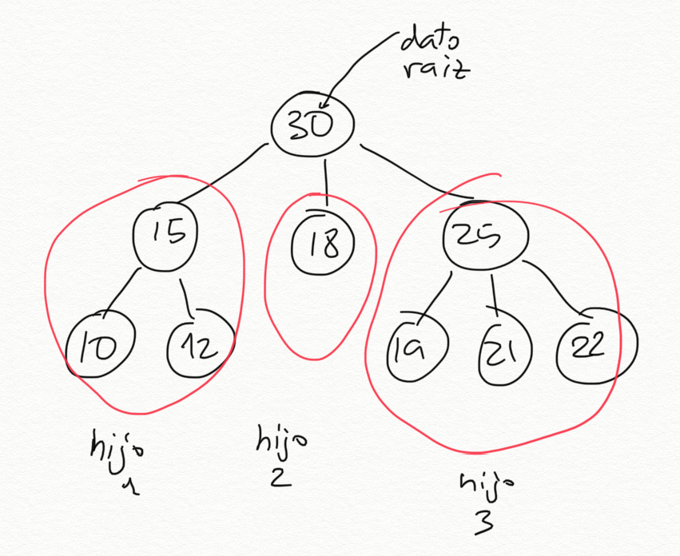
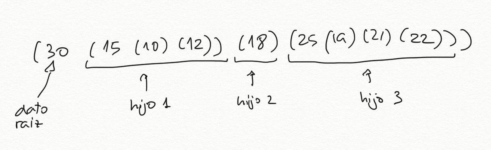
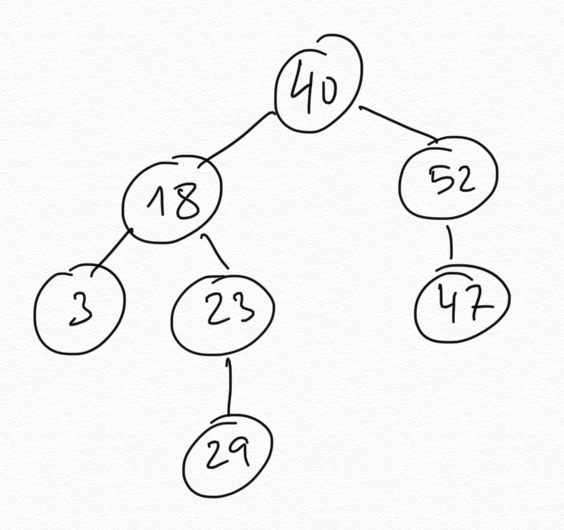
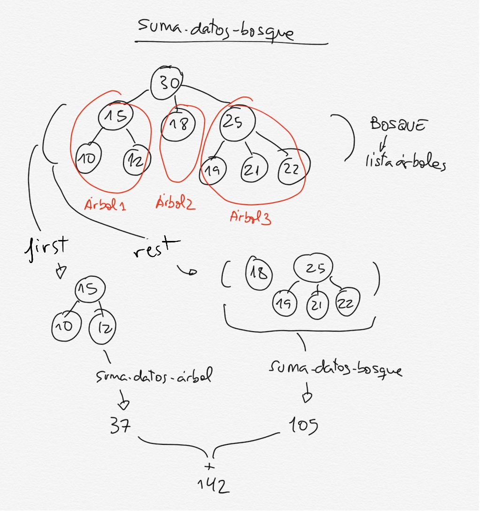
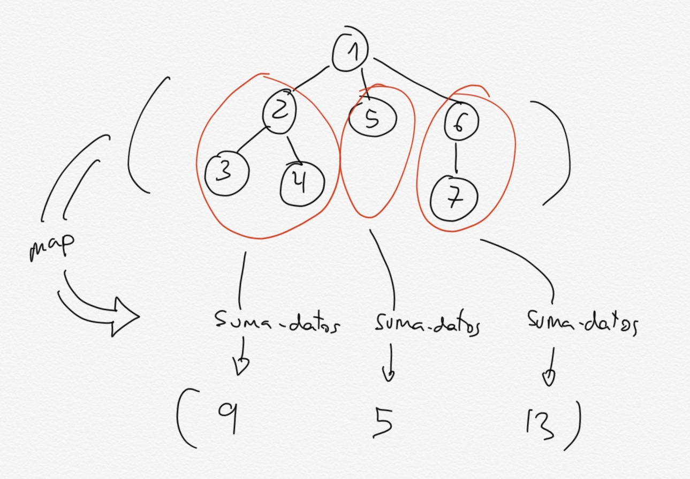
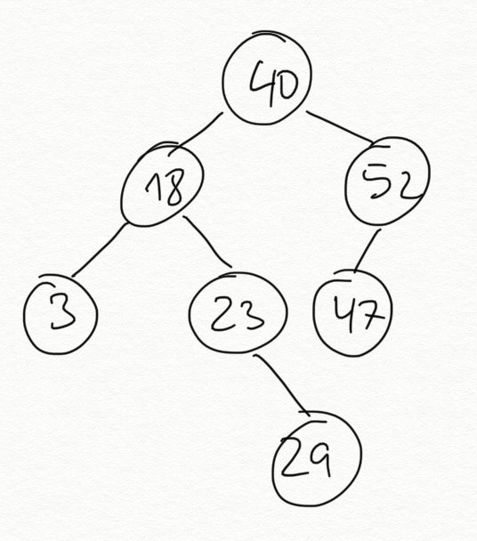
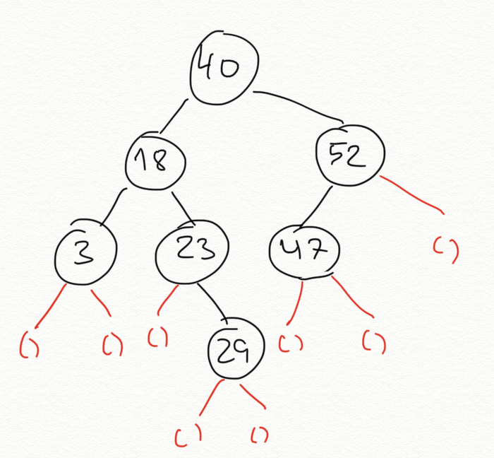
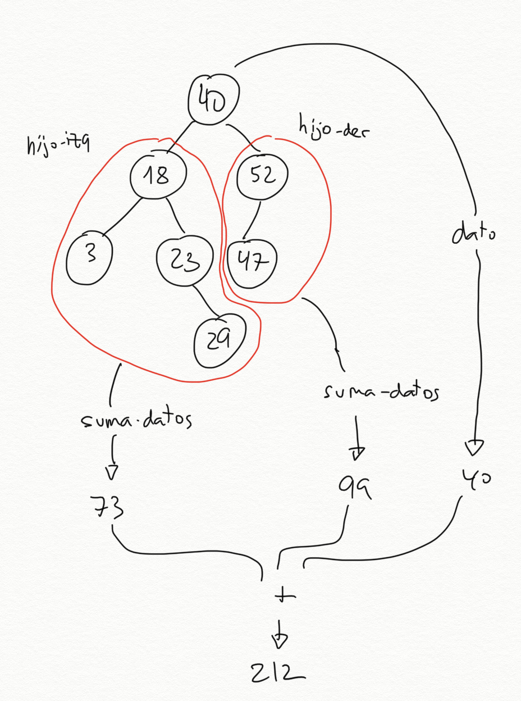

<!-- _class: cover -->
<!-- _paginate: false -->
<!-- _footer: "" -->

<div class="eyebrow">Programming Languages and Paradigms</div>
<div class="week-marker">Week 7</div>

# Trees and binary trees

<p class="lead">Topic 4 · Recursive data structures</p>

<div class="meta">
  <strong>Cristina Pomares Puig</strong>
  Departamento de Ciencia de la Computación e Inteligencia Artificial<br>
  Universidad de Alicante
</div>

<!--
Idea: Continue Topic 4 from structured lists to trees.
Say: "Structured lists stored data only in leaves. Trees store one datum at every node and connect each node to child trees."
Bridge: "We will first define the representation, then hide it behind an abstraction barrier."
-->

---

<div class="eyebrow">Today</div>

## Four views of trees

<div class="sequence week04-roadmap">
  <div><b>1 · REPRESENT</b><span>Encode a root and its child trees with lists</span></div>
  <div><b>2 · ABSTRACT</b><span>Use selectors and constructors instead of the representation</span></div>
  <div><b>3 · RECUR</b><span>Process one tree and a forest with mutual recursion</span></div>
  <div><b>4 · SPECIALISE</b><span>Represent and traverse binary trees</span></div>
</div>

<!--
Idea: Follow the four blocks developed in the class notes.
Say: "The main distinction is between one tree and a list of child trees, which we call a forest."
Bridge: "We begin with the recursive definition of a tree."
-->

---

<!-- _class: section -->

<div class="eyebrow">01</div>

# Tree definition

<p class="lead">A tree contains a root value and a list of children that are themselves trees.</p>

<!--
Idea: State the recursive definition from the notes as the section title.
Say: "Every child has the same structure as the complete tree, so the data definition is recursive."
Bridge: "A concrete example shows the root, internal nodes, and leaves."
-->

---

<div class="eyebrow">Recursive definition</div>

## A datum and a list of child trees

<div class="columns equal">
<div class="figure-center week07-tree-hero">
  
</div>
<div class="week07-tree-definition">
  <div><b>Root datum</b><span>The value stored at the root of the tree</span></div>
  <div><b>Children</b><span>A list whose elements are also trees</span></div>
  <div><b>Leaf</b><span>A tree whose list of children is empty</span></div>
</div>
</div>

<!--
Idea: Pair the exact definition with the supplied tree diagram.
Say: "A leaf is still a tree. Its root contains a datum and its child list is empty."
Bridge: "The example contains three child trees below the root."
-->

---

<div class="eyebrow">Reading the example</div>

## The root `30` has three child trees

<div class="week07-tree-children">
  <div><b>15</b><span>two leaf children</span><code>10</code><code>12</code></div>
  <div><b>18</b><span>leaf tree</span><code>no children</code></div>
  <div><b>25</b><span>three leaf children</span><code>19</code><code>21</code><code>22</code></div>
</div>

<div class="week07-root-line"><span>root</span><strong>30</strong><span>children: 15, 18, 25</span></div>

<!--
Idea: Repeat the decomposition described immediately below the figure in the notes.
Say: "The children of 30 are complete trees. One child is a leaf and the other two have their own children."
Bridge: "The Scheme representation stores the datum first and then those child trees."
-->

---

<div class="eyebrow">List representation</div>

## A tree with `n` children uses a list of `n + 1` elements

<div class="week07-representation-rule">
  <code>(dato hijo-1 hijo-2 ... hijo-n)</code>
  <div><span><b>first</b> element</span><strong>root datum</strong></div>
  <div><span><b>rest</b> of the list</span><strong>child trees</strong></div>
</div>

<div class="week07-leaf-rule"><b>Leaf node</b><code>(dato)</code><span>The list contains only its root datum.</span></div>

<!--
Idea: Present the exact representation selected in the notes.
Say: "The outer list contains one datum followed by zero or more trees. Therefore a leaf is a one-element list."
Bridge: "We can now translate the diagram into Scheme data."
-->

---

<div class="eyebrow">The tree as a Scheme list</div>

## Parentheses delimit each child tree

<div class="columns equal">
<div class="figure-center week07-tree-list-image">
  
</div>
<div>

```racket
(define arbol1
  '(30
     (15 (10) (12))
     (18)
     (25 (19) (21) (22))))
```

<div class="week07-list-parts">
  <div><code>30</code><span>root datum</span></div>
  <div><code>(15 ...)</code><span>first child tree</span></div>
  <div><code>(18)</code><span>second child, a leaf</span></div>
  <div><code>(25 ...)</code><span>third child tree</span></div>
</div>

</div>
</div>

<!--
Idea: Keep the representation and diagram together.
Say: "The first element is data. Every remaining element is a complete tree represented by another list."
Bridge: "The supplied list diagram marks those roles explicitly."
-->

---

<div class="eyebrow">Anatomy of the representation</div>

## One list contains data and complete child trees

<div class="figure-center week07-list-anatomy-image">
  
</div>

<!--
Idea: Use the exact diagram from the notes rather than recreating the annotations.
Say: "At the outer level, first is the datum 30 and rest is a list of three trees. Each of those trees follows the same representation."
Bridge: "A second example checks that we can move from a diagram to the list."
-->

---

<div class="eyebrow">Second representation example</div>

## From a tree diagram to Scheme data

<div class="columns equal">
<div class="figure-center week07-second-tree-image">
  
</div>
<div>

```racket
(define arbol2
  '(40
     (18
       (3)
       (23 (29)))
     (52
       (47))))
```

<div class="week07-leaf-rule"><b>Check</b><span>Every leaf appears as a one-element list.</span></div>

</div>
</div>

<!--
Idea: Give the exact second example and answer from the class notes.
Say: "The node 23 has one child, 29. The node 52 has one child, 47. Leaves such as 3, 29, and 47 use one-element lists."
Bridge: "Programs should not depend directly on this concrete list encoding."
-->

---

<!-- _class: section -->

<div class="eyebrow">02</div>

# The abstraction barrier

<p class="lead">Selectors and constructors let functions work with trees without depending on their list representation.</p>

<!--
Idea: Introduce the definition of an abstraction barrier from the notes.
Say: "The barrier exposes tree operations and hides how the tree is implemented."
Bridge: "We begin with selectors."
-->

---

<div class="eyebrow">Tree selectors</div>

## Data, children, and the leaf predicate

<div class="columns equal">
<div>

```racket
(define (dato-arbol arbol)
  (first arbol))

(define (hijos-arbol arbol)
  (rest arbol))
```

</div>
<div>

```racket
(define (hoja-arbol? arbol)
  (null? (hijos-arbol arbol)))
```

<div class="week07-selector-suffix"><code>-arbol</code><span>The common suffix identifies functions in the tree abstraction barrier.</span></div>

</div>
</div>

<!--
Idea: Preserve the exact selector definitions and naming convention.
Say: "All tree operations use the suffix arbol. The names reveal that the argument must be a tree."
Bridge: "The two main selectors return different kinds of values."
-->

---

<div class="eyebrow">Selector result types</div>

## Return types of the tree selectors

<div class="week07-selector-types">
  <div><code>(dato-arbol arbol)</code><b>Datum</b><span>The value stored in the root node</span></div>
  <div><code>(hijos-arbol arbol)</code><b>List of trees</b><span>A forest that can be traversed with <code>first</code> and <code>rest</code></span></div>
</div>

<div class="week06-warning"><strong>Forest</strong><span>In these notes, a forest is a list of trees.</span></div>

<!--
Idea: Emphasise the return types exactly as the notes do.
Say: "Hijos-arbol does not return one tree. It returns a list whose elements are trees. That list is a forest."
Bridge: "The selector examples make the distinction concrete."
-->

---

<!-- _class: compact code-small -->

<div class="eyebrow">Selector examples</div>

## Applying the barrier to `arbol1`

<div class="columns equal">
<div class="figure-center week07-selector-image">
  
</div>
<div>

```racket
(dato-arbol arbol1)
; ⇒ 30

(hijos-arbol arbol1)
; ⇒ ((15 (10) (12))
;     (18)
;     (25 (19) (21) (22)))

(hoja-arbol?
  (first (hijos-arbol arbol1)))
; ⇒ #f

(hoja-arbol?
  (second (hijos-arbol arbol1)))
; ⇒ #t
```

</div>
</div>

<!--
Idea: Use all four selector examples from the notes.
Say: "The first child has children of its own, while the second child is the leaf tree containing 18."
Bridge: "Using the correct barrier keeps list operations and tree operations distinct."
-->

---

<div class="eyebrow">Lists and trees use different operations</div>

## Work at the correct level of abstraction

<div class="columns equal">
<div class="figure-center week07-barrier-image">
  
</div>
<div class="week07-barrier-rules">
  <div><b>List or forest</b><span>Use <code>first</code> and <code>rest</code>.</span></div>
  <div><b>Tree</b><span>Use <code>dato-arbol</code> and <code>hijos-arbol</code>.</span></div>
  <div><b>Root value</b><span>Use the operations appropriate for the stored data.</span></div>
</div>
</div>

<!--
Idea: Make the warning from the notes the main visual.
Say: "Although a tree is implemented with a list, our tree functions should use the tree barrier. The names document which kind of value we hold."
Bridge: "Retrieving the value 12 requires alternating list and tree operations."
-->

---

<div class="eyebrow">Following types through an expression</div>

## Retrieving `12` from `arbol1`

```racket
(dato-arbol
  (second
    (hijos-arbol
      (first
        (hijos-arbol arbol1)))))
; ⇒ 12
```

<div class="week07-access-path">
  <span><b>1</b><code>(hijos-arbol arbol1)</code><small>forest</small></span>
  <span><b>2</b><code>(first ...)</code><small>tree rooted at 15</small></span>
  <span><b>3</b><code>(hijos-arbol ...)</code><small>forest containing 10 and 12</small></span>
  <span><b>4</b><code>(second ...)</code><small>tree rooted at 12</small></span>
  <span><b>5</b><code>(dato-arbol ...)</code><small>datum 12</small></span>
</div>

<!--
Idea: Explain the exact expression from the class notes through its intermediate types.
Say: "First and second choose elements from forests. Dato-arbol and hijos-arbol operate on the trees obtained from those forests."
Bridge: "The constructor completes the abstraction barrier."
-->

---

<div class="eyebrow">Tree constructor</div>

## Build a tree from a datum and a list of children

<div class="columns equal">
<div>

```racket
(define (construye-arbol
          dato lista-arboles)
  (cons dato lista-arboles))
```

<div class="week07-constructor-signature"><code>datum</code><span>+</span><code>list of trees</code><span>⇒</span><code>tree</code></div>

</div>
<div>

```racket
(define arbol3
  (construye-arbol 2 '()))

(define arbol4
  (construye-arbol 10
    (list
      (construye-arbol 2 '())
      (construye-arbol 5 '())
      (construye-arbol 9 '()))))
```

</div>
</div>

<!--
Idea: Use the leaf and three-child examples from the notes.
Say: "An empty child list constructs a leaf. A non-empty list supplies complete child trees."
Bridge: "The larger example builds arbol1 from smaller trees."
-->

---

<!-- _class: compact code-small -->

<div class="eyebrow">Constructing arbol1</div>

## Build the children before the root

```racket
(define arbol-15
  (construye-arbol 15
    (list (construye-arbol 10 '())
          (construye-arbol 12 '()))))

(define arbol-18
  (construye-arbol 18 '()))

(define arbol-25
  (construye-arbol 25
    (list (construye-arbol 19 '())
          (construye-arbol 21 '())
          (construye-arbol 22 '()))))

(define arbol1b
  (construye-arbol 30
    (list arbol-15 arbol-18 arbol-25)))
```

<div class="week07-constructor-result"><code>arbol1b</code><span>⇒</span><code>(30 (15 (10) (12)) (18) (25 (19) (21) (22)))</code></div>

<!--
Idea: Preserve the staged construction from the notes because it mirrors the recursive data definition.
Say: "Each variable is a complete tree. The final constructor combines the three child trees under the root 30."
Bridge: "Recursive functions follow the same tree-and-forest structure."
-->

---

<!-- _class: section -->

<div class="eyebrow">03</div>

# Recursive functions on trees

<p class="lead">One function processes a tree. A second function processes its list of children.</p>

<!--
Idea: Introduce the mutual-recursion pattern shared by the functions in the notes.
Say: "A tree contains a datum and a forest. The tree function handles the datum, then delegates the forest to an auxiliary function."
Bridge: "The first example adds every datum."
-->

---

<div class="eyebrow">Shared recursion pattern</div>

## Tree and forest functions call each other

<div class="week07-mutual-pattern">
  <div><b>Tree function</b><code>(f-arbol arbol)</code><span>process the root datum</span><span>call the forest function on the children</span></div>
  <div><b>Forest function</b><code>(f-bosque bosque)</code><span>call the tree function on the first tree</span><span>recur on the rest of the forest</span></div>
</div>

<div class="week07-function-overview"><code>suma-datos-arbol</code><code>to-list-arbol</code><code>cuadrado-arbol</code><code>map-arbol</code><code>altura-arbol</code></div>

<!--
Idea: Name the common mutual-recursion pattern before showing individual implementations.
Say: "The tree function receives one tree. The forest function receives a list of trees. Their types determine which selectors they use."
Bridge: "Suma-datos combines root and child results with addition."
-->

---

<div class="eyebrow">suma-datos-arbol</div>

## Root datum plus the sum of the forest

<div class="columns equal">
<div>

```racket
(define (suma-datos-arbol arbol)
  (+ (dato-arbol arbol)
     (suma-datos-bosque
       (hijos-arbol arbol))))
```

</div>
<div class="week07-sum-rule">
  <code>(dato-arbol arbol)</code>
  <strong>+</strong>
  <code>(suma-datos-bosque<br>(hijos-arbol arbol))</code>
</div>
</div>

```racket
(define arbol2 '(40 (18 (3) (23 (29))) (52 (47))))
(suma-datos-arbol arbol2) ; ⇒ 212
```

<!--
Idea: State the recursive definition from the notes before the auxiliary function.
Say: "Every tree has a root datum. The only remaining work is to sum the list of child trees."
Bridge: "The forest function processes that list with first and rest."
-->

---

<!-- _class: compact code-small -->

<div class="eyebrow">suma-datos-bosque</div>

## Sum the first tree and the rest of the forest

<div class="columns equal">
<div>

```racket
(define (suma-datos-bosque bosque)
  (if (null? bosque)
      0
      (+ (suma-datos-arbol
           (first bosque))
         (suma-datos-bosque
           (rest bosque)))))
```

<div class="week07-forest-base"><code>'()</code><span>contains no trees, so its sum is <code>0</code></span></div>

</div>
<div class="figure-center week07-forest-image">
  
</div>
</div>

<!--
Idea: Pair the auxiliary definition with the supplied forest diagram.
Say: "First returns a tree, so we call suma-datos-arbol. Rest returns another forest, so we call suma-datos-bosque."
Bridge: "This alternation is mutual recursion."
-->

---

<div class="eyebrow">Mutual recursion</div>

## A leaf ends the cycle with an empty forest

<div class="week07-mutual-cycle">
  <div><code>suma-datos-arbol</code><span>receives one tree</span><b>calls</b><code>suma-datos-bosque</code></div>
  <div><code>suma-datos-bosque</code><span>receives a list of trees</span><b>calls</b><code>suma-datos-arbol</code></div>
</div>

<div class="week06-warning"><strong>Termination</strong><span>A leaf has no children. Its empty forest reaches the base case and returns <code>0</code>.</span></div>

<!--
Idea: Explain the termination statement from the notes without a call trace.
Say: "The two functions call each other, but every descent reaches leaf trees. A leaf passes an empty list to the forest function."
Bridge: "Map and foldr can replace the explicit forest recursion."
-->

---

<!-- _class: compact code-small -->

<div class="eyebrow">Sum with higher-order functions</div>

## Sum of the child trees with `map` and `foldr`

<div class="columns equal">
<div>

```racket
(define (suma-datos-arbol-fos arbol)
  (foldr +
    (dato-arbol arbol)
    (map suma-datos-arbol-fos
         (hijos-arbol arbol))))
```

<div class="week07-hof-result"><code>(map ... hijos)</code><span>⇒ one sum for each child tree</span></div>

</div>
<div class="figure-center week07-hof-tree-image">
  
</div>
</div>

<!--
Idea: Use the graphic explanation supplied in the notes.
Say: "For a leaf, hijos-arbol returns an empty list. Map returns an empty list and foldr returns the root datum, so no explicit base case is needed."
Bridge: "To-list uses the same pattern but returns a preorder list."
-->

---

<div class="eyebrow">Function to-list-arbol</div>

## Preorder visits the root before its children

```racket
(to-list-arbol
  '(*
     (+ (5) (* (2) (3)) (10))
     (- (12))))
; ⇒ (* + 5 * 2 3 10 - 12)
```

<div class="week07-preorder-rule">
  <b>Preorder</b>
  <span>root datum first</span>
  <span>then child trees from left to right</span>
</div>

<!--
Idea: Define preorder using the exact example from the notes.
Say: "The output starts with the current root, then lists every child subtree from left to right."
Bridge: "Again, one function handles a tree and another handles a forest."
-->

---

<!-- _class: compact code-small -->

<div class="eyebrow">Mutual recursion for preorder</div>

## `cons` the root and `append` child traversals

<div class="columns equal">
<div>

```racket
(define (to-list-arbol arbol)
  (cons (dato-arbol arbol)
        (to-list-bosque
          (hijos-arbol arbol))))
```

</div>
<div>

```racket
(define (to-list-bosque bosque)
  (if (null? bosque)
      '()
      (append
        (to-list-arbol (first bosque))
        (to-list-bosque (rest bosque)))))
```

</div>
</div>

<div class="week07-combine-line"><code>cons</code><span>adds the current root</span><code>append</code><span>joins the preorder lists of the forest</span></div>

<!--
Idea: Keep the two exact definitions side by side.
Say: "The tree function adds one datum. The forest function concatenates the preorder traversal of its first tree with the traversal of the rest."
Bridge: "Recursive map and foldr give the shorter version."
-->

---

<div class="eyebrow">Preorder with higher-order functions</div>

## Map each child tree and concatenate its preorder list

```racket
(define (to-list-arbol-fos arbol)
  (cons (dato-arbol arbol)
        (foldr append '()
          (map to-list-arbol-fos
               (hijos-arbol arbol)))))
```

<div class="week07-hof-sequence">
  <div><b>map</b><span>returns one preorder list per child tree</span></div>
  <div><b>foldr append</b><span>concatenates those lists from left to right</span></div>
  <div><b>cons</b><span>places the current root at the beginning</span></div>
</div>

<!--
Idea: Follow the concise explanation in the topic text.
Say: "Hijos-arbol returns a list of trees, so map can apply the same tree function to each child."
Bridge: "The next functions construct a new tree instead of reducing it to one value."
-->

---

<!-- _class: compact code-small -->

<div class="eyebrow">Function cuadrado-arbol</div>

## Construct a new tree with squared data

<div class="columns equal">
<div>

```racket
(define (cuadrado-arbol arbol)
  (construye-arbol
    (cuadrado (dato-arbol arbol))
    (cuadrado-bosque
      (hijos-arbol arbol))))

(define (cuadrado-bosque bosque)
  (if (null? bosque)
      '()
      (cons
        (cuadrado-arbol (first bosque))
        (cuadrado-bosque (rest bosque)))))
```

</div>
<div>

```racket
(cuadrado-arbol
  '(2 (3 (4) (5)) (6)))

; ⇒ (4 (9 (16) (25)) (36))
```

<div class="week07-transform-rule"><b>Preserved</b><span>the tree structure</span><b>Changed</b><span>every datum</span></div>

</div>
</div>

<!--
Idea: Emphasise that the constructor preserves structure while data change.
Say: "The tree function transforms the root datum. The forest function constructs the transformed list of child trees."
Bridge: "Map removes the explicit forest helper."
-->

---

<div class="eyebrow">cuadrado-arbol with map</div>

## The children already form a list suitable for `map`

```racket
(define (cuadrado-arbol-fos arbol)
  (construye-arbol
    (cuadrado (dato-arbol arbol))
    (map cuadrado-arbol-fos
         (hijos-arbol arbol))))
```

<div class="week07-construction-flow">
  <code>(dato-arbol arbol)</code><span>square the root</span>
  <code>(hijos-arbol arbol)</code><span>map the same transformation over every child</span>
  <code>construye-arbol</code><span>combine the new datum and child trees</span>
</div>

<!--
Idea: Show why map matches the children selector exactly.
Say: "Hijos-arbol returns a list of trees. Map applies cuadrado-arbol-fos to each one and returns the list needed by construye-arbol."
Bridge: "Map-arbol generalises the root transformation."
-->

---

<!-- _class: compact code-small -->

<div class="eyebrow">Function map-arbol</div>

## A function parameter transforms every datum

<div class="columns equal">
<div>

```racket
(define (map-arbol f arbol)
  (construye-arbol
    (f (dato-arbol arbol))
    (map-bosque f
      (hijos-arbol arbol))))

(define (map-bosque f bosque)
  (if (null? bosque)
      '()
      (cons (map-arbol f (first bosque))
            (map-bosque f (rest bosque)))))
```

</div>
<div>

```racket
(map-arbol cuadrado
  '(2 (3 (4) (5)) (6)))
; ⇒ (4 (9 (16) (25)) (36))

(map-arbol (lambda (x) (+ x 1))
  '(2 (3 (4) (5)) (6)))
; ⇒ (3 (4 (5) (6)) (7))
```

</div>
</div>

<!--
Idea: Use the two examples from the notes to show the generalisation.
Say: "Only f decides how data change. The mutual-recursion pattern still rebuilds the same tree structure."
Bridge: "The higher-order version maps directly over the children."
-->

---

<div class="eyebrow">map-arbol with map</div>

## Apply `f` to the root and recurse over every child

```racket
(define (map-arbol-fos f arbol)
  (construye-arbol
    (f (dato-arbol arbol))
    (map
      (lambda (x)
        (map-arbol-fos f x))
      (hijos-arbol arbol))))
```

<div class="week07-hof-sequence">
  <div><b>Root</b><span><code>f</code> transforms the datum.</span></div>
  <div><b>Children</b><span>The recursive lambda transforms each child tree.</span></div>
  <div><b>Result</b><span>The constructor preserves the original branching structure.</span></div>
</div>

<!--
Idea: Present the exact higher-order definition from the notes.
Say: "The lambda is required because map-arbol-fos receives both f and a tree, while map supplies only the current child."
Bridge: "Height combines child results with maximum rather than rebuilding a tree."
-->

---

<div class="eyebrow">Height of a tree</div>

## A leaf has height `0`

<div class="week07-height-definition">
  <div><b>Path length</b><span>number of edges between two nodes</span></div>
  <div><b>Node height</b><span>longest path from that node to a leaf</span></div>
  <div><b>Tree height</b><span>height of the root</span></div>
</div>

<div class="week07-height-examples"><code>(altura-arbol '(2)) ; ⇒ 0</code><code>(altura-arbol '(4 (9 (16) (25)) (36))) ; ⇒ 2</code></div>

<!--
Idea: Use the definitions and examples from the topic text.
Say: "Height counts edges, not nodes. Therefore a leaf has no edge below it and its height is zero."
Bridge: "A non-leaf takes the maximum height among its children and adds one."
-->

---

<!-- _class: compact code-small -->

<div class="eyebrow">Recursive tree height</div>

## One plus the greatest child height

<div class="columns equal">
<div>

```racket
(define (altura-arbol arbol)
  (if (hoja-arbol? arbol)
      0
      (+ 1
         (altura-bosque
           (hijos-arbol arbol)))))
```

</div>
<div>

```racket
(define (altura-bosque bosque)
  (if (null? bosque)
      0
      (max
        (altura-arbol (first bosque))
        (altura-bosque (rest bosque)))))
```

</div>
</div>

<div class="week07-combine-line"><code>altura-bosque</code><span>selects the maximum child height</span><code>+ 1</code><span>counts the edge from the root</span></div>

<!--
Idea: Keep the mutual definitions together and tie the one to an edge.
Say: "The forest function finds the greatest height among all child trees. The tree function adds the edge from the current root to that child."
Bridge: "Map and foldr express the same maximum."
-->

---

<div class="eyebrow">Tree height with higher-order functions</div>

## Map child heights, keep their maximum, then add one

```racket
(define (altura-arbol-fos arbol)
  (if (hoja-arbol? arbol)
      0
      (+ 1
         (foldr max 0
           (map altura-arbol-fos
                (hijos-arbol arbol))))))
```

<div class="week07-hof-sequence">
  <div><b>map</b><span>calculates the height of every child tree</span></div>
  <div><b>foldr max</b><span>keeps the greatest child height</span></div>
  <div><b>+ 1</b><span>counts the edge from the current root</span></div>
</div>

<!--
Idea: Follow the explanation in the notes without adding a trace.
Say: "The mapped list contains the heights of all child trees. Foldr selects the maximum and the final addition counts one more edge."
Bridge: "Binary trees keep the recursive idea but fix the number of child positions."
-->

---

<!-- _class: section -->

<div class="eyebrow">04</div>

# Binary trees

<p class="lead">Every node has zero, one, or two children, stored in fixed left and right positions.</p>

<!--
Idea: Introduce the exact definition from the notes.
Say: "A general tree stores a list of children. A binary tree stores two child positions, either of which may be empty."
Bridge: "The example makes the missing positions visible."
-->

---

<div class="eyebrow">Binary-tree example</div>

## No node has more than two children

<div class="columns equal">
<div class="figure-center week07-binary-tree-image">
  
</div>
<div class="week07-binary-facts">
  <div><b>Left child</b><span>first child position</span></div>
  <div><b>Right child</b><span>second child position</span></div>
  <div><b>Missing child</b><span>represented by the empty tree</span></div>
</div>
</div>

<!--
Idea: Use the supplied binary-tree figure and the definition from the notes.
Say: "The positions are significant. A node may have only a right child, so we must preserve the empty left position."
Bridge: "The representation therefore always contains three elements."
-->

---

<div class="eyebrow">Binary-tree representation</div>

## Datum, left child, and right child

<div class="columns equal">
<div>

```text
(dato hijo-izquierdo hijo-derecho)
```

```racket
; Leaf containing 10
'(10 () ())
```

<div class="week07-leaf-rule"><b>Empty child</b><code>'()</code><span>marks a missing left or right subtree.</span></div>

</div>
<div class="figure-center week07-binary-list-image">
  
</div>
</div>

<!--
Idea: State the three-element representation and leaf example exactly as in the notes.
Say: "Unlike a general-tree leaf, a binary-tree leaf still has three positions. Both child positions contain the empty tree."
Bridge: "The complete example follows the same rule at every node."
-->

---

<!-- _class: compact code-small -->

<div class="eyebrow">The example as Scheme data</div>

## Empty lists preserve missing child positions

```racket
'(40
   (18
     (3 () ())
     (23
       ()
       (29 () ())))
   (52
     (47 () ())
     ()))
```

<div class="week07-binary-read">
  <div><code>23</code><span>has no left child and has <code>29</code> on the right</span></div>
  <div><code>52</code><span>has <code>47</code> on the left and no right child</span></div>
</div>

<!--
Idea: Use the exact list representation from the notes and explain the two asymmetric nodes.
Say: "The empty lists tell us which side is missing. Removing them would lose the distinction between left and right."
Bridge: "A separate abstraction barrier hides this three-element representation."
-->

---

<!-- _class: compact code-small -->

<div class="eyebrow">Binary-tree abstraction barrier</div>

## Selectors and the empty-tree predicate

<div class="columns equal">
<div>

```racket
(define (dato-arbolb arbol)
  (first arbol))

(define (hijo-izq-arbolb arbol)
  (second arbol))

(define (hijo-der-arbolb arbol)
  (third arbol))
```

</div>
<div>

```racket
(define arbolb-vacio '())

(define (vacio-arbolb? arbol)
  (equal? arbol arbolb-vacio))

(define (hoja-arbolb? arbol)
  (and
    (vacio-arbolb? (hijo-izq-arbolb arbol))
    (vacio-arbolb? (hijo-der-arbolb arbol))))
```

</div>
</div>

<!--
Idea: Use the complete barrier from the topic text, including hoja-arbolb?.
Say: "The suffix arbolb distinguishes binary-tree operations. A leaf has two empty child trees."
Bridge: "The constructor receives exactly those two child positions."
-->

---

<div class="eyebrow">Binary-tree constructor</div>

## The constructor fixes the left and right positions

```racket
(define (construye-arbolb dato hijo-izq hijo-der)
  (list dato hijo-izq hijo-der))
```

```racket
(define arbolb1
  (construye-arbolb
    10
    (construye-arbolb 8 arbolb-vacio arbolb-vacio)
    (construye-arbolb 15 arbolb-vacio arbolb-vacio)))
```

<div class="week07-binary-constructor"><code>10</code><span>root</span><code>8</code><span>left child</span><code>15</code><span>right child</span></div>

<!--
Idea: Use the small constructor example from the notes.
Say: "Both child arguments are binary trees. A leaf is constructed by passing arbolb-vacio in both positions."
Bridge: "The larger example repeats the same construction recursively."
-->

---

<!-- _class: compact code-small -->

<div class="eyebrow">Constructing the complete binary tree</div>

## Constructors replace the literal nested list

```racket
(define arbolb2
  (construye-arbolb 40
    (construye-arbolb 18
      (construye-arbolb 3 arbolb-vacio arbolb-vacio)
      (construye-arbolb 23
        arbolb-vacio
        (construye-arbolb 29 arbolb-vacio arbolb-vacio)))
    (construye-arbolb 52
      (construye-arbolb 47 arbolb-vacio arbolb-vacio)
      arbolb-vacio)))
```

<div class="week07-constructor-result"><span>The constructor makes each left and right position explicit.</span></div>

<!--
Idea: Preserve the full constructor example from the notes.
Say: "The code follows the diagram from the root downward. Empty-tree constants preserve every missing position."
Bridge: "Recursive functions now process the root, left subtree, and right subtree."
-->

---

<div class="eyebrow">Binary-tree recursion pattern</div>

## Combine the root with two recursive results

<div class="week07-binary-pattern">
  <code>(dato-arbolb arbol)</code>
  <div>
    <span><b>left result</b><code>(f (hijo-izq-arbolb arbol))</code></span>
    <span><b>right result</b><code>(f (hijo-der-arbolb arbol))</code></span>
  </div>
  <strong>Base case: <code>(vacio-arbolb? arbol)</code></strong>
</div>

<!--
Idea: State the combined pattern described before the three functions in the notes.
Say: "Each non-empty node contributes its datum and two smaller binary-tree problems. The recursion stops at an empty tree."
Bridge: "Suma-datos combines the three values with addition."
-->

---

<!-- _class: compact code-small -->

<div class="eyebrow">suma-datos-arbolb</div>

## Empty trees contribute `0`

<div class="columns equal">
<div>

```racket
(define (suma-datos-arbolb arbol)
  (if (vacio-arbolb? arbol)
      0
      (+ (dato-arbolb arbol)
         (suma-datos-arbolb
           (hijo-izq-arbolb arbol))
         (suma-datos-arbolb
           (hijo-der-arbolb arbol)))))

(suma-datos-arbolb arbolb2)
; ⇒ 212
```

</div>
<div class="figure-center week07-binary-sum-image">
  
</div>
</div>

<!--
Idea: Pair the exact function with the supplied case diagram.
Say: "The two recursive calls return the sums of the left and right subtrees. Adding the root produces the sum of the complete tree."
Bridge: "Preorder combines lists rather than numbers."
-->

---

<!-- _class: compact code-small -->

<div class="eyebrow">to-list-arbolb</div>

## Root, then left subtree, then right subtree

```racket
(define (to-list-arbolb arbol)
  (if (vacio-arbolb? arbol)
      '()
      (cons
        (dato-arbolb arbol)
        (append
          (to-list-arbolb (hijo-izq-arbolb arbol))
          (to-list-arbolb (hijo-der-arbolb arbol))))))

(to-list-arbolb arbolb2)
; ⇒ (40 18 3 23 29 52 47)
```

<div class="week07-preorder-rule"><b>Preorder</b><span>root</span><span>left subtree</span><span>right subtree</span></div>

<!--
Idea: Use the exact definition and output from the notes.
Say: "Each recursive call returns a preorder list. Append joins left and right, then cons places the root at the beginning."
Bridge: "The final function reconstructs the binary tree after transforming its data."
-->

---

<!-- _class: compact code-small -->

<div class="eyebrow">cuadrado-arbolb</div>

## Rebuild the tree after squaring every datum

```racket
(define (cuadrado-arbolb arbol)
  (if (vacio-arbolb? arbol)
      arbolb-vacio
      (construye-arbolb
        (cuadrado (dato-arbolb arbol))
        (cuadrado-arbolb (hijo-izq-arbolb arbol))
        (cuadrado-arbolb (hijo-der-arbolb arbol)))))

(cuadrado-arbolb arbolb1)
; ⇒ (100 (64 () ()) (225 () ()))
```

<div class="week07-transform-rule"><b>Base case</b><span>return the empty binary tree</span><b>General case</b><span>construct a node from three transformed components</span></div>

<!--
Idea: Keep the exact final function and example from the notes.
Say: "An empty tree remains empty. A non-empty tree rebuilds its root, left subtree, and right subtree with the constructor."
Bridge: "Stop here. The next class starts the Swift part of the course."
-->
