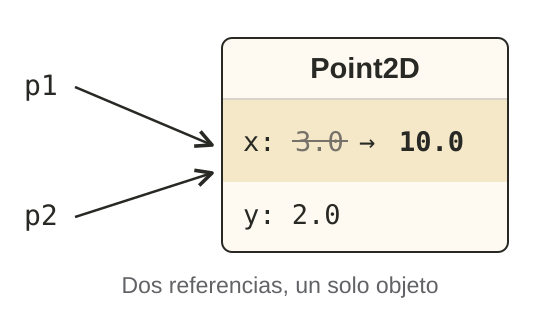

<!-- _class: cover institutional-cover -->
<!-- _paginate: false -->
<!-- _footer: "" -->

<div class="system-week">Semana 1</div>

# Lenguajes y paradigmas<br>de programación

<div class="system-topics">Presentación de la asignatura<br>Programación funcional</div>
<div class="system-author">Cristina Pomares Puig</div>
<div class="institutional-logos">


</div>
<div class="mascot-figure cover-mascot wizard"></div>

<!--
Marcas institucionales: https://imagenycomunicacion.ua.es/es/identidad-visual-corporativa-y-logotipos-ua.html
Logo DCCIA: https://web.ua.es/es/dccia/imagenes/gestadm/logotipos/logodccia.jpg
-->

<!--
Fuente principal de toda la presentación: notas-clase/semana01/semana01.md.
Presentar la asignatura y el punto de partida: funciones que transforman entradas en salidas.
-->

---
## La sesión de hoy

<div class="session-agenda">
  <div><b>Tema 0</b><strong>Presentación de la asignatura</strong><span>Organización, prácticas y evaluación.</span></div>
  <div><b>Tema 2 · Parte 1</b><strong>Programación funcional</strong><span>Funciones, evaluación de expresiones y modelo de sustitución en Scheme.</span></div>
</div>

<p class="independent-study"><strong>Para estudiar en casa:</strong> tema 1, Lenguajes de programación.</p>

<!--
Fuente: Tema 0, Tema 1 y «Veremos hoy» del Tema 2.
El tema 1 es no presencial. Su cronología, genealogía y paradigmas quedan en las notas.
-->

---
<!-- footer: "LPP · Tema 0: Presentación de la asignatura · Parte 1" -->
## Tres bloques temáticos

<div class="course-blocks">
<div><b>1</b><strong>Programación funcional</strong><span>Temas 1 y 2<br>Scheme</span></div>
<div><b>2</b><strong>Procesos y estructuras recursivas</strong><span>Temas 3 y 4<br>Scheme</span></div>
<div><b>3</b><strong>Programación funcional y POO avanzada</strong><span>Temas 5 y 6<br>Swift</span></div>
</div>

<p class="concept-note">Moodle recoge la planificación semanal, los horarios y los avisos. El foro permite compartir dudas y respuestas.</p>

<!--
Fuente: Tema 0: Temario, Planificación y Horarios.
Consultar la planificación vigente en Moodle. No reutilizar las fechas ni las capturas de horarios del curso de las notas.
En teoría se puede asistir excepcionalmente a otro grupo. En prácticas se debe asistir al asignado; el cambio se solicita en la Secretaría de la EPS.
-->

---
## Prácticas y trabajo semanal

<div class="columns equal">
<div>

### Cómo trabajar

1. Preparar los ejemplos de teoría.
2. Resolver los ejercicios en prácticas y en casa.
3. Entregar en Moodle al final de la semana.
4. Comparar con la solución y preguntar las dudas.

</div>
<div>

### Recursos de la asignatura

- Dos seminarios: Scheme y Swift.
- Doce hojas de ejercicios semanales.
- Web de apuntes: teoría, seminarios y prácticas.
- Moodle: planificación, foro y entregas.

</div>
</div>

> Trabaja los ejercicios antes de mirar la solución. Prueba los ejemplos, entiende los resultados y propón variantes.

<!--
Fuente: Tema 0: Prácticas y Consejos para aprender con éxito.
Insistir en el trabajo propio y continuo, sin memorizar soluciones. Usar también lápiz y papel.
-->

---
## Evaluación

<div class="assessment-bars">
  <div><span>Parcial 1</span><strong>35%</strong><i style="--weight:35%"></i></div>
  <div><span>Parcial 2</span><strong>30%</strong><i style="--weight:30%"></i></div>
  <div><span>Parcial 3</span><strong>35%</strong><i style="--weight:35%"></i></div>
</div>

<p class="small">Tres exámenes escritos de teoría y práctica. No se exige nota mínima en cada parcial.</p>
<p class="assessment-extra">Parciales 1 y 2 durante el curso. Parcial 3 en la fecha del examen oficial de la convocatoria ordinaria.</p>
<p class="exam-note"><strong>Dispositivos con conexión a internet:</strong> dentro de las mochilas y en el suelo. Incumplir la norma invalida la prueba con un 0.</p>

<!--
Fuente: Tema 0: Evaluación y advertencia sobre dispositivos móviles.
Estos porcentajes y normas proceden de las notas. Contrastar con la guía docente del curso antes de impartirlo.
-->

---
<!-- footer: "LPP · Tema 1: Lenguajes de programación · Parte 1" -->
<!-- _class: section topic-opening -->

<div class="mascot-figure section-mascot wizard"></div>
<div class="eyebrow">Tema 1</div>

# Lenguajes de programación

<p class="lead">Tema no presencial: debéis estudiarlo en casa con los apuntes de la asignatura.</p>

<!--
Fuente: notas-clase/semana01/semana01.md, Tema 1: Lenguajes de programación.
Recordar que este tema se estudia en casa antes de comenzar el tema 2 en clase.
-->

---
<!-- _class: topic-summary -->

## Historia y paradigmas de programación

<div class="columns equal">
<div>

### Historia y evolución

El tema recorre la aparición de los lenguajes, desde FORTRAN y Lisp hasta lenguajes como Java y Swift.

### Genealogía de los lenguajes

Los lenguajes se influyen entre sí. Su genealogía muestra relaciones entre distintas familias y cómo se transmiten ideas.

</div>
<div>

### Paradigmas de programación

- **Funcional:** Lisp, Scheme, Haskell, Racket.
- **Lógico:** Prolog.
- **Imperativo o procedural:** FORTRAN, BASIC, C, JavaScript.
- **Orientado a objetos:** Java, C++.

</div>
</div>

<p class="concept-note">Para consultar la popularidad de los lenguajes: <a href="https://www.tiobe.com/tiobe-index/">índice TIOBE</a>.</p>

<div class="mascot-reminder"><div class="mascot-figure "></div><p>Estas son las ideas principales. <strong>El tema 1 se estudia en casa</strong> con los apuntes de la asignatura.</p></div>

<!--
Fuente: notas-clase/semana01/semana01.md, Tema 1: fechas de creación, genealogía y paradigmas.
Introducir estas ideas brevemente; el desarrollo del tema se estudia en casa.
TIOBE se incluye solo como enlace, sin posiciones, fechas ni capturas que requieran actualización.
-->

---
<!-- footer: "LPP · Tema 2: Programación funcional · Parte 1" -->
<!-- _class: section topic-opening -->

<div class="mascot-figure section-mascot wizard"></div>
<div class="eyebrow">Tema 2 · Parte 1</div>

# Programación funcional

<p class="lead">Programas construidos mediante la definición y composición de funciones.</p>

<!-- Fuente: comienzo del Tema 2. -->

---
## Veremos hoy

<p class="agenda-topic">Tema 2 · Programación funcional · Parte 1</p>

<ol class="topic-agenda">
<li><strong>El paradigma de programación funcional</strong></li>
<li><strong>Programación declarativa e imperativa</strong></li>
<li><strong>Evaluación de expresiones en Scheme</strong></li>
<li><strong>Definición y composición de funciones</strong></li>
<li><strong>Modelo de computación de sustitución</strong><span>Orden aplicativo y orden normal</span></li>
<li><strong>Funciones y formas especiales</strong><span>define, if, cond, quote, símbolos y listas</span></li>
</ol>

<!-- Fuente: lista «Veremos hoy», con el mismo orden que las notas. -->

---
<!-- _class: reviewed-definition -->
## Definición de programación funcional

<p class="definition-intro">Un programa funcional combina funciones matemáticas que transforman entradas en salidas, sin estado interno mutable ni efectos laterales.</p>

<div class="columns equal definition-review">
<div>

```racket
(define (cuadrado x)
  (* x x))

(cuadrado 4) ; ⇒ 16
```

</div>
<div>

### Función pura

Con los mismos argumentos, devuelve el mismo resultado.

El resultado depende de sus argumentos. La llamada no modifica el estado externo.

</div>
</div>

<div class="mascot-reminder mascot-question"><div class="mascot-figure asking"></div><p><strong>Pregunta:</strong> ¿seguiría siendo pura si además incrementase un contador global?</p></div>

<!--
Fuente: Definición de programación funcional. Se usa cuadrado, definido más adelante en las notas.
Pizarra: (cuadrado 4), (* 4 4), 16.
Respuesta: no, modificaría estado externo aunque devolviese 16.
-->

---
## Características del paradigma funcional

<div class="columns equal">
<div>

### El modelo que utilizamos

- Funciones matemáticas puras.
- Valores inmutables.
- Recursión.
- Listas como estructura fundamental.
- Funciones como valores.

</div>
<div>

### Cómo se relacionan

Construimos funciones pequeñas y las componemos para resolver cálculos mayores.

La recursión permitirá trabajar con listas y otras estructuras recursivas.

Las expresiones lambda y las funciones de orden superior permitirán pasar operaciones como argumentos.

</div>
</div>

<!-- Fuente: Principales características del paradigma funcional. Recursión y orden superior se desarrollan más adelante. -->

---
## Lenguajes y aplicaciones

<div class="language-review">
<div><strong>Principalmente funcionales</strong><span>Clojure, Erlang</span></div>
<div><strong>Funcional puro</strong><span>Haskell</span></div>
<div><strong>Multiparadigma</strong><span>Swift, Python, Scala, Ruby, Groovy</span></div>
</div>

<p class="concept-note">En la asignatura empezamos con <strong>Scheme</strong> y después usamos <strong>Swift</strong>. Podemos utilizar un estilo funcional en lenguajes que admiten otros paradigmas.</p>
<p class="application-note">La ausencia de estado compartido mutable facilita razonar sobre concurrencia. La composición permite encadenar operaciones sobre flujos de datos.</p>

<!--
Fuente: Lenguajes de programación funcional, Ventajas y Aplicaciones prácticas.
Scheme también admite mutación y efectos laterales. Las lecturas complementarias están en las notas.
-->

---
## Programación declarativa e imperativa

<div class="columns equal paradigm-contrast">
<div>

### Declarativa

- Declara valores y relaciones.
- Expresa el resultado que se busca.
- Abstrae los cambios de estado intermedios.

**Ejemplos:** hojas de cálculo, Prolog, programación funcional y SwiftUI.

</div>
<div>

### Imperativa

- Especifica pasos de ejecución.
- Usa asignaciones.
- Trabaja con mutación y estado local mutable.

**Ejemplos:** los fragmentos de C y Java que veremos a continuación.

</div>
</div>

<p class="concept-note">La programación declarativa también requiere cálculo. El programa expresa relaciones sin detallar cada cambio de estado.</p>

<!--
Fuente: Programación declarativa vs. imperativa.
Pregunta: ¿declarativa significa que el ordenador no realiza pasos de evaluación?
Respuesta: no, se abstraen pasos y cambios de estado, pero el cálculo sigue existiendo.
-->

---
## Pasos de ejecución y composición

<div class="columns equal">
<div>

### Variables intermedias

```c
int a = cuadrado(8);
int b = doble(a);
int c = cuadrado(b);
return c;
```

</div>
<div>

### Composición de funciones

```racket
(cuadrado
  (doble
    (cuadrado 8)))
```

</div>
</div>

<div class="compact-results nearby-results"><span><code>(cuadrado 8)</code><b>64</b></span><span><code>(doble 64)</code><b>128</b></span><span><code>(cuadrado 128)</code><b>16384</b></span></div>

<!--
Fuente: Pasos de ejecución. Mismos nombres y cálculo que en las notas.
Pizarra: relacionar a, b y c con las subexpresiones anidadas.
Pregunta: ¿qué llamada proporciona el argumento del cuadrado exterior?
Respuesta: (doble (cuadrado 8)), con valor 128.
-->

---
<!-- _class: mutation-review -->
## Mutación

<div class="columns equal">
<div>

### Asignación destructiva

```java
int x = 10;
x = x + 1;
```

La posición de memoria asociada a `x` pasa de almacenar `10` a almacenar `11`.

</div>
<div>

### Valores inmutables

```racket
#lang racket

(define a 12)
(define a 200)
```

Al intentar definir de nuevo `a`, se produce un error:

```text
module: identifier already defined in: a
```

</div>
</div>

<p class="concept-note">En programación funcional, los valores definidos son <strong>inmutables</strong>.</p>

<!--
Fuente: Mutación. El ejemplo de definición duplicada se ejecuta como módulo, no en el REPL.
Distinguir definir un nombre de actualizar una posición de memoria.
-->

---
## Mutación y efectos laterales

<div class="columns equal alias-layout">
<div>

```java
Point2D p1 = new Point2D(3.0, 2.0);
Point2D p2 = p1;

p2.setCoordX(10.0);
p1.getCoordX(); // 10.0
```

</div>
<div>

</div>
</div>

<div class="mascot-reminder"><div class="mascot-figure pointing"></div><p><code>p2 = p1</code> copia la referencia: <strong>no crea otro objeto</strong>. Por eso, el cambio a través de <code>p2</code> también se observa a través de <code>p1</code>.</p></div>

<!--
Fuente: Mutación y efectos laterales.
Pregunta: ¿la asignación crea una copia del objeto?
Respuesta: no, copia la referencia. Mostrar un único objeto y dos referencias.
Los efectos de la mutación compartida pueden complicar la depuración, especialmente con concurrencia.
-->

---
<!-- _class: referential-transparency -->
## Estado local mutable y transparencia referencial

<div class="columns equal">
<div>

```c
int contador() {
  static int c = 0;
  c++;
  return c;
}

contador(); // 1
contador(); // 2
contador(); // 3
```

</div>
<div>

### El resultado depende de la historia

La variable local estática conserva su valor entre llamadas.

<div class="referential-definition">

### Transparencia referencial

**Una expresión pura se puede sustituir por su valor sin cambiar el resultado del programa.**

</div>

</div>
</div>

<div class="mascot-reminder"><div class="mascot-figure thinking"></div><p>Podemos sustituir <code>(cuadrado 3)</code> por <code>9</code>. <strong>El contador no cumple la transparencia referencial:</strong> su resultado depende del estado.</p></div>

<!--
Fuente: Estado local mutable y transparencia referencial.
Se corrige la cabecera C de las notas, «int function contador», a «int contador».
Pizarra: seguir c=0, 1, 2, 3. Comparar con dos llamadas a cuadrado con el mismo argumento.
-->

---
## Resumen de los dos modelos

<div class="comparison-table">
  <div class="header"><span></span><b>Modelo funcional</b><b>Modelo imperativo</b></div>
  <div><strong>Variable</strong><span>Nombre dado a un valor</span><span>Nombre de una zona de memoria</span></div>
  <div><strong>Estado</strong><span>Valores sin mutación</span><span>Asignaciones y cambios de estado</span></div>
  <div><strong>Cálculo</strong><span>Composición de expresiones</span><span>Secuencia de instrucciones</span></div>
</div>

<div class="mascot-reminder mascot-question"><div class="mascot-figure asking"></div><p><strong>Pregunta:</strong> ¿cuál podemos entender solo a partir de sus argumentos: <code>cuadrado</code>, la actualización de <code>Point2D</code> o <code>contador()</code>?</p></div>

<!--
Fuente: Resumen de programación declarativa e imperativa.
Respuesta: cuadrado. Los otros ejemplos dependen de estado mutable.
-->

---
## Evaluación de expresiones en Scheme

<div class="columns equal">
<div>

```racket
2                   ; ⇒ 2
(+ 2 3)             ; ⇒ 5
(+)                 ; ⇒ 0
(+ 2 4 5 6)         ; ⇒ 17
(+ (* 2 3) (- 3 1)) ; ⇒ 8
```

</div>
<div class="prefix-anatomy">
  <code>(+ 2 3)</code>
  <div><span>función</span><strong>+</strong></div>
  <div><span>argumentos</span><strong>2, 3</strong></div>
</div>
</div>

<p class="concept-note">Evaluamos expresiones para obtener valores. La notación prefija coloca la función antes de sus argumentos.</p>

<div class="mascot-reminder"><div class="mascot-figure pointing"></div><p>El <code>+</code> exterior recibe <strong>dos argumentos</strong>: el valor de <code>(* 2 3)</code> y el de <code>(- 3 1)</code>.</p></div>

<!--
Fuente: Evaluación de expresiones en Scheme.
Pregunta: ¿cuántos argumentos recibe el + exterior en el último ejemplo?
Respuesta: dos, los valores de (* 2 3) y (- 3 1).
-->

---
<!-- _class: question -->
## ¿Cuál es el resultado?

```racket
(+ (* 2 3)
   (- 3 (/ 12 3)))
```

1. Identifica la función y los argumentos de la llamada exterior.
2. Busca las subexpresiones que puedes evaluar primero.
3. Sustituye cada subexpresión por su valor.

<div class="mascot-reminder mascot-question"><div class="mascot-figure asking"></div><p>Antes de ejecutar el ejemplo, predice el resultado y justifica cada sustitución.</p></div>

<!--
Fuente: ejemplo anidado de Evaluación de expresiones.
Dar 60–90 segundos y resolver en pizarra antes de mostrar la siguiente diapositiva.
Respuesta: 5, porque (* 2 3)=6, (/ 12 3)=4 y (- 3 4)=-1.
-->

---
## Evaluación de dentro a fuera

<div class="evaluation-ladder week01-evaluation">
  <code>(+ (* 2 3) (- 3 (/ 12 3)))</code>
  <span>Evaluamos la división interior</span>
  <code>(+ (* 2 3) (- 3 4))</code>
  <span>Evaluamos la multiplicación y la resta</span>
  <code>(+ 6 -1)</code>
  <strong>5</strong>
</div>

<p class="concept-note">Cada sustitución conserva el valor de la expresión completa. La llamada exterior necesita los valores de sus argumentos.</p>

<!--
Fuente: Evaluación de expresiones.
La traza elige un orden válido entre subexpresiones independientes. No impone un orden universal de izquierda a derecha en Scheme.
-->

---
## Definición de funciones en Scheme

<div class="columns equal">
<div>

```racket
(define (cuadrado x)
  (* x x))
```

El cuerpo es una expresión. Su valor es el resultado de la función, sin una instrucción `return`.

</div>
<div>

```racket
(cuadrado 10)
; ⇒ 100

(cuadrado
  (+ 10
     (cuadrado (+ 2 4))))
; ⇒ 2116
```

</div>
</div>

<div class="mascot-reminder"><div class="mascot-figure thinking"></div><p><code>x</code> es el <strong>parámetro formal</strong>; <code>10</code> es el <strong>argumento</strong> de la llamada <code>(cuadrado 10)</code>. Al sustituirlo, el cuerpo queda <code>(* 10 10)</code>.</p></div>

<!--
Fuente: Definición de funciones en Scheme.
Pizarra: desarrollar la llamada anidada. (+ 2 4)=6, cuadrado=36, (+ 10 36)=46, cuadrado=2116.
-->

---
<!-- _class: auxiliary-composition -->

## Funciones auxiliares y composición

<div class="columns equal">
<div>

### Cálculo repetido

```racket
(define (suma-cuadrados x y)
  (+ (* x x)
     (* y y)))
```

</div>
<div>

### Abstracción reutilizable

```racket
(define (cuadrado x)
  (* x x))

(define (suma-cuadrados x y)
  (+ (cuadrado x)
     (cuadrado y)))
```

</div>
</div>

<p class="concept-note">La función auxiliar da nombre a una operación reutilizable. La segunda versión expresa el cálculo mediante <code>cuadrado</code>.</p>
<div class="mascot-reminder mascot-question"><div class="mascot-figure asking"></div><p><strong>Pregunta:</strong> ¿qué llamadas realiza <code>(suma-cuadrados 3 4)</code> antes de sumar?</p></div>

<!--
Fuente: Funciones auxiliares y composición.
Respuesta: (cuadrado 3)=9 y (cuadrado 4)=16. Resultado: 25.
-->

---
## Composición de funciones

<div class="columns equal">
<div>

```racket
(define (conduce-vehiculo imagenes)
  (obten-acciones
    (reconoce
      (filtra
        (obten-caracteristicas
          imagenes)))))
```

</div>
<div>

### Recorrido de los datos

1. Obtener características de las imágenes.
2. Filtrar esas características.
3. Reconocer a partir del resultado.
4. Obtener las acciones del vehículo.

Cada resultado es el argumento de la llamada que lo contiene.

</div>
</div>

<p class="concept-note">Es un ejemplo conceptual: para ejecutarlo hay que implementar las operaciones. La composición expresa sus dependencias.</p>

<!--
Fuente: Composición de funciones, ejemplo del vehículo autónomo.
Pizarra: relacionar las llamadas con el procesamiento de imágenes de las notas. Leer de dentro a fuera.
-->

---
## Modelo de computación de sustitución

<p class="definition-intro">Las reglas del modelo permiten reescribir expresiones sin cambiar su valor:</p>

<div class="rule-list four-rules">
  <div><b>1</b><strong>Valor primitivo</strong><span>Un número se evalúa a sí mismo.</span></div>
  <div><b>2</b><strong>Identificador</strong><span>Se obtiene el valor asociado por <code>define</code>. Si no existe, hay un error.</span></div>
  <div><b>3</b><strong>Llamada primitiva</strong><span>Se evalúan los argumentos y se aplica la función primitiva a sus valores.</span></div>
  <div><b>4</b><strong>Función definida</strong><span>La regla 4 tiene dos variantes según cuándo se evalúan los argumentos.</span></div>
</div>


<!-- Fuente: Modelo de computación de sustitución, reglas 1–3 y presentación de la regla 4. -->

---
## Regla 4: orden aplicativo y orden normal

<div class="columns equal evaluation-orders">
<div>

### Orden aplicativo

1. Evaluar los argumentos.
2. Sustituir la llamada por el cuerpo de la función.
3. Reemplazar cada parámetro formal por el **argumento evaluado**.
4. Evaluar la expresión resultante.

</div>
<div>

### Orden normal

1. Sustituir la llamada por el cuerpo de la función.
2. Reemplazar cada parámetro formal por el **argumento sin evaluar**.
3. Continuar las sustituciones y evaluar las operaciones primitivas.

</div>
</div>

<div class="mascot-reminder"><div class="mascot-figure pointing"></div><p>Scheme utiliza <strong>orden aplicativo</strong>.</p></div>

<!--
Fuente: las dos variantes de la regla 4.
Pizarra: subrayar «argumento evaluado» y «argumento sin evaluar».
El orden normal se compara como modelo, no como modo de ejecución del intérprete Scheme.
-->

---
## Modelo de sustitución: ejemplo

<div class="columns equal">
<div>

```racket
(define (doble x)
  (+ x x))

(define (cuadrado y)
  (* y y))

(define a 2)

(doble (cuadrado a))
```

</div>
<div>

### Las mismas definiciones

- `a` tiene asociado el valor `2`.
- `cuadrado` tiene cuerpo `(* y y)`.
- `doble` tiene cuerpo `(+ x x)`.

### Dos estrategias

El orden aplicativo comienza evaluando `(cuadrado a)`. El normal comienza expandiendo la llamada a `doble`.

</div>
</div>

<div class="mascot-reminder"><div class="mascot-figure thinking"></div><p>En programación funcional pura, <strong>el resultado no depende del orden de evaluación</strong>: el orden aplicativo y el orden normal dan el mismo resultado. En este ejemplo, <code>8</code>.</p></div>

<!--
Fuente: ejemplo doble/cuadrado del modelo de sustitución.
Mantener las definiciones a la vista durante las dos trazas siguientes.
-->

---
<!-- _class: compact -->
## Orden aplicativo

```text
(doble (cuadrado a))  ; expresión inicial
(doble (cuadrado 2))  ; R2: sustituir a
(doble (* 2 2))       ; R4: expandir cuadrado
(doble 4)             ; R3: aplicar *
(+ 4 4)               ; R4: expandir doble
8                     ; R3: aplicar +
```

<div class="order-caption">La llamada interior se convierte en un valor antes de expandir <code>doble</code>.</div>
<div class="mascot-reminder mascot-question"><div class="mascot-figure asking"></div><p><strong>Pregunta:</strong> ¿qué valor sustituye a <code>x</code> en el cuerpo de <code>doble</code>?</p></div>

<!--
Fuente: traza de orden aplicativo.
Respuesta: 4. El cuerpo queda (+ 4 4).
Pedir cada reescritura al alumnado antes de escribirla en pizarra.
-->

---
<!-- _class: compact -->
## Orden normal

```text
(doble (cuadrado a))       ; expresión inicial
(+ (cuadrado a) (cuadrado a)) ; R4: expandir doble
(+ (* a a) (* a a))        ; R4: expandir cuadrado
(+ (* 2 2) (* 2 2))        ; R2: sustituir a
(+ 4 (* 2 2))             ; R3: aplicar *
(+ 4 4)                   ; R3: aplicar *
8                         ; R3: aplicar +
```

<p class="concept-note">El argumento sin evaluar aparece dos veces y se repite el cálculo de <code>cuadrado</code>. Las dos trazas producen el mismo resultado: <code>8</code>.</p>

<!--
Fuente: traza de orden normal. Se corrigen los paréntesis incompletos de las notas.
La pureza por sí sola no garantiza que ambos órdenes terminen en todos los programas.
Pizarra: rodear las dos copias de (cuadrado a) y comparar con el orden aplicativo.
-->

---
## ¿Qué ocurre con una función no pura?

```racket
(define (zero x)
  (- x x))

(zero (random 10))
```

<div class="columns equal random-orders">
<div><strong>Orden aplicativo</strong><span>Evalúa <code>random</code> una vez y resta el valor obtenido de sí mismo. El resultado es <code>0</code>.</span></div>
<div><strong>Orden normal</strong><span>La sustitución produce dos llamadas a <code>random</code>. Pueden devolver números distintos.</span></div>
</div>

<p class="concept-note">Una llamada aleatoria no tiene transparencia referencial. La columna de orden normal compara modelos: Scheme ejecuta la llamada en orden aplicativo.</p>

<!--
Fuente: ejemplo con funciones no puras y orden de evaluación.
Pregunta: ¿cuántas veces llama Scheme a random en este ejemplo?
Respuesta: una. No prometer valores concretos para dos llamadas independientes.
-->

---
## Funciones y formas especiales en Scheme

<div class="columns equal">
<div>

### Llamada a una función

Evalúa los argumentos y aplica la función a los valores obtenidos.

En `(+ 2 3)`, los argumentos valen `2` y `3`, y el resultado es `5`.

</div>
<div>

### Forma especial

Las formas especiales **tienen sus propias reglas de evaluación**, que determinan qué expresiones se evalúan y cuándo.

- `define`: introduce asociaciones.
- `if` y `cond`: seleccionan expresiones.
- `quote`: devuelve datos sin evaluarlos.

</div>
</div>

<div class="mascot-reminder mascot-question"><div class="mascot-figure asking"></div><p><strong>Pregunta:</strong> ¿qué problema tendría evaluar las dos ramas de un <code>if</code> antes de elegir una?</p></div>

<!--
Fuente: Funciones y formas especiales en Scheme.
Respuesta: la rama innecesaria podría producir un error o no terminar.
-->

---
<!-- _class: define-review -->
## Forma especial `define`

<div class="columns equal">
<div>

### Sintaxis y evaluación

```racket
(define <identificador> <expresión>)
```

1. Evaluar la expresión.
2. Asociar su valor al identificador.

El nombre que se define no se evalúa como un argumento.

</div>
<div>

### Ejemplo

```racket
(define base 10)
(define altura 12)
(define area (/ (* base altura) 2))
; area ⇒ 60
```

La última definición utiliza los valores asociados a `base` y `altura` para calcular `area`.

</div>
</div>

<!--
Fuente: Forma especial define.
Pregunta: ¿qué ocurriría si primero se intentase evaluar el nombre aún no definido?
Respuesta: fallaría la búsqueda de su valor. define necesita una regla propia.
-->

---
## Forma especial `define` para definir funciones

<div class="columns equal">
<div>

### Sintaxis

```text
(define (<nombre-funcion> <argumentos>)
  <cuerpo>)
```

Se crea una función con ese cuerpo y se le da un nombre.


</div>
<div>

### Definición

```racket
(define (doble x)
  (+ x x))
```

### Llamada

```racket
(doble 5) ; ⇒ 10
```


</div>
</div>

<div class="mascot-reminder"><div class="mascot-figure pointing"></div><p><strong>Definir una función no evalúa su cuerpo.</strong> <code>(define (doble x) (+ x x))</code> crea la función; <code>(doble 5)</code> la llama y calcula <code>10</code>.</p></div>

<!--
Fuente: Forma especial define para definir funciones.
Pregunta: ¿definir doble calcula ya un número?
Respuesta: no, crea la función. El cuerpo se evalúa al llamarla.
-->

---
<!-- _class: if-review -->
## Forma especial `if`

<div class="columns equal if-review-grid">
<div>

```racket
(if <condición>
    <expresión-true>
    <expresión-false>)
```

1. Evaluar la condición.
2. Evaluar únicamente la rama seleccionada.
3. Devolver el valor de esa rama.

</div>
<div>

### Ejemplo

```racket
(if (> 10 5)
    (substring "Hola qué tal" (+ 1 1) 4)
    (/ 12 0))
; ⇒ "la"
```

<div class="mascot-aside">
<div class="mascot-figure pointing"></div>
<p>Solo se evalúa <strong>la rama seleccionada</strong>. Aquí, la división por cero no se evalúa.</p>
</div>

</div>
</div>

<!--
Fuente: Forma especial if. Se recupera exactamente la expresión de las notas.
No se evalúa (/ 12 0). Solo #f cuenta como falso en Scheme.
Pedir la predicción antes de ejecutar y señalar la rama seleccionada.
-->

---
<!-- _class: compact cond-reminder -->
## Forma especial `cond`

```racket
(cond
  ((> 3 4) "3 es mayor que 4")
  ((< 2 1) "2 es menor que 1")
  ((= 3 1) "3 es igual que 1")
  ((> 3 5) "3 es mayor que 5")
  (else "ninguna condición es cierta"))
```

Se prueban las condiciones de arriba abajo. Se evalúa el consecuente de la primera que resulte cierta y se omiten las cláusulas posteriores.

Si ninguna es cierta, se evalúa el consecuente de `else`.

<div class="mascot-reminder mascot-question"><div class="mascot-figure asking"></div><p><strong>Pregunta:</strong> ¿qué devuelve el ejemplo? ¿Qué cambiaría si la primera condición fuese cierta?</p></div>

<!--
Fuente: Forma especial cond. Se corrige la cadena de la cuarta cláusula para que coincida con (> 3 5).
Respuesta: "ninguna condición es cierta". Si la primera fuese cierta, se omitirían todas las demás cláusulas.
-->

---
<!-- _class: quote-review -->
## Forma especial `quote` y símbolos

<div class="columns equal">
<div>

```racket
(quote x) ; ⇒ x
'hola    ; ⇒ hola
```

La forma especial `quote` se abrevia con el carácter `'`. Devuelve el identificador sin evaluar: un símbolo.

</div>
<div>

```racket
(define x 12)

(symbol? 'x) ; ⇒ #t
(symbol? x)  ; ⇒ #f
```

`x` se evalúa a `12`. La expresión `'x` produce el símbolo `x`.

</div>
</div>

<div class="symbol-summary"><span><strong>Símbolo</strong><code>'hola</code> es un dato atómico.</span><span><strong>Cadena</strong><code>"hola"</code> es una secuencia de caracteres.</span></div>

<!--
Fuente: Forma especial quote, símbolos y listas; Símbolos como tipos primitivos.
Pregunta: ¿por qué (symbol? x) es falso?
Respuesta: symbol? recibe el número 12, no el símbolo x.
Pizarra: (define saludo 'hola), saludo ⇒ hola. Un símbolo puede ligarse a una variable y pasarse como argumento.
-->

---
## Forma especial `quote` y expresiones

```racket
'(1 2 3)
'(a b c)
'(* (+ 1 2) 5)
```

<div class="quoted-expression">
  <span>Sin quote</span><code>(* (+ 1 2) 5)</code><strong>15</strong>
  <span>Con quote</span><code>'(* (+ 1 2) 5)</code><strong>Una lista</strong>
</div>

<div class="mascot-reminder"><div class="mascot-figure thinking"></div><p>Con <code>quote</code>, <strong>la suma interior también queda como dato</strong>. La lista tiene tres elementos: el símbolo <code>*</code>, la lista <code>(+ 1 2)</code> y el número <code>5</code>.</p></div>

<!--
Fuente: Forma especial quote y expresiones; Listas.
Pregunta: ¿se convierte (+ 1 2) en 3 dentro de la lista citada?
Respuesta: no. Marcar los tres elementos exteriores y los de la lista interior.
-->

---
## Función `list` y forma especial `quote`

<div class="columns equal">
<div>

### `list` evalúa sus argumentos

```racket
(list 1
      (/ 2 3)
      (+ 2 3))
; ⇒ (1 2/3 5)
```

</div>
<div>

### `quote` conserva los datos

```racket
'(1
  (/ 2 3)
  (+ 2 3))
; ⇒ (1 (/ 2 3) (+ 2 3))
```

</div>
</div>

<p class="concept-note">Ambas listas tienen tres elementos exteriores. Con <code>list</code>, el segundo es el número <code>2/3</code>. Con <code>quote</code>, es la lista <code>(/ 2 3)</code>.</p>
<div class="mascot-reminder mascot-question"><div class="mascot-figure asking"></div><p><strong>Pregunta:</strong> si <code>a</code>, <code>b</code> y <code>c</code> valen 1, 2 y 3, ¿qué devuelven <code>(list a b c)</code> y <code>'(a b c)</code>?</p></div>

<!--
Fuente: Función list y forma especial quote.
Respuesta: (1 2 3) y (a b c), respectivamente.
Pedir la predicción antes de ejecutar y distinguir el tipo de cada elemento.
-->

---
<!-- _class: cons-review -->
## Funciones `cons` y `append`

<div class="columns equal">
<div>

### `cons`: añadir a la cabeza

```racket
(cons 1 '(1 2 3 4))
; ⇒ (1 1 2 3 4)

(cons '(1 2) '(1 2 3 4))
; ⇒ ((1 2) 1 2 3 4)
```

El primer argumento se añade como **un solo elemento**, aunque sea una lista.

</div>
<div>

### `append`: concatenar listas

```racket
(define list1 '(1 2 3 4))
(define list2 '(hola como estás))
(append list1 list2)
; ⇒ (1 2 3 4 hola como estás)
```

Los elementos de las listas se concatenan en una nueva lista.

</div>
</div>

<p class="concept-note"><code>cons</code> y <code>append</code> <strong>siempre devuelven una nueva lista</strong>, sin modificar las listas originales.</p>

<div class="mascot-reminder mascot-question"><div class="mascot-figure asking"></div><p><strong>Pregunta:</strong> compara <code>(cons '(1 2) '(3 4))</code> y <code>(append '(1 2) '(3 4))</code>. ¿Cuántos elementos tiene cada resultado?</p></div>

<!--
Fuente: Funciones cons y append. Ejemplos de las notas y comparación con los mismos argumentos.
Respuesta: ((1 2) 3 4), tres elementos; (1 2 3 4), cuatro elementos.
Trabajamos con listas propias. Los pares y las listas impropias se desarrollan en la semana siguiente.
-->
