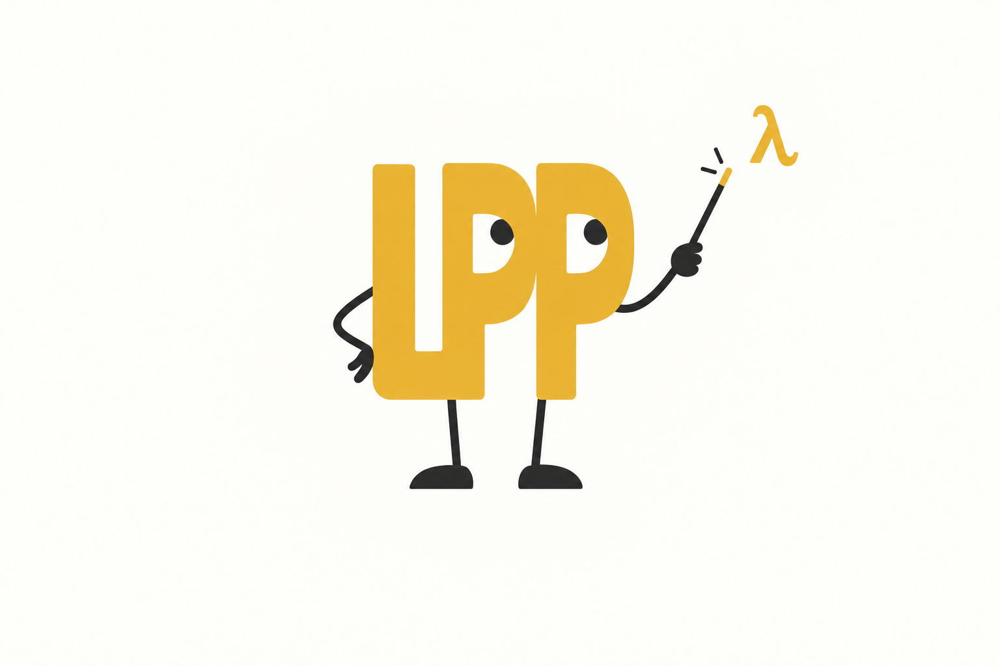
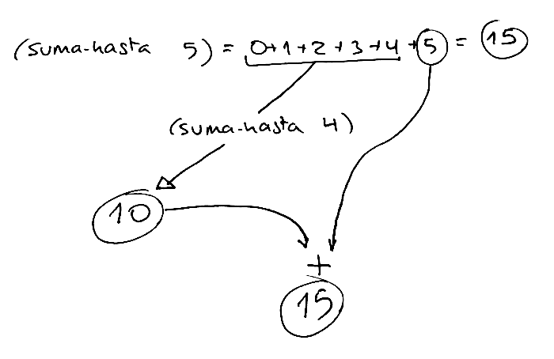
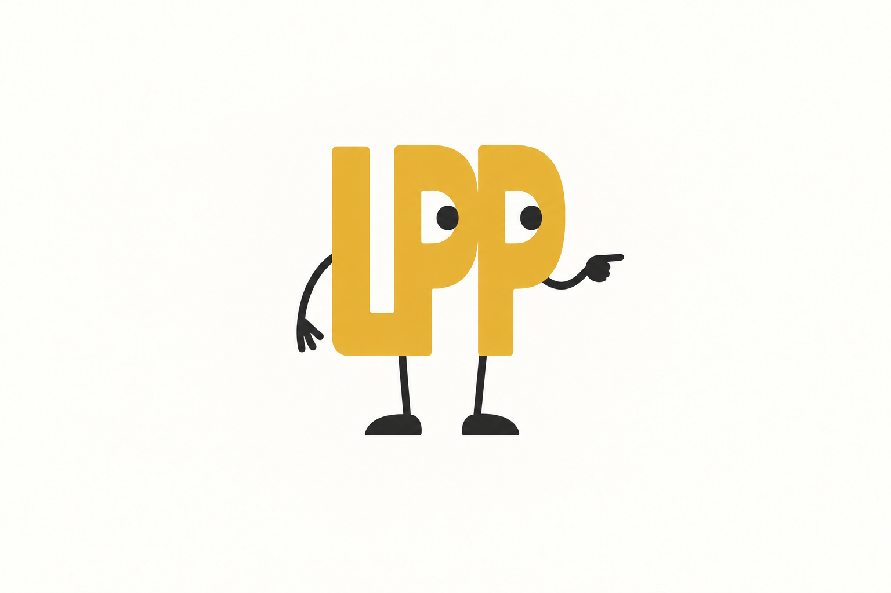
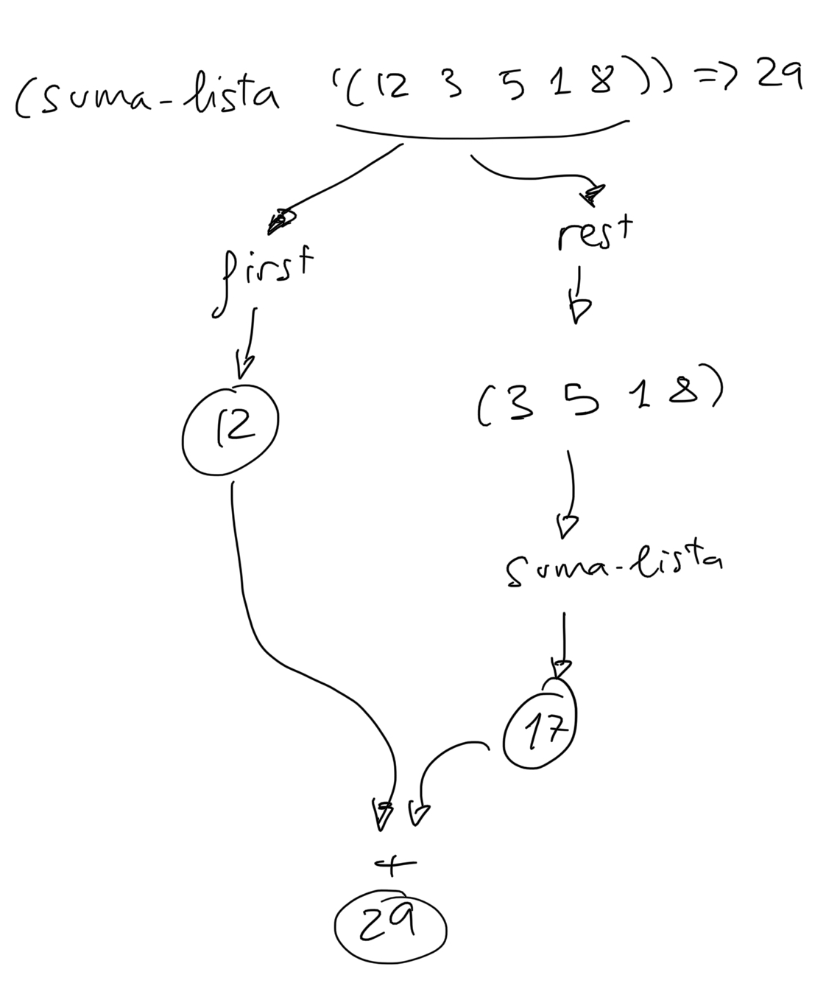
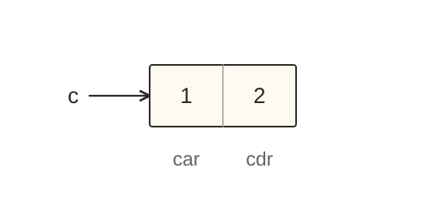
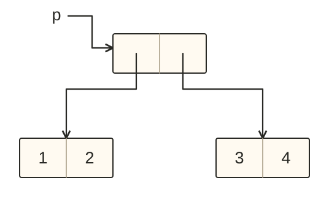
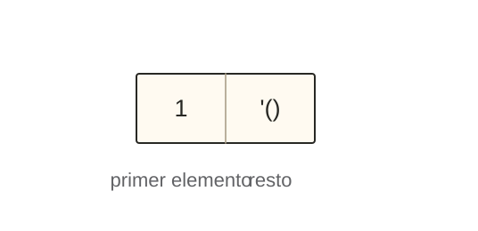
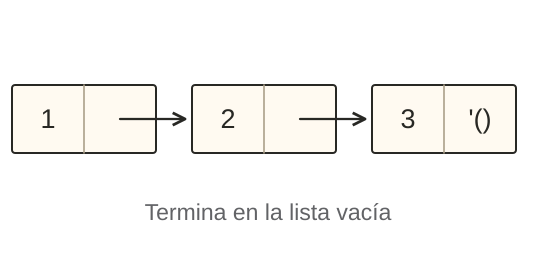
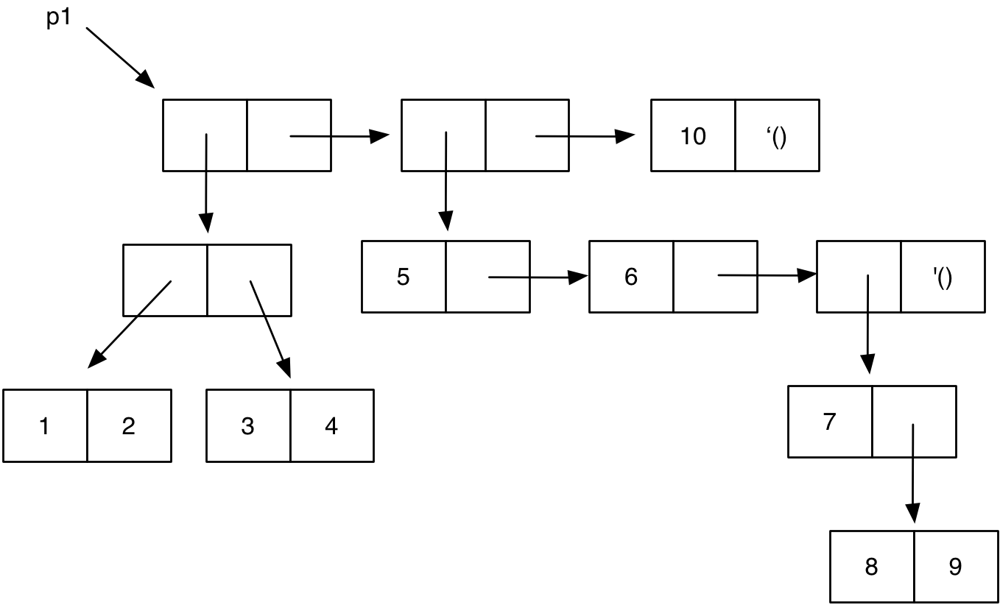

<!-- _class: cover institutional-cover -->
<!-- _paginate: false -->
<!-- _footer: "" -->
<div class="system-week">Semana 2</div>

# Recursión, parejas<br>y listas

<div class="system-topics">Diseño de funciones recursivas<br>Tipos de datos compuestos en Scheme</div>
<div class="system-author">Cristina Pomares Puig</div>
<div class="institutional-logos">


</div>
<div class="mascot-figure cover-mascot wizard"></div>

<!--
Fuente: notas-clase/semana02/semana02.md. Diseño: semana 1, tema lpp-light.
Logo UA (versión oficial horizontal, una tinta): https://imagenycomunicacion.ua.es/es/identidad-visual-corporativa-y-logotipos-ua.html
Logo DCCIA: https://web.ua.es/es/dccia/imagenes/gestadm/logotipos/logodccia.jpg
Se conservan las proporciones y colores originales de las marcas.
-->

---
## Veremos hoy

<p class="agenda-topic">Tema 2 · Programación funcional · Parte 2</p>

<ol class="topic-agenda">
<li><strong>Recursión</strong><span>Diseño de funciones con números, cadenas y listas</span></li>
<li><strong>Tipos de datos compuestos en Scheme</strong><span>Parejas, objetos de primera clase y diagramas caja-y-puntero</span></li>
<li><strong>Listas en Scheme</strong><span>Implementación con parejas y listas con elementos compuestos</span></li>
</ol>

<!--
Fuente: notas-clase/semana02/semana02.md, Veremos hoy.
-->

---
<!-- _class: section topic-opening -->

<div class="mascot-figure section-mascot wizard"></div>
<div class="eyebrow">Tema 2 · Programación funcional</div>

# Confía en la recursión

<p class="lead">Resolver un caso más sencillo y utilizar el valor que devuelve la llamada recursiva.</p>

---
## Diseño de una función recursiva

<div class="columns equal">
<div>

### Caso general

Contiene una llamada a la propia función con un **problema más sencillo**.

Usamos el resultado de esa llamada para resolver el problema original.

</div>
<div>

### Caso base

Devuelve directamente la solución del **caso más sencillo**, sin llamadas recursivas.

</div>
</div>

<div class="mascot-reminder"><div class="mascot-figure thinking"></div><p>Para diseñar la función, <strong>confía en la recursión</strong>: supone que la llamada recursiva devuelve el valor que debe. No necesitas entrar en ella ni desarrollar todas sus llamadas.</p></div>

<!--
Fuente: notas-clase/semana02/semana02.md, Confía en la recursión; no utilizar el depurador ni hacer trazas para diseñar.
-->

---
## Sumar los números hasta `x`

<div class="columns equal">
<div>

```racket
(define (suma-hasta x)
  (if (= 0 x)
      0
      (+ (suma-hasta (- x 1)) x)))
```

</div>
<div>

### ¿Qué devuelve?

```racket
(suma-hasta 5) ; ⇒ 15
```

La suma de los números desde `0` hasta `x`:

`0 + 1 + 2 + 3 + 4 + 5 = 15`.

</div>
</div>

<p class="concept-note">El caso base devuelve <code>0</code>. En el caso general sumamos <code>x</code> al resultado de <code>(suma-hasta (- x 1))</code>.</p>

<!--
Fuente: notas-clase/semana02/semana02.md, Confía en la recursión. Dominio del ejemplo: enteros no negativos.
-->

---
## Diseño de `suma-hasta`

<div class="columns equal recursive-design">
<div>



</div>
<div>

### Caso general

```racket
(+ (suma-hasta (- x 1)) x)
```

La recursión calcula la suma hasta `x - 1`. Solo falta sumar `x`.

### Caso base

¿Cuál es el caso más sencillo que podemos resolver sin recursión?

`(suma-hasta 0)` devuelve `0`.

</div>
</div>

<!--
Fuente: notas-clase/semana02/semana02.md, Diseño de `suma-hasta`.
-->

---
## Usar el resultado de la recursión

<div class="recursion-evaluation">
<code>(+ (suma-hasta (- 5 1)) 5)</code>
<span>El problema más sencillo es sumar hasta <code>4</code>.</span>
<code>(+ (suma-hasta 4) 5)</code>
<span>Confiamos en que <code>(suma-hasta 4)</code> devuelve <strong>10</strong>.</span>
<code>(+ 10 5)</code>
<strong>15</strong>
</div>

<!--
Fuente: notas-clase/semana02/semana02.md, Confía en la recursión, ejemplo concreto con x igual a 5. No desplegar la llamada suma-hasta 4.
-->

---
## Construir el alfabeto hasta un carácter

<div class="columns equal">
<div>

### El problema original

```racket
(alfabeto-hasta #\h)
; ⇒ "abcdefgh"
```

### Un problema más sencillo

```racket
(alfabeto-hasta #\g)
; ⇒ "abcdefg"
```

</div>
<div>

### Usar el resultado de la recursión

Solo falta añadir el carácter actual al final de la cadena:

```racket
(string-append "abcdefg"
               (string #\h))
; ⇒ "abcdefgh"
```

</div>
</div>

<div class="mascot-reminder mascot-question"><div class="mascot-figure asking"></div><p><strong>Pregunta:</strong> ¿cuál es el caso base?</p></div>

<!--
Fuente: notas-clase/semana02/semana02.md, Otro ejemplo de función recursiva alfabeto-hasta. Respuesta: #\a, con resultado "a".
-->

---
<!-- _class: lesson-code week02-code -->

## El carácter anterior

```racket
(define (anterior char)
  (integer->char (- (char->integer char) 1)))
```

Convertimos el carácter en su código, restamos uno y volvemos a convertirlo en carácter.

```racket
(anterior #\h) ; ⇒ #\g
```

<p class="concept-note">La llamada recursiva será <code>(alfabeto-hasta (anterior char))</code>.</p>

<!--
Fuente: notas-clase/semana02/semana02.md, El carácter anterior.
-->

---
<!-- _class: lesson-code week02-code -->

## Definición de `alfabeto-hasta`

```racket
(define (alfabeto-hasta char)
  (if (equal? char #\a)
      "a"
      (string-append
        (alfabeto-hasta (anterior char))
        (string char))))
```

<div class="mascot-reminder"><div class="mascot-figure pointing"></div><p>La recursión devuelve <strong>una cadena</strong>. <code>(string char)</code> convierte el carácter actual en una cadena para poder añadirlo con <code>string-append</code>.</p></div>

<!--
Fuente: notas-clase/semana02/semana02.md, Solución final de alfabeto-hasta. Dominio: caracteres consecutivos desde a hasta el solicitado.
-->

---
## Selección de elementos: `first` y `rest`

<div class="columns equal">
<div>

```racket
(define lista1 '(1 2 3 4))

(first lista1) ; ⇒ 1
(rest lista1)  ; ⇒ (2 3 4)
```

</div>
<div>

```racket
(define lista2 '((1 2) 3 4))

(first lista2) ; ⇒ (1 2)
(rest lista2)  ; ⇒ (3 4)
```

</div>
</div>

<div class="mascot-reminder"><div class="mascot-figure pointing"></div><p><code>first</code> devuelve <strong>un elemento</strong>, que también puede ser una lista. <code>rest</code> devuelve <strong>una lista</strong> con los elementos restantes.</p></div>

<!--
Fuente: notas-clase/semana02/semana02.md, Selección de elementos: `first` y `rest`.
-->

---
## Diseñar `suma-lista`

<div class="columns equal recursive-design list-sum-design">
<div>



</div>
<div>

Para sumar `(12 3 5 1 8)`:

1. Pedimos a la recursión la suma de `(3 5 1 8)`.
2. Confiamos en que devuelve `17`.
3. Sumamos el primer elemento: `12 + 17 = 29`.

### Caso general

```racket
(+ (first lista)
   (suma-lista (rest lista)))
```

</div>
</div>

<!--
Fuente: notas-clase/semana02/semana02.md, Diseñar `suma-lista`.
-->

---
<!-- _class: lesson-code week02-code -->

## Definición de `suma-lista`

```racket
(define (suma-lista lista)
  (if (null? lista)
      0
      (+ (first lista)
         (suma-lista (rest lista)))))
```

<div class="columns equal">
<div>

### Caso base

La suma de la lista vacía es `0`.

</div>
<div>

### Caso general

Sumamos el primer elemento al resultado de la recursión con el resto.

</div>
</div>

<!--
Fuente: notas-clase/semana02/semana02.md, Definición de `suma-lista`.
-->

---
<!-- _class: lesson-code week02-code -->

## Contar apariciones: `veces`

```racket
(define (veces lista id)
  (cond
    ((null? lista) 0)
    ((equal? (first lista) id)
     (+ 1 (veces (rest lista) id)))
    (else (veces (rest lista) id))))

(veces '(a b a a b b) 'a) ; ⇒ 3
```

<div class="mascot-reminder"><div class="mascot-figure thinking"></div><p>La recursión cuenta las apariciones en <strong>el resto de la lista</strong>. Solo sumamos <code>1</code> si el primer elemento coincide con <code>id</code>. Si la lista está vacía, devolvemos <code>0</code>.</p></div>

<!--
Fuente: notas-clase/semana02/semana02.md, Contar apariciones: `veces`.
-->

---
<!-- _class: section topic-opening -->

<div class="mascot-figure section-mascot wizard"></div>
<div class="eyebrow">Tema 2 · Programación funcional</div>

# El tipo de dato pareja

<p class="lead">Un constructor, dos partes y dos funciones de acceso.</p>

---
## Construcción con `cons` y con `quote`

<div class="columns equal">
<div>

### Construir una pareja

```racket
(cons 1 2) ; ⇒ (1 . 2)
```

También podemos escribirla como dato:

```racket
'(1 . 2) ; ⇒ (1 . 2)
```

</div>
<div>

### ¿Se evalúan los argumentos?

```racket
(define a 1)
(define b 2)

(cons a b) ; ⇒ (1 . 2)
'(a . b)  ; ⇒ (a . b)
```

</div>
</div>

<div class="mascot-reminder"><div class="mascot-figure pointing"></div><p><code>cons</code> <strong>evalúa sus argumentos</strong>. <code>quote</code> conserva los datos sin evaluarlos.</p></div>

<!--
Fuente: notas-clase/semana02/semana02.md, Construcción con `cons` y con `quote`.
-->

---
## Funciones de acceso: `car` y `cdr`

<div class="columns equal pair-access">
<div>

```racket
(define c (cons 1 2))

(car c) ; ⇒ 1
(cdr c) ; ⇒ 2
```

</div>
<div>



</div>
</div>

<code>car</code> devuelve la parte izquierda; <code>cdr</code>, la parte derecha.

<!--
Fuente: notas-clase/semana02/semana02.md, Funciones de acceso: `car` y `cdr`.
-->

---
## Definición declarativa y predicado

<div class="columns equal">
<div>

### Definición declarativa

```text
(car (cons x y)) = x
(cdr (cons x y)) = y
```

</div>
<div>

### Predicado `pair?`

```racket
(pair? 3)          ; ⇒ #f
(pair? (cons 3 4)) ; ⇒ #t
```

</div>
</div>

<p class="concept-note">Las igualdades describen qué devuelven <code>car</code> y <code>cdr</code> al acceder a una pareja construida con <code>cons</code>.</p>

<!--
Fuente: notas-clase/semana02/semana02.md, Definición declarativa y predicado.
-->

---
<!-- _class: lesson-code week02-code -->

## Parejas con datos de cualquier tipo

```racket
(define c (cons 'hola #f))

(car c) ; ⇒ 'hola
(cdr c) ; ⇒ #f
```

Las dos partes de una pareja pueden contener datos de cualquier tipo.

<div class="mascot-reminder"><div class="mascot-figure thinking"></div><p>En programación funcional, las parejas son <strong>inmutables</strong>: una vez creadas, no modificamos su contenido.</p></div>

<!--
Fuente: notas-clase/semana02/semana02.md, Las parejas pueden contener cualquier tipo de dato; las parejas son objetos inmutables. La mutación de parejas se estudiará con el paradigma imperativo.
-->

---
## Objetos de primera clase

Una pareja puede:

1. **Asignarse a una variable.**
2. **Pasarse como argumento.**
3. **Devolverse como resultado de una función.**
4. **Formar parte de una estructura de datos mayor.**

```racket
(define p1 (cons 1 2))
(define p2 (cons #f "hola"))
```

<p class="concept-note">Las parejas son objetos de primera clase porque pueden utilizarse de estas cuatro formas.</p>

<!--
Fuente: notas-clase/semana02/semana02.md, Objetos de primera clase.
-->

---
<!-- _class: lesson-code week02-code -->

## Parejas como argumentos y resultados

```racket
(define (suma-parejas p1 p2)
  (cons (+ (car p1) (car p2))
        (+ (cdr p1) (cdr p2))))
```

```racket
(suma-parejas (cons 1 2) (cons 3 4))
```


<div class="mascot-reminder"><div class="mascot-figure asking"></div><p>La función recibe <strong>dos parejas</strong> y devuelve <strong>una nueva pareja</strong> con la suma de sus partes izquierdas y la suma de sus partes derechas.<br><span class="mascot-question-text"><strong>Pregunta:</strong> ¿qué pareja devuelve?</span></p></div>

<!--
Fuente: notas-clase/semana02/semana02.md, Paso como argumento y devolución como resultado. Respuesta: (4 . 6); las parejas recibidas no se modifican.
-->

---
<!-- _class: lesson-code week02-code -->

## Una función con distintos tipos de datos

```racket
(define (suma x y)
  (cond
    ((and (number? x) (number? y)) (+ x y))
    ((and (pair? x) (pair? y)) (suma-parejas x y))
    ((and (string? x) (string? y)) (string-append x y))
    (else 'error)))
```

<div class="mascot-reminder mascot-question"><div class="mascot-figure asking"></div><p><strong>Lo probamos:</strong> <code>(suma 2 3)</code>, <code>(suma "hola" " mundo")</code> y <code>(suma 2 "hola")</code>.</p></div>

Los predicados comprueban qué datos hemos recibido y seleccionan la operación.

<!--
Fuente: notas-clase/semana02/semana02.md, Ejemplo de función que recibe distintos tipos de datos. Las notas dicen débilmente tipado; la precisión es tipado dinámico. Resultados: 5, "hola mundo", símbolo error. suma-parejas debe estar definida.
-->

---
<!-- _class: box-pointer-explanation -->

## Diagramas caja-y-puntero

<div class="columns equal pair-access">
<div>

```racket
(define p1 (cons 1 2))
(define p2 (cons 3 4))
(define p (cons p1 p2))
```

Equivale a:

```racket
(define p (cons (cons 1 2)
                (cons 3 4)))
```

</div>
<div>



</div>
</div>

<p class="concept-note">El resultado de un <code>cons</code> puede ser argumento de otro <code>cons</code>.</p>

<div class="mascot-reminder"><div class="mascot-figure pointing"></div><p>Las flechas representan <strong>el contenido</strong>: indican qué pareja contiene cada parte.</p></div>

<!--
Fuente: notas-clase/semana02/semana02.md, Formar parte de otras parejas y diagramas caja-y-puntero. Las dos definiciones de p se muestran como alternativas.
-->

---
## De la expresión al diagrama

<div class="columns equal">
<div>

```racket
(define p (cons (cons 1
                      (cons 3 4))
                2))
```

```racket
(define p2 (cons 5 (cons p 6)))
```

</div>
<div>

1. Dibuja el objeto asociado a `p`.
2. Construye después `p2`.
3. Busca una combinación de `car` y `cdr` que devuelva `3` desde `p2`.

</div>
</div>

<div class="mascot-reminder"><div class="mascot-figure thinking"></div><p>Las expresiones se evalúan <strong>de dentro a fuera</strong>. Construye primero las parejas interiores y sigue después las referencias una a una.</p></div>

<!--
Fuente: De la expresión al diagrama. Notas de clase de la semana 2.
Respuesta: (car (cdr (car (car (cdr p2))))). p2.cdr.car=p; p.car.cdr.car=3.
-->

---
## Selectores compuestos

<div class="columns equal">
<div>

### Llamadas anidadas

```racket
(cdr (cdr (car p)))
```

</div>
<div>

### Selector compuesto

```racket
(cddar p)
```

</div>
</div>

<div class="mascot-reminder"><div class="mascot-figure pointing"></div><p>Las letras entre <code>c</code> y <code>r</code> se leen <strong>de derecha a izquierda</strong>: primero <code>car</code>, después <code>cdr</code> y, por último, <code>cdr</code>.</p></div>

<p class="concept-note">Hay combinaciones de una a cuatro letras: <code>2 + 4 + 8 + 16 = 30</code> selectores, contando <code>car</code> y <code>cdr</code>.</p>

<!--
Fuente: notas-clase/semana02/semana02.md, Funciones c????r. Se corrige la errata cadar de la explicación: la composición mostrada es cddar.
-->

---
<!-- _class: section topic-opening -->

<div class="mascot-figure section-mascot wizard"></div>
<div class="eyebrow">Tema 2 · Programación funcional</div>

# Listas en Scheme

<p class="lead">Una definición recursiva construida con parejas y terminada por la lista vacía.</p>

---
<!-- _class: lesson-code week02-code -->

## Construir listas con `cons`

```racket
(cons 1 '(1 2 3 4))        ; ⇒ (1 1 2 3 4)
(cons 'hola '(como estás)) ; ⇒ (hola como estás)
(cons '(1 2) '(1 2 3 4))   ; ⇒ ((1 2) 1 2 3 4)
```

<div class="mascot-reminder"><div class="mascot-figure pointing"></div><p><code>cons</code> añade su primer argumento como <strong>un solo elemento</strong> al comienzo de la lista, aunque ese elemento sea otra lista. Devuelve una nueva lista.</p></div>

<!--
Fuente: notas-clase/semana02/semana02.md, Relación entre listas y parejas, recordatorio de cons con listas.
-->

---
## ¿Pareja o lista?

<div class="columns equal">
<div>

```racket
(define p1 (cons 1 2))
(pair? p1) 
(list? p1)
```

</div>
<div>

```racket
(define lista '(1 2 3))
(list? lista)
(pair? lista)
```

</div>
</div>

<div class="mascot-reminder mascot-question"><div class="mascot-figure asking"></div><p><strong>Lo probamos:</strong> predice los cuatro resultados antes de ejecutarlos.</p></div>

<!--
Fuente: ¿Pareja o lista?. Notas de clase de la semana 2.
Respuestas: #t, #f; #t, #t. Una lista no vacía es pareja; una pareja cualquiera puede no ser lista.
-->

---
## Construir una pareja con una lista

<div class="columns equal">
<div>

```racket
(define lista '(1 2 3))

(car lista)
(cdr lista)
```

</div>
<div>

```racket
(define p1 (cons 1 lista))

(pair? p1)
(list? p1)
```

</div>
</div>

<div class="mascot-reminder mascot-question"><div class="mascot-figure asking"></div><p><strong>Lo probamos:</strong> ¿qué devuelve cada expresión? ¿Qué lista representa <code>p1</code>?</p></div>

<!--
Fuente: notas-clase/semana02/semana02.md, Relación entre listas y parejas. Respuestas: 1, (2 3); #t, #t; p1 representa (1 1 2 3).
-->

---
## Definición de una lista

Una lista es, de forma recursiva:

- La **lista vacía**, `'()`.
- Una **pareja** cuya parte izquierda contiene el **primer elemento** y cuya parte derecha contiene **el resto de la lista**.

<div class="mascot-reminder"><div class="mascot-figure thinking"></div><p>Para que una pareja sea una lista, <strong>su parte derecha también debe ser una lista</strong>. Seguimos aplicando la definición hasta llegar a la lista vacía.</p></div>

<!--
Fuente: notas-clase/semana02/semana02.md, Definición de listas con parejas. La lista vacía no es un símbolo, como se comprueba después en las notas.
-->

---
## La lista de un elemento

<div class="columns equal">
<div>

```racket
(cons 1 '())
```

```racket
(define l (cons 1 '()))
(pair? l)
(list? l)
```

</div>
<div>



</div>
</div>

<div class="mascot-reminder"><div class="mascot-figure pointing"></div><p><code>(cons 1 '())</code> es <strong>una pareja y una lista</strong>: su parte izquierda es <code>1</code> y su parte derecha es la lista vacía.</p></div>

<!--
Fuente: La lista de un elemento. Notas de clase de la semana 2.

-->

---
## La lista `(1 2 3)`

<div class="columns equal">
<div>

```racket
(cons 1
      (cons 2
            (cons 3
                  '())))
```

</div>
<div>



</div>
</div>

<div class="mascot-reminder"><div class="mascot-figure thinking"></div><p>Cada pareja aporta <strong>un elemento</strong>. Su <code>cdr</code> contiene el resto de la lista, hasta llegar a <code>'()</code>.</p></div>

<!--
Fuente: La lista `(1 2 3)`. Notas de clase de la semana 2.

-->

---
## La lista vacía

<div class="columns equal">
<div>

### ¿Qué es?

```racket
(list? '())   ; ⇒ #t
(symbol? '()) ; ⇒ #f
(pair? '())   ; ⇒ #f
```

</div>
<div>

### Comprobar si está vacía

```racket
(null? '()) ; ⇒ #t
```

En Racket, `null` contiene la lista vacía:

```racket
null ; ⇒ '()
```

</div>
</div>

<div class="mascot-reminder"><div class="mascot-figure pointing"></div><p>La lista vacía <strong>es una lista, pero no es una pareja</strong>. Es el caso base de la definición recursiva de lista.</p></div>

<!--
Fuente: notas-clase/semana02/semana02.md, Lista vacía. Los resultados se muestran sin el prefijo de quote que puede añadir la impresión de DrRacket.
-->

---
## Listas de asociación

<div class="columns equal">
<div>

```racket
(list (cons 'a 1)
      (cons 'b 2)
      (cons 'c 3))
```

</div>
<div>

```racket
(cons (cons 'a 1)
      (cons (cons 'b 2)
            (cons (cons 'c 3)
                  '())))
```

</div>
</div>

Cada elemento de la lista es una pareja clave–valor. Dibuja la estructura exterior y después sus elementos.

<!--
Fuente: Listas de asociación. Notas de clase de la semana 2.

-->

---
## Listas de listas

<div class="columns equal">
<div>

```racket
(define lista (list 1 (list 1 2 3) 3))
```

</div>
<div>

```racket
(define lista '(1 (1 2 3) 3))
```

</div>
</div>

<div class="mascot-reminder"><div class="mascot-figure thinking"></div><p>La lista exterior tiene <strong>tres elementos</strong>: <code>1</code>, <code>(1 2 3)</code> y <code>3</code>. La lista interior cuenta como un solo elemento.</p></div>

<!--
Fuente: Listas de listas. Notas de clase de la semana 2.

-->

---
<!-- _class: lesson-figure -->

## Del diagrama a la expresión



¿Qué expresión con `list` y `cons` construye esta estructura?

<!--
Fuente: Ejemplo inverso. Notas de clase de la semana 2.
Identificar primero los tres elementos de la lista exterior. Mostrar la solución después del intento.
-->

---
<!-- _class: lesson-code week02-code -->

## Solución del ejemplo inverso

```racket
(define p1
  (list (cons (cons 1 2)
              (cons 3 4))
        (list 5 6 (cons 7 (cons 8 9)))
        10))
```

La lista exterior tiene tres elementos:

1. Una pareja cuyas dos partes son parejas.
2. La lista con los elementos `5`, `6` y `(7 8 . 9)`.
3. El número `10`.

<!--
Fuente: notas-clase/semana02/semana02.md, Ejemplo inverso, solución. El diagrama se plantea en la diapositiva anterior.
-->

---
## Impresión de parejas

<div class="columns equal">
<div>

### Impresión del intérprete

```racket
(define p (cons 1 (cons 2 3)))
p ; ⇒ (1 2 . 3)
```

</div>
<div>

### Estructura explícita

```racket
(print-pareja p)
; ⇒ (1 . (2 . 3))
```

</div>
</div>

<div class="mascot-reminder"><div class="mascot-figure pointing"></div><p>Son <strong>dos formas de mostrar la misma estructura</strong>. El intérprete abrevia la cadena de parejas; <code>print-pareja</code>, definida en los apuntes, muestra cada pareja.</p></div>

<!--
Fuente: notas-clase/semana02/semana02.md, Impresión de listas y parejas por el intérprete. print-pareja es una función de los apuntes, no una primitiva.
-->

---
## Distintos niveles de abstracción

Una vez conocida la implementación con parejas, podemos trabajar con la abstracción de lista:

<div class="list-abstraction">
<div><code>(first lista)</code><span>El primer elemento.</span></div>
<div><code>(rest lista)</code><span>El resto de la lista.</span></div>
<div><code>(list-ref lista n)</code><span>El elemento en la posición <code>n</code>, contando desde <code>0</code>.</span></div>
<div><code>(cons dato lista)</code><span>Una nueva lista con <code>dato</code> al principio.</span></div>
</div>

<p class="concept-note">No necesitamos bajar al nivel de parejas ni usar <code>car</code> y <code>cdr</code> cada vez que resolvemos un problema con listas.</p>

<!--
Fuente: notas-clase/semana02/semana02.md, Distintos niveles de abstracción.
-->
