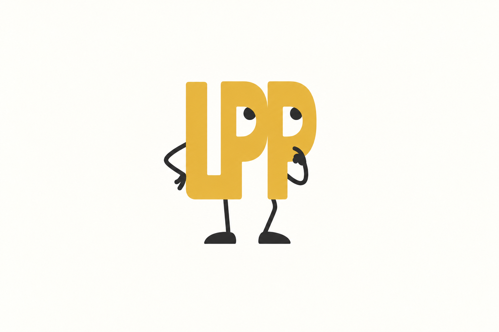
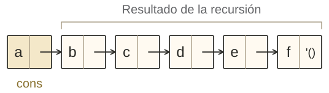
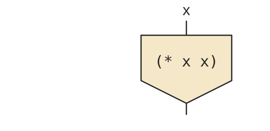
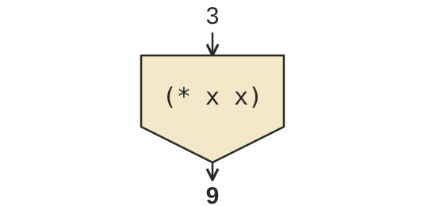
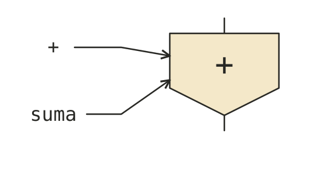
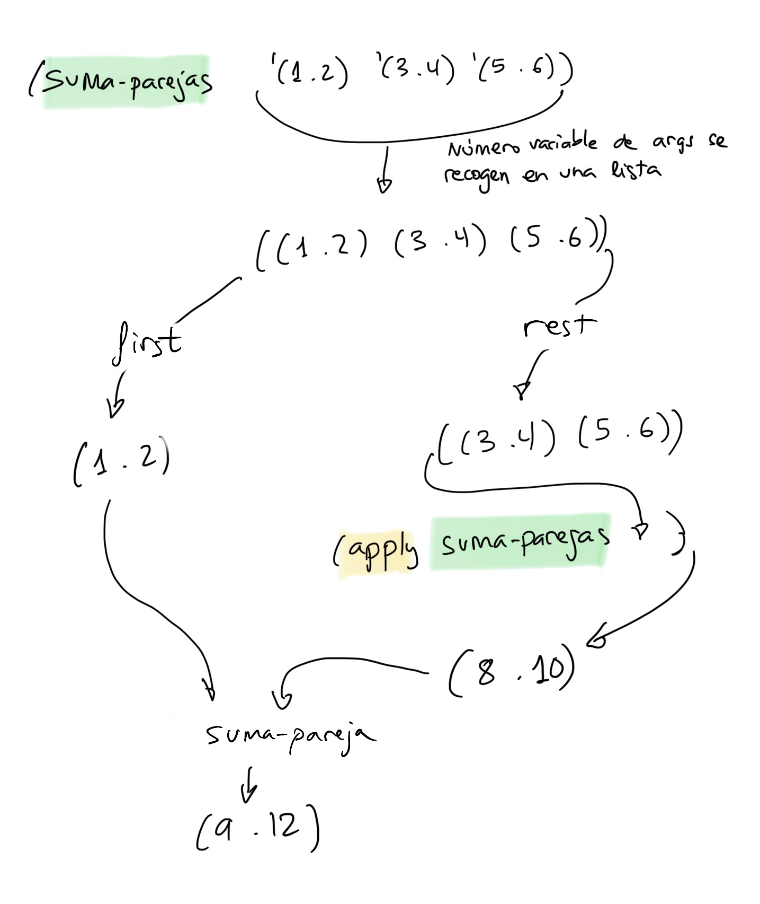

<!-- _class: cover institutional-cover -->
<!-- _paginate: false -->
<!-- _footer: "" -->
<div class="system-week">Semana 3</div>

# Construcción de listas<br>y funciones como valores

<div class="system-topics">Recursión y argumentos variables<br>lambda y apply</div>
<div class="system-author">Cristina Pomares Puig</div>
<div class="institutional-logos">


</div>
<div class="mascot-figure cover-mascot wizard"></div>

<!-- Fuente: notas-clase/semana03/semana03.md. Diseño: semana 1, tema lpp-light. -->

---
## Veremos hoy

<p class="agenda-topic">Tema 2 · Programación funcional · Parte 3</p>
<ol class="topic-agenda">
<li><strong>Funciones recursivas para construir listas</strong><span>mi-append, mi-reverse, lista-desde, filtros y primo?</span></li>
<li><strong>Funciones con número variable de argumentos</strong><span>Notación de punto y recogida de argumentos en una lista</span></li>
<li><strong>Funciones como datos de primera clase</strong><span>lambda, funciones como argumentos y apply</span></li>
</ol>

<!--
Fuente: notas-clase/semana03/semana03.md, Veremos hoy.
-->

---
<!-- _class: section topic-opening -->

<div class="mascot-figure section-mascot wizard"></div>
<div class="eyebrow">Tema 2 · Parte 3</div>

# Construir listas con recursión

<p class="lead">Elegir el problema más pequeño y reconstruir la lista a partir de su resultado.</p>

---
## Recordatorio: diseño recursivo

<div class="columns equal">
<div>

### Formular el caso general

1. Partir de un **ejemplo concreto**.
2. Llamar a la recursión con una versión más pequeña del problema.
3. Usar su resultado para completar la solución.

</div>
<div>

### Buscar el caso base

¿Cuál es el caso más sencillo que podemos resolver sin una llamada recursiva?

</div>
</div>

<div class="mascot-reminder"><div class="mascot-figure thinking"></div><p><strong>Confía en la recursión.</strong> Para diseñar la función, supone que la llamada con el problema más pequeño devuelve el resultado que debe.</p></div>

<!--
Fuente: notas-clase/semana03/semana03.md, Recordatorio: diseño de funciones recursivas.
-->

---
## Objetivo de `mi-append`

Queremos implementar de forma recursiva la función `append`: construir una lista con los elementos de la primera, seguidos por los de la segunda.

```racket
(mi-append '(a b c) '(d e f)) ; ⇒ (a b c d e f)
```

<div class="columns equal">
<div>

### Primera lista

`(a b c)`

</div>
<div>

### Segunda lista

`(d e f)`

</div>
</div>

<div class="mascot-reminder mascot-question"><div class="mascot-figure asking"></div><p><strong>Pregunta:</strong> ¿con qué listas llamarías a la recursión? ¿Qué harías después con el resultado que devuelve?</p></div>

<!--
Fuente: notas-clase/semana03/semana03.md, Función mi-append, objetivo y formulación del caso general.
-->

---
## Elegir la llamada recursiva

Queremos obtener `(a b c d e f)`. Probamos dos formas de reducir el problema:

<div class="columns equal">
<div>

### Reducir las dos listas

```racket
(mi-append '(b c) '(e f))
; ⇒ (b c e f)
```

Faltan `a` y `d`. No basta con añadirlos al principio o al final.

</div>
<div>

### Reducir solo la segunda

```racket
(mi-append '(a b c) '(e f))
; ⇒ (a b c e f)
```

Falta `d`, pero hay que introducirlo entre `c` y `e`.

</div>
</div>

<div class="mascot-reminder"><div class="mascot-figure thinking"></div><p>No basta con que la llamada sea más sencilla: <strong>también debemos poder reconstruir fácilmente la solución</strong> a partir del resultado.</p></div>

<!--
Fuente: notas-clase/semana03/semana03.md, Función mi-append, los dos intentos de llamada recursiva que no permiten completar fácilmente el resultado.
-->

---
<!-- _class: append-pointers -->

## La llamada recursiva de `mi-append`

<div class="columns equal">
<div>

### Reducir solo la primera lista

```racket
(mi-append '(b c) '(d e f))
; ⇒ (b c d e f)
```

Ahora solo falta añadir `a` a la cabeza.



</div>
<div>

### Completar el resultado

```racket
(cons 'a '(b c d e f))
; ⇒ (a b c d e f)
```

En general:

```racket
(cons (first lista1)
      (mi-append (rest lista1) lista2))
```

</div>
</div>

<p class="checkpoint"><strong>Caso base:</strong> si la primera lista está vacía, devolvemos la segunda.</p>

<!--
Fuente: notas-clase/semana03/semana03.md, Función mi-append, llamada correcta y caso base.
-->

---
<!-- _class: lesson-code week03-code recursive-call-check -->

## Definición de `mi-append`

```racket
(define (mi-append l1 l2)
  (if (null? l1)
      l2
      (cons (first l1)
            (mi-append (rest l1) l2))))
```

<div class="columns equal">
<div>

### Caso base

```racket
(mi-append '() '(a b c))
; ⇒ (a b c)
```

</div>
<div>

### Caso general

Reducimos `l1`, mantenemos `l2` y añadimos el primer elemento con `cons`.

</div>
</div>

<div class="mascot-reminder mascot-question"><div class="mascot-figure asking"></div><p>En <code>(mi-append '(a b c) '(d e f))</code>, <strong>¿qué devuelve la primera llamada recursiva?</strong></p></div>

<!--
Respuesta de la pregunta: (b c d e f). Después se añade a con cons.
Fuente: notas-clase/semana03/semana03.md, Definición de `mi-append`.
-->

---
## Invertir una lista

```racket
(mi-reverse '(1 2 3 4 5 6)) ; ⇒ (6 5 4 3 2 1)
```

<div class="columns equal">
<div>

### Confiamos en la recursión

La inversa del resto `(2 3 4 5 6)` será:

`(6 5 4 3 2)`.

Solo falta añadir `1` **al final**.

</div>
<div>

### Función auxiliar

```racket
(añade-al-final 1 '(6 5 4 3 2))
; ⇒ (6 5 4 3 2 1)
```

<div class="mascot-reminder mascot-question"><div class="mascot-figure asking"></div><p><strong>Ejercicio:</strong> define <code>(añade-al-final dato lista)</code>.</p></div>

</div>
</div>

<!--
Fuente: notas-clase/semana03/semana03.md, Función mi-reverse, idea recursiva y añade-al-final.
-->

---
<!-- _class: lesson-code week03-code reverse-with-helper -->

## Definición de `mi-reverse`

<div class="columns equal">
<div>

```racket
(define (mi-reverse lista)
  (if (null? lista)
      '()
      (añade-al-final
        (first lista)
        (mi-reverse (rest lista)))))
```

</div>
<div>

### Función auxiliar

```racket
(define (añade-al-final dato lista)
  (append lista (list dato)))
```

**Caso base:** la inversa de la lista vacía es la lista vacía.

**Caso general:** invertimos el resto y añadimos el primer elemento al final del resultado.

</div>
</div>

<div class="mascot-reminder"><div class="mascot-figure pointing"></div><p>Aquí <strong>no sirve añadir el primero con <code>cons</code></strong>: lo colocaría a la cabeza, cuando lo necesitamos al final.</p></div>

<!--
Fuente: notas-clase/semana03/semana03.md, Función mi-reverse, definición completa.
Mostrar la solución de añade-al-final después del ejercicio de la diapositiva anterior.
-->

---
## Construir una lista desde un número

<div class="columns equal">
<div>

```racket
(define (lista-desde x)
  (if (= x 1)
      '(1)
      (cons x
            (lista-desde (- x 1)))))
```

</div>
<div>

### Ejemplo concreto

```racket
(lista-desde 5)
; ⇒ (5 4 3 2 1)
```

La recursión construye `(4 3 2 1)`; añadimos `5` a la cabeza.

</div>
</div>

<div class="mascot-reminder"><div class="mascot-figure thinking"></div><p>El caso base es <code>x = 1</code> y devuelve <code>'(1)</code>. En el caso general, <strong>construimos la lista desde <code>x - 1</code> y añadimos <code>x</code></strong>.</p></div>

<!--
Fuente: notas-clase/semana03/semana03.md, Función lista-desde. Dominio: enteros positivos, como en las notas.
-->

---
<!-- _class: lesson-code week03-code -->

## Filtrar los números pares

```racket
(define (filtra-pares lista)
  (cond
    ((null? lista) '())
    ((even? (first lista))
     (cons (first lista) (filtra-pares (rest lista))))
    (else (filtra-pares (rest lista)))))
```

```racket
(filtra-pares '(1 2 3 4 5 6)) ; ⇒ (2 4 6)
```

<div class="mascot-reminder"><div class="mascot-figure pointing"></div><p>La recursión filtra el resto. Si el primer número es par, <strong>lo conservamos con <code>cons</code></strong>; si no, devolvemos directamente el resultado de la recursión.</p></div>

<!--
Fuente: notas-clase/semana03/semana03.md, Filtrar los números pares.
-->

---
<!-- _class: prime-overview -->

## Ejemplo: comprobar si un número es primo

Un número primo tiene exactamente **dos divisores**: `1` y él mismo.

<div class="columns equal">
<div>

### Componer funciones

```racket
(define (divisores x)
  (filtra-divisores (lista-desde x) x))

(define (primo? x)
  (= 2 (length (divisores x))))
```

<code>lista-desde</code> construye los candidatos y <code>filtra-divisores</code> conserva los divisores.

</div>
<div>

### Ejemplos

```racket
(divisores 8)  ; ⇒ (8 4 2 1)
(primo? 8)    ; ⇒ #f

(divisores 11) ; ⇒ (11 1)
(primo? 11)    ; ⇒ #t
```

Comprobamos si la longitud de la lista de divisores es <code>2</code>.

</div>
</div>

<div class="mascot-reminder"><div class="mascot-figure thinking"></div><p>Reutilizamos lo que ya sabemos: <strong>construir una lista, filtrarla y comprobar su longitud</strong>.</p></div>

<!--
Fuente: notas-clase/semana03/semana03.md, Ejemplo final primo? y funciones auxiliares.
Ver este ejemplo brevemente, como aplicación de construcción, filtrado y composición.
Las funciones auxiliares siguen el esquema de filtra-pares y están en las notas de clase:

(define (divisor? x y)
  (= 0 (remainder y x)))

(define (filtra-divisores lista x)
  (cond
    ((null? lista) '())
    ((divisor? (first lista) x)
     (cons (first lista)
           (filtra-divisores (rest lista) x)))
    (else (filtra-divisores (rest lista) x))))

Dominio: enteros positivos. lista-desde genera candidatos en orden descendente.
No desarrollar de nuevo el diseño recursivo completo ni hacer trazas.
-->

---
<!-- _class: section topic-opening -->

<div class="mascot-figure section-mascot wizard"></div>
<div class="eyebrow">Tema 2 · Parte 3</div>

# Número variable de argumentos

<p class="lead">Los argumentos restantes se recogen en una lista.</p>

---
<!-- _class: lesson-code week03-code -->

## Notación de punto

```text
(define (funcion-dos-o-mas-args x y . lista-args)
  <cuerpo>)
```

```racket
(funcion-dos-o-mas-args 1 2 3 4 5 6)
```

<div class="argument-bindings">
<div><code>x</code><span>1</span></div>
<div><code>y</code><span>2</span></div>
<div><code>lista-args</code><span>(3 4 5 6)</span></div>
</div>

<div class="mascot-reminder"><div class="mascot-figure pointing"></div><p>Los parámetros anteriores al punto son obligatorios. <strong>Los argumentos restantes se recogen en una lista</strong>, aunque no quede ninguno.</p></div>

<!--
Fuente: notas-clase/semana03/semana03.md, Funciones con número variable de argumentos, notación de punto y ejemplo de llamada.
-->

---
<!-- _class: lesson-code week03-code -->

## Todos los argumentos en una lista

```text
(define (funcion-cualquier-numero-args . lista-args)
  <cuerpo>)
```

No hay parámetros obligatorios: podemos pasar **cero o más argumentos**.

<div class="variable-calls">
<div><code>(funcion-cualquier-numero-args)</code><span>lista-args = <code>'()</code></span></div>
<div><code>(funcion-cualquier-numero-args 1)</code><span>lista-args = <code>'(1)</code></span></div>
<div><code>(funcion-cualquier-numero-args 1 2 3)</code><span>lista-args = <code>'(1 2 3)</code></span></div>
</div>

<!--
Fuente: notas-clase/semana03/semana03.md, Todos los argumentos en una lista.
-->

---
<!-- _class: lesson-code week03-code variable-sum-example -->

## Ejemplo: `mi-suma`

```racket
(define (mi-suma x y . lista-nums)
  (if (null? lista-nums)
      (+ x y)
      (+ x (+ y (suma-lista lista-nums)))))
```

<div class="columns equal">
<div>

### Solo los obligatorios

```racket
(mi-suma 2 3) ; ⇒ 5
```

`lista-nums` es la lista vacía.

</div>
<div>

### Con argumentos adicionales

```racket
(mi-suma 1 2 3 4) ; ⇒ 10
```

`lista-nums` vale `(3 4)`.

</div>
</div>

<div class="mascot-reminder mascot-question"><div class="mascot-figure asking"></div><p><strong>Pregunta:</strong> ¿pueden ser recursivas las funciones con número variable de argumentos? Lo retomaremos con <code>apply</code>.</p></div>

<!--
Fuente: notas-clase/semana03/semana03.md, Funciones con número variable de argumentos, mi-suma. Requiere suma-lista, de la semana 2.
-->

---
<!-- _class: section topic-opening -->

<div class="mascot-figure section-mascot wizard"></div>
<div class="eyebrow">Tema 2 · Parte 3</div>

# Funciones de primera clase

<p class="lead">Las funciones también pueden asignarse, pasarse, devolverse y guardarse en estructuras de datos.</p>

---
## Funciones como tipos de datos de primera clase

Una función puede:

1. **Asignarse a una variable.**
2. **Pasarse como argumento** de otra función.
3. **Devolverse como resultado** de una función.
4. **Guardarse en una estructura de datos**, como una lista.

<div class="mascot-reminder"><div class="mascot-figure thinking"></div><p>Una función es <strong>un valor con el que podemos trabajar</strong>, igual que hacíamos con números, cadenas o parejas.</p></div>

<!--
Fuente: notas-clase/semana03/semana03.md, Funciones como tipos de datos de primera clase.
-->

---
## Forma especial `lambda`

<div class="columns equal">
<div>

### Datos sin darles nombre

```racket
(string-append "hola" "adiós")
```

Las dos cadenas se crean directamente y se pasan como argumentos.

</div>
<div>

### Funciones sin darles nombre

```text
(lambda (<arg1> ... <argn>)
  <cuerpo>)
```

`lambda` construye una **función anónima en tiempo de ejecución**.

</div>
</div>

<div class="mascot-reminder"><div class="mascot-figure wizard"></div><p>Los parámetros y el cuerpo describen la función. <strong>Crear la función no ejecuta su cuerpo</strong> con argumentos concretos.</p></div>

<!--
Fuente: notas-clase/semana03/semana03.md, Forma especial lambda y sintaxis. Se recupera la analogía con las cadenas anónimas.
-->

---
## Funciones anónimas

<div class="columns equal">
<div>

### Sumar dos parejas

```racket
(lambda (p1 p2)
  (cons (+ (car p1) (car p2))
        (+ (cdr p1) (cdr p2))))
```

Recibe dos parejas y construye otra con la suma de cada componente.

</div>
<div>

### Obtener el mayor

```racket
(lambda (a b)
  (if (> a b)
      a
      b))
```

Recibe dos números y devuelve el mayor.

</div>
</div>

<p class="concept-note">Cada expresión <code>lambda</code> produce una función, sin asociarla todavía a un nombre.</p>

<!--
Fuente: notas-clase/semana03/semana03.md, Funciones anónimas.
-->

---
## Crear, nombrar e invocar una función

<div class="procedure-stages">
<div><h3>Crear</h3><pre><code>(lambda (x) (* x x))
; ⇒ #&lt;procedure&gt;</code></pre><p>Se construye una función.</p></div>
<div><h3>Dar un nombre</h3><pre><code>(define f
  (lambda (x) (* x x)))</code></pre><p><code>f</code> queda asociado al procedimiento.</p></div>
<div><h3>Invocar</h3><pre><code>(f 3)
; ⇒ 9</code></pre><p>Ahora se calcula el cuadrado.</p></div>
</div>

```racket
f ; ⇒ #<procedure:f>
```

<div class="mascot-reminder"><div class="mascot-figure wizard"></div><p>Escribir <code>f</code> devuelve <strong>el procedimiento</strong>. Escribir <code>(f 3)</code> lo invoca y devuelve <strong>el resultado</strong>.</p></div>

<!--
Fuente: notas-clase/semana03/semana03.md, Semántica de lambda y asignar el procedimiento a un identificador.
-->

---
<!-- _class: function-as-value -->

## Semántica de la forma especial `lambda`

<div class="columns equal">
<div>

### Crear la función

```racket
(lambda (x) (* x x))
```

<div class="function-creation-scene">

<div class="mascot-figure creating"></div>
</div>

</div>
<div>

### Invocar la función

```racket
((lambda (x) (* x x)) 3)
```



</div>
</div>

<p class="concept-note"><code>lambda</code> <strong>construye la función</strong>. Al invocarla con <code>3</code>, se evalúa <code>(* 3 3)</code> y se obtiene <code>9</code>.</p>

<!--
Fuente: notas-clase/semana03/semana03.md, Semántica de lambda e invocación directa; imagen funcion-cuadrado.png.
Se usa el mismo dibujo conceptual de función como máquina, redibujado con el diseño de las transparencias.
La mascota con varita representa la creación de la función por lambda. No es un dibujo de su representación en memoria.
A la izquierda se representa el parámetro x; todavía no se ha pasado ningún argumento.
A la derecha se muestra la invocación con el argumento 3 y su resultado 9.
-->

---
## Invocación directa de una función anónima

```racket
((lambda (x) (* x x)) 3) ; ⇒ 9
```

<div class="columns equal">
<div>

### Crear el procedimiento

```racket
(lambda (x) (* x x))
```

La expresión `lambda` ocupa la posición de función de la llamada exterior.

</div>
<div>

### Aplicarlo al argumento

El argumento es `3`. El cuerpo se evalúa con ese valor:

```racket
(* 3 3) ; ⇒ 9
```

</div>
</div>

<div class="mascot-reminder"><div class="mascot-figure pointing"></div><p>Los <strong>paréntesis exteriores invocan</strong> el procedimiento creado por <code>lambda</code> con el argumento <code>3</code>.</p></div>

<!--
Fuente: notas-clase/semana03/semana03.md, Podemos invocar a la función anónima directamente.
-->

---
## Expresiones lambda en otros lenguajes

<div class="columns equal lambda-languages">
<div>

### Java

```java
(Integer x) -> x * x
```

### Scala

```scala
(x: Int) => x * x
```

</div>
<div>

### Objective-C

```objective-c
^int (int x) {
    return x * x;
}
```

### Swift

```swift
{ (x: Int) -> Int in return x * x }
```

</div>
</div>

<p class="concept-note">La sintaxis cambia, pero en todos los ejemplos se construye una función anónima que calcula el cuadrado de su argumento.</p>

<!--
Fuente: notas-clase/semana03/semana03.md, Expresiones lambda en distintos lenguajes. Se ajustan las erratas sintácticas de Java y Objective-C; son fragmentos de expresiones, no programas completos.
-->

---
## Identificadores y funciones

<div class="columns equal function-alias">
<div>

```racket
+ ; ⇒ #<procedure:+>

(define suma +)

(suma 1 2 3 4) ; ⇒ 10
```

</div>
<div>



</div>
</div>

<div class="mascot-reminder"><div class="mascot-figure pointing"></div><p><code>suma</code> y <code>+</code> quedan asociados <strong>al mismo procedimiento</strong>. No hemos creado una nueva función ni la hemos invocado al definir <code>suma</code>.</p></div>

<!--
Fuente: notas-clase/semana03/semana03.md, Identificadores y funciones. Esquema adaptado al estilo de las máquinas de funciones de estas transparencias.
-->

---
## `define` y azúcar sintáctico

<div class="columns equal">
<div>

### Definición habitual

```racket
(define (cuadrado x)
  (* x x))
```

</div>
<div>

### Con `lambda`

```racket
(define cuadrado
  (lambda (x)
    (* x x)))
```

</div>
</div>

Las dos definiciones expresan lo mismo: crear el procedimiento y asociarlo al nombre `cuadrado`.

<div class="mascot-reminder"><div class="mascot-figure thinking"></div><p><strong>Azúcar sintáctico:</strong> una forma de escribir más cómoda que se transforma internamente en otra. Aquí, la definición de función se convierte en <code>lambda</code> y una asociación de nombre.</p></div>

<!--
Fuente: notas-clase/semana03/semana03.md, `define` y azúcar sintáctico.
-->

---
## Predicado `procedure?`

<div class="columns equal">
<div>

### ¿Es una función?

```racket
(procedure? (lambda (x) (* x x)))
; ⇒ #t

(define suma +)
(procedure? suma) ; ⇒ #t
```

</div>
<div>

### ¿Y si usamos `quote`?

```racket
(procedure? '+) ; ⇒ #f
(symbol? '+)    ; ⇒ #t
```

`'+` es un símbolo: el identificador no se evalúa.

</div>
</div>

<div class="mascot-reminder"><div class="mascot-figure pointing"></div><p><code>+</code> se evalúa al <strong>procedimiento</strong>. <code>'+</code> produce el <strong>símbolo</strong> que escribe su nombre.</p></div>

<!--
Fuente: notas-clase/semana03/semana03.md, Predicado `procedure?`.
-->

---
## Funciones como tipos de datos de primera clase

Una función es un dato de primera clase porque puede:

<div class="first-class-properties">
<div><b>1</b><strong>Asignarse a una variable</strong><span>Ya lo hemos visto</span></div>
<div class="current-property"><b>2</b><strong>Pasarse como argumento de otra función</strong><span>Lo veremos ahora</span></div>
<div><b>3</b><strong>Devolverse como resultado de una función</strong><span>Siguiente parte</span></div>
<div><b>4</b><strong>Guardarse en un dato compuesto, como una lista</strong><span>Siguiente parte</span></div>
</div>

<div class="mascot-reminder"><div class="mascot-figure thinking"></div><p>Ya hemos asociado funciones a nombres con <code>define</code>. Ahora vamos a comprobar que <strong>también podemos pasarlas como argumentos</strong>.</p></div>

<!--
Fuente: notas-clase/semana03/semana03.md, Funciones como tipos de datos de primera clase y Funciones argumentos de otras funciones.
Retomar explícitamente las cuatro propiedades después de lambda y antes de aplica.
Las funciones que devuelven funciones y las funciones en estructuras de datos se desarrollan en la semana 4.
-->

---
## Función `aplica`

<div class="columns equal">
<div>

### Recibir una función

```racket
(define (aplica f x y)
  (f x y))
```

`f` recibe la función; `x` e `y`, los datos con los que la llamamos.

</div>
<div>

### Usar distintas operaciones

```racket
(aplica + 2 3) ; ⇒ 5
(aplica * 4 5) ; ⇒ 20
```

El cuerpo de `aplica` es el mismo. Cambia la función recibida.

</div>
</div>

<div class="mascot-reminder"><div class="mascot-figure thinking"></div><p>Una función puede ocupar <strong>la posición de argumento</strong> al llamar a <code>aplica</code> y después <strong>la posición de función</strong> en <code>(f x y)</code>.</p></div>

<!--
Fuente: notas-clase/semana03/semana03.md, Función aplica y ejemplos. Se conserva la corrección del producto 4 por 5, que da 20.
-->

---
## Pasar distintas funciones a `aplica`

<div class="columns equal">
<div>

### Concatenar directamente

```racket
(aplica string-append
        "hola" "adios")
; ⇒ "holaadios"
```

</div>
<div>

### Concatenar con un guion

```racket
(define (string-append-con-guion s1 s2)
  (string-append s1 "-" s2))

(aplica string-append-con-guion
        "hola" "adios")
; ⇒ "hola-adios"
```

</div>
</div>

<p class="concept-note">Pasamos una función ya existente o una definida por nosotros. En ambos casos, <code>aplica</code> la invoca con los dos datos recibidos.</p>

<!--
Fuente: notas-clase/semana03/semana03.md, Función aplica, ejemplos con cadenas.
-->

---
<!-- _class: lesson-code week03-code -->

## Pasar una expresión lambda

```racket
(aplica (lambda (x y)
          (sqrt (+ (* x x) (* y y))))
        3 4)
; ⇒ 5
```

<div class="columns equal">
<div>

### Primer argumento

La función anónima que calcula la raíz de la suma de cuadrados.

</div>
<div>

### Datos para la función

`3` y `4`, que se asocian a los parámetros `x` e `y`.

</div>
</div>

<div class="mascot-reminder"><div class="mascot-figure wizard"></div><p>No hace falta darle un nombre: <strong>creamos la función con <code>lambda</code> y la pasamos directamente</strong> como argumento a <code>aplica</code>.</p></div>

<!--
Fuente: notas-clase/semana03/semana03.md, Pasar una expresión lambda.
-->

---
## Composición con `aplica-2`

<div class="columns equal">
<div>

```racket
(define (aplica-2 f g x)
  (f (g x)))
```

Recibe **dos funciones** y **un dato**.

</div>
<div>

### Orden de aplicación

1. Aplicar `g` a `x`.
2. Pasar el resultado como argumento de `f`.
3. Devolver el resultado de `f`.

</div>
</div>

<div class="composition-path"><code>x</code><span>→ g →</span><code>(g x)</code><span>→ f →</span><code>(f (g x))</code></div>

<!--
Fuente: notas-clase/semana03/semana03.md, Composición con `aplica-2`.
-->

---
## Ejemplos de composición

<div class="columns equal">
<div>

### Funciones con nombre

```racket
(define (suma-5 x) (+ x 5))
(define (doble x) (+ x x))

(aplica-2 suma-5 doble 3)
; ⇒ 11
```

Primero `doble`: `3 → 6`.
Después `suma-5`: `6 → 11`.

</div>
<div>

### Funciones anónimas

```racket
(aplica-2 (lambda (x) (* x 2))
          (lambda (x) (+ x 5))
          10)
; ⇒ 30
```

Primero sumar `5`: `10 → 15`.
Después multiplicar por `2`: `15 → 30`.

</div>
</div>

<div class="mascot-reminder mascot-question"><div class="mascot-figure asking"></div><p><strong>Pregunta:</strong> ¿qué devuelve <code>(aplica-2 doble suma-5 3)</code>? ¿Por qué cambia el resultado?</p></div>

<!--
Fuente: notas-clase/semana03/semana03.md, Función aplica-2, ejemplos. Respuesta de la pregunta: 16.
-->

---
<!-- _class: apply-example -->

## Función `apply`

`apply` recibe una función y una lista. Pasa **cada elemento de la lista como un argumento**, en el mismo orden.

<div class="columns equal">
<div>

### Con una función existente

```racket
(apply + '(1 2 3 4)) ; ⇒ 10
```

Equivale a:

```racket
(+ 1 2 3 4) ; ⇒ 10
```

</div>
<div>

### Con una expresión `lambda`

```racket
(apply (lambda (x y)
         (+ x (* 2 y)))
       '(2 5))
; ⇒ 12
```

`x` recibe `2`; `y`, `5`.

</div>
</div>

<div class="mascot-reminder"><div class="mascot-figure pointing"></div><p>La función no recibe la lista como un único argumento: <strong><code>apply</code> reparte sus elementos entre los parámetros</strong>.</p></div>

<!--
Fuente: notas-clase/semana03/semana03.md, Función `apply`.
-->

---
## La aridad debe coincidir

<div class="columns equal">
<div>

### Tres datos para `cons`

```racket
(apply cons '(a b c))
```

```text
cons: arity mismatch;
  expected: 2
  given: 3
```

</div>
<div>

### Dos datos para `cons`

```racket
(apply cons '(a b)) ; ⇒ (a . b)
```

Equivale a:

```racket
(cons 'a 'b) ; ⇒ (a . b)
```

</div>
</div>

<div class="mascot-reminder"><div class="mascot-figure thinking"></div><p><code>cons</code> necesita <strong>exactamente dos argumentos</strong>. El número de elementos de la lista debe ser compatible con los argumentos que acepta la función.</p></div>

<!--
Fuente: notas-clase/semana03/semana03.md, Función apply, error de aridad. Mensaje de error abreviado, sin cambiar los datos de esperado y recibido.
-->

---
## Sumar un número variable de parejas

```racket
(suma-parejas '(1 . 2) '(3 . 4) '(5 . 6)) ; ⇒ (9 . 12)
```

<div class="columns equal">
<div>

### Ya sabemos sumar dos parejas

```racket
(define (suma-pareja p1 p2)
  (cons (+ (car p1) (car p2))
        (+ (cdr p1) (cdr p2))))
```

</div>
<div>

### Ahora queremos admitir cualquier número

Los argumentos se recogen en la lista `parejas`.

Si no hay parejas, devolveremos `(0 . 0)`.

</div>
</div>

<div class="mascot-reminder mascot-question"><div class="mascot-figure asking"></div><p><strong>Pregunta:</strong> ¿qué devuelve la primera llamada recursiva? ¿Cómo usarías <code>first</code>, <code>rest</code> y <code>apply</code> para formular el caso general?</p></div>

<!--
Fuente: notas-clase/semana03/semana03.md, Función apply y funciones recursivas, objetivo de suma-parejas y función auxiliar.
Respuesta sobre la llamada recursiva: suma (3 . 4) y (5 . 6), y devuelve (8 . 10).
-->

---
<!-- _class: lesson-code week03-code recursive-apply-example -->

## Recursión con argumentos variables

```racket
(define (suma-parejas . parejas)
  (if (null? parejas)
      '(0 . 0)
      (suma-pareja
        (first parejas)
        (apply suma-parejas (rest parejas)))))
```

```racket
(apply suma-parejas '((3 . 4) (5 . 6)))
; ⇒ (8 . 10)
```

<div class="mascot-reminder"><div class="mascot-figure pointing"></div><p><code>rest</code> devuelve una lista. <strong><code>apply</code> convierte sus elementos en los argumentos de la llamada recursiva</strong>, que suma todas esas parejas.</p></div>

<!--
Fuente: notas-clase/semana03/semana03.md, Función apply y funciones recursivas, solución.
-->

---
<!-- _class: pair-sum-design -->

## Cómo se combina el resultado

<div class="columns equal recursive-pairs-example">
<div>



</div>
<div>

### Confiamos en la recursión

```racket
(apply suma-parejas
       '((3 . 4) (5 . 6)))
; ⇒ (8 . 10)
```

### Completamos el resultado

```racket
(suma-pareja '(1 . 2) '(8 . 10))
; ⇒ (9 . 12)
```

La pareja `(1 . 2)` se combina con la suma de las parejas restantes.

</div>
</div>

<!--
Fuente: notas-clase/semana03/semana03.md, Función apply y funciones recursivas, representación gráfica original.
-->
