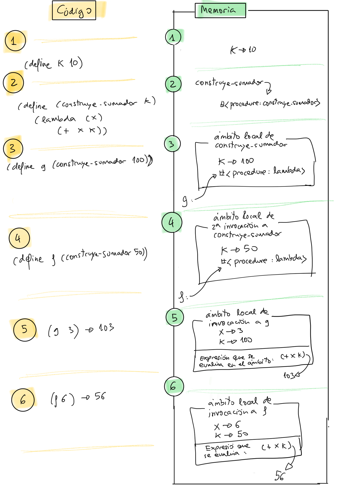

<!-- _class: cover institutional-cover -->
<!-- _paginate: false -->
<!-- _footer: "" -->
<div class="system-week">Semana 4</div>

# Clausuras y funciones<br>de orden superior

<div class="system-topics">Funciones que devuelven funciones<br>map, filter y plegados</div>
<div class="system-author">Cristina Pomares Puig</div>
<div class="institutional-logos">


</div>
<div class="mascot-figure cover-mascot wizard"></div>

<!-- Fuente: notas-clase/semana04/semana04.md. Diseño: semana 1, tema lpp-light. -->

---

## Veremos hoy

1. Generalizar con parámetros de tipo función.
2. Funciones que devuelven funciones: clausuras.
3. Funciones en estructuras de datos.
4. Funciones de orden superior.
5. Composición de operaciones sobre listas.

<!--
Marcas institucionales: https://imagenycomunicacion.ua.es/es/identidad-visual-corporativa-y-logotipos-ua.html
Logo DCCIA: https://web.ua.es/es/dccia/imagenes/gestadm/logotipos/logodccia.jpg
-->

<!--
Fuente: Veremos hoy. Notas de clase de la semana 4.

-->

---

<!-- _class: section topic-opening -->

<div class="mascot-figure section-mascot wizard"></div>
<div class="eyebrow">Semana 4</div>

# Generalizar una solución

<p class="lead">Separar el recorrido recursivo de la operación aplicada a cada dato.</p>

---

<!-- _class: lesson-code -->

## Sumatorio de un intervalo

```racket
(define (sum-x a b)
    (if (> a b)
        0
        (+ a (sum-x (+ a 1) b))))
(sum-x 1 10) ; ⇒ 55
```

El recorrido avanza desde `a` hasta `b`. Cuando `a > b`, el resultado es `0`.

<!--
Fuente: ejemplo del bloque de código que comienza en la línea 36. Notas de clase de la semana 4.

-->

---

<!-- _class: lesson-code -->

## La misma recursión, distinto término

```racket
(define (sum-cuadrado-x a b)
    (if (> a b)
        0
        (+ (* a a) (sum-cuadrado-x (+ a 1) b))))
(sum-cuadrado-x 1 10) ; ⇒ 385
```

<!--
Fuente: La misma recursión, distinto término. Notas de clase de la semana 4.
Respuesta: la transformación de a. La estructura de la recursión se conserva.
-->

---

<!-- _class: lesson-code -->

## La misma recursión, distinto término (continuación)

```racket
(define (sum-cubo-x a b)
    (if (> a b)
        0
        (+ (* a a a) (sum-cubo-x (+ a 1) b))))
(sum-cubo-x 1 10) ; ⇒ 3025
```

¿Qué parte cambia entre las dos definiciones?

<!--
Fuente: La misma recursión, distinto término. Notas de clase de la semana 4.
Respuesta: la transformación de a. La estructura de la recursión se conserva.
-->

---

<!-- _class: lesson-code -->

## Función general `sum-f-x`

```racket
(define (sum-f-x f a b)
    (if (> a b)
        0
        (+ (f a) (sum-f-x f (+ a 1) b))))
```

El parámetro `f` representa la operación que antes estaba escrita dentro de cada función.

<!--
Fuente: ejemplo del bloque de código que comienza en la línea 84. Notas de clase de la semana 4.

-->

---

<!-- _class: lesson-code -->

## Dos usos de la generalización

```racket
(define (cubo x)
    (* x x x))
(sum-f-x cubo 1 10) ; ⇒ 3025
```

<!--
Fuente: Dos usos de la generalización. Notas de clase de la semana 4.

-->

---

<!-- _class: lesson-code -->

## Dos usos de la generalización (continuación)

```racket
(sum-f-x (lambda (n) (/ n (- n 1))) 2 100)
```

Podemos pasar una función con nombre o crearla con una expresión `lambda`.

<!--
Fuente: Dos usos de la generalización. Notas de clase de la semana 4.

-->

---

<!-- _class: section topic-opening -->

<div class="mascot-figure section-mascot wizard"></div>
<div class="eyebrow">Semana 4</div>

# Funciones que devuelven funciones

<p class="lead">La función devuelta conserva acceso al ámbito en el que se creó.</p>

---

<!-- _class: lesson-code -->

## Función `construye-sumador`

```racket
(define (construye-sumador k)
   (lambda (x)
       (+ x k)))
```

Al invocarla, devuelve una función que suma `k` a su argumento.

<!--
Fuente: ejemplo del bloque de código que comienza en la línea 130. Notas de clase de la semana 4.

-->

---

## Construir e invocar la función

<div class="columns equal">
<div>

```racket
(construye-sumador 10) ; ⇒ #<procedure>
```

```racket
(define f (construye-sumador 10))
(f 3) ; ⇒ 13
```

</div>
<div>

```racket
((construye-sumador 10) 3) ; ⇒ 13
```

```racket
(define g (construye-sumador 100))
(g 3) ; ⇒ 103
```

</div>
</div>

Crear la función y llamarla son dos operaciones diferentes.

<!--
Fuente: Construir e invocar la función. Notas de clase de la semana 4.

-->

---

<!-- _class: lesson-code -->

## ¿Qué valor de `k` se utiliza?

```racket
(define k 10)
(define (construye-sumador k)
   (lambda (x)
       (+ x k)))
(define g (construye-sumador 100))
(define f (construye-sumador 50))
(g 3) ; ⇒ ???
(f 6) ; ⇒ ???
```

Predice los valores de `(g 3)` y `(f 6)`.

<!--
Fuente: ejemplo del bloque de código que comienza en la línea 168. Notas de clase de la semana 4.
Respuestas: 103 y 56. Cada clausura usa el k de su propia invocación constructora, no el k global.
-->

---

## La clausura captura su ámbito

1. `construye-sumador` recibe un valor concreto de `k`.
2. `lambda` crea una función en ese ámbito local.
3. La función captura el ámbito al que pertenece `k`.
4. Una llamada posterior utiliza ese `k` y su nuevo argumento `x`.

<!--
Fuente: La clausura captura su ámbito. Notas de clase de la semana 4.
Explicar ámbito léxico; evitar describir la captura como búsqueda en el ámbito desde el que se llama.
-->

---

<!-- _class: lesson-figure -->

## Ámbitos de las clausuras



<!--
Fuente: Ejemplo de construye-sumador. Notas de clase de la semana 4.
Identificar el ámbito de definición y el ámbito capturado por cada procedimiento.
-->

---

<!-- _class: section topic-opening -->

<div class="mascot-figure section-mascot wizard"></div>
<div class="eyebrow">Semana 4</div>

# Funciones en listas

<p class="lead">Recuperar una función de una estructura de datos y después invocarla.</p>

---

<!-- _class: lesson-code -->

## Construcción de una lista de funciones

```racket
(define (doble x) (+ x x))
(define (cuadrado x) (* x x))
(define (suma-1 x) (+ x 1))
(define lista (list cuadrado suma-1 doble))
lista
; ⇒ (#<procedure:cuadrado>  #<procedure:suma-1>  #<procedure:doble>)
```

Usamos `list` para evaluar los identificadores y guardar los procedimientos. Una lista citada de nombres guardaría símbolos.

<!--
Fuente: ejemplo del bloque de código que comienza en la línea 212. Notas de clase de la semana 4.

-->

---

<!-- _class: lesson-code -->

## Añadir una función anónima

```racket
(define lista2 (cons (lambda (x) (+ x 5)) lista))
lista2
; ⇒ (#<procedure> #<procedure:cuadrado> #<procedure:suma-1> #<procedure:doble>)
```

El primer elemento de `lista2` es ahora una función que suma `5`.

<!--
Fuente: ejemplo del bloque de código que comienza en la línea 226. Notas de clase de la semana 4.

-->

---

<!-- _class: lesson-code -->

## Invocar una función de la lista

```racket
((first lista2) 10) ; ⇒ 15
```

`first` devuelve un procedimiento. La llamada exterior lo aplica a `10`.

<!--
Fuente: ejemplo del bloque de código que comienza en la línea 244. Notas de clase de la semana 4.

-->

---

<!-- _class: lesson-code -->

## Composición con `aplica-funcs`

```racket
(define (aplica-funcs lista-funcs x)
    (if (null? lista-funcs)
        x
        ((first lista-funcs)
            (aplica-funcs (rest lista-funcs) x))))
```

La recursión compone las funciones de derecha a izquierda. Si no quedan funciones, devuelve `x`.

<!--
Fuente: ejemplo del bloque de código que comienza en la línea 272. Notas de clase de la semana 4.

-->

---

<!-- _class: lesson-code -->

## Ejemplo de composición

```racket
(define lista-funcs (list (lambda (x) (* x x))
                          (lambda (x) (* x x x))
                          (lambda (x) (+ x 1))))
(aplica-funcs lista-funcs 5)
⇒ 46656
```

Se calcula primero `5 + 1`, después el cubo y finalmente el cuadrado: `46656`.

<!--
Fuente: ejemplo del bloque de código que comienza en la línea 282. Notas de clase de la semana 4.
En la expresión equivalente de las notas falta un paréntesis de cierre. La implementación sí está completa.
-->

---

<!-- _class: section topic-opening -->

<div class="mascot-figure section-mascot wizard"></div>
<div class="eyebrow">Semana 4</div>

# Funciones de orden superior

<p class="lead">Reciben funciones como argumentos o devuelven funciones como resultado.</p>

---

## Operaciones sobre listas

- **`map`:** transforma todos los elementos.
- **`filter`:** conserva los que cumplen un predicado.
- **`exists?` y `for-all?`:** comprueban condiciones.
- **`foldr` y `foldl`:** combinan los elementos con un valor inicial.

<!--
Fuente: Operaciones sobre listas. Notas de clase de la semana 4.
exists? y for-all? son las funciones implementadas para la asignatura.
-->

---

<!-- _class: lesson-code -->

## Ejemplos de `map`

```racket
(map cuadrado '(1 2 3 4 5))
; ⇒ (1 4 9 16 25)
(map (lambda (str) (string-append "Hola-" str)) '("me" "llamo" "Ana"))
; ⇒ ("Hola-me" "Hola-llamo" "Hola-Ana")
(map (lambda (s) 
        (string-length (symbol->string s))) '(Esta es una lista de símbolos))
; ⇒ (4 2 3 5 2 8)
```

La lista resultante conserva el número de elementos. Cada elemento es el resultado de la transformación.

<!--
Fuente: ejemplo del bloque de código que comienza en la línea 349. Notas de clase de la semana 4.

-->

---

<!-- _class: lesson-code -->

## Implementación de `mi-map`

```racket
(define (mi-map f lista)
    (if (null? lista)
        '()
        (cons (f (first lista))
              (mi-map f (rest lista)))))
```

La función se aplica al primer elemento; la recursión transforma el resto.

<!--
Fuente: ejemplo del bloque de código que comienza en la línea 364. Notas de clase de la semana 4.

-->

---

## `map` con varias listas

```racket
(map + '(1 2 3) '(10 20 30)) ; ⇒ (11 22 33)
(map cons '(1 2 3) '(10 20 30)) ; ⇒ ((1 . 10) (2 . 20) (3 . 30))
(map > '(12 3 40) '(20 0 10)) ; ⇒ (#f #t #t)
```

La función recibe tantos argumentos como listas. En estos ejemplos, todas tienen la misma longitud.

<!--
Fuente: `map` con varias listas. Notas de clase de la semana 4.
Relacionar cada argumento con la misma posición en cada lista.
-->

---

<!-- _class: lesson-code -->

## Transformar datos de varias listas

```racket
(map + '(1 2 3) '(10 20 30)) ; ⇒ (11 22 33)
(map cons '(1 2 3) '(10 20 30)) ; ⇒ ((1 . 10) (2 . 20) (3 . 30))
(map > '(12 3 40) '(20 0 10)) ; ⇒ (#f #t #t)
(define (mayor a b) (if (> a b) a b))
(define (mayor-de-tres a b c)
    (mayor a (mayor b c)))
(map mayor-de-tres '(10 2 20 -1 34) 
                   '(2 3 12 89 0) 
                   '(100 -10 23 45 8))
; ⇒ (100 3 23 89 34)
```

La transformación puede recibir dos o más argumentos.

<!--
Fuente: ejemplo del bloque de código que comienza en la línea 389. Notas de clase de la semana 4.
El bloque incluye los ejemplos de mayor y mayor-de-tres de las notas.
-->

---

<!-- _class: lesson-code -->

## Ejemplos de `filter`

```racket
(filter even? '(1 2 3 4 5 6 7 8))
; ⇒ (2 4 6 8)
(filter (lambda (s) 
           (>= (string-length (symbol->string s)) 4))
           '(Esta es una lista de símbolos))
; ⇒ (Esta lista símbolos)
(filter (lambda (pareja)
            (>= (car pareja) (cdr pareja))) 
            '((10 . 4) (2 . 4) (8 . 8) (10 . 20)))
; ⇒ ((10 . 4) (8 . 8))
```

El resultado contiene elementos originales, en el mismo orden. Su longitud puede ser menor.

<!--
Fuente: ejemplo del bloque de código que comienza en la línea 429. Notas de clase de la semana 4.

-->

---

<!-- _class: lesson-code -->

## Implementación de `mi-filter`

```racket
(define (mi-filter pred lista)
  (cond
    ((null? lista) '())
    ((pred (first lista)) (cons (first lista)
                              (mi-filter pred (rest lista))))
    (else (mi-filter pred (rest lista)))))
```

El predicado decide si añadimos el primer elemento al resultado recursivo.

<!--
Fuente: ejemplo del bloque de código que comienza en la línea 447. Notas de clase de la semana 4.

-->

---

<!-- _class: lesson-code -->

## ¿Existe algún elemento que cumpla?

```racket
(define (exists? predicado lista)
  (if (null? lista)
      #f
      (or (predicado (first lista))
          (exists? predicado (rest lista)))))
```

<!--
Fuente: ¿Existe algún elemento que cumpla?. Notas de clase de la semana 4.

-->

---

<!-- _class: lesson-code -->

## ¿Existe algún elemento que cumpla? (continuación)

```racket
(exists? even? '(1 2 3 4 5 6)) ; ⇒ #t
(exists? (lambda (x)
             (> x 10)) '(1 3 5 8)) ; ⇒ #f
```

La lista vacía produce `#f`. `or` permite detener la búsqueda al encontrar una coincidencia.

<!--
Fuente: ¿Existe algún elemento que cumpla?. Notas de clase de la semana 4.

-->

---

<!-- _class: lesson-code -->

## ¿Cumplen todos los elementos?

```racket
(define (for-all? predicado lista)
  (or (null? lista)
      (and (predicado (first lista))
           (for-all? predicado (rest lista)))))
```

<!--
Fuente: ¿Cumplen todos los elementos?. Notas de clase de la semana 4.

-->

---

<!-- _class: lesson-code -->

## ¿Cumplen todos los elementos? (continuación)

```racket
(for-all? even? '(2 4 6)) ; ⇒ #t
(for-all? (lambda (x)
             (> x 10)) '(12 30 50 80)) ; ⇒ #t
```

La lista vacía produce `#t`. `and` permite terminar al encontrar un incumplimiento.

<!--
Fuente: ¿Cumplen todos los elementos?. Notas de clase de la semana 4.

-->

---

## Plegado con `foldr`

```text
(foldr combina base lista) -> valor
```

```text
(combina dato resultado) -> resultado
```

`combina` recibe un dato y el resultado acumulado. `base` es el resultado para la lista vacía.

Las combinaciones se forman de derecha a izquierda.

<!--
Fuente: Plegado con `foldr`. Notas de clase de la semana 4.

-->

---

## Sumar mediante un plegado

<div class="columns equal">
<div>

```racket
(define (suma dato resultado)
    (+ dato resultado))
```

```racket
(foldr suma 0 '(1 2 3)) ; ⇒ 6
```

</div>
<div>

```racket
(suma 3 0) ; ⇒ 3
(suma 2 3) ; ⇒ 5
(suma 1 5) ; ⇒ 6
```

</div>
</div>

El primer argumento procede de la lista; el segundo es el resultado ya calculado.

<!--
Fuente: Sumar mediante un plegado. Notas de clase de la semana 4.

-->

---

<!-- _class: lesson-code -->

## Plegar cadenas con `foldr`

```racket
(foldr string-append "****" '("hola" "que" "tal")) 
; ⇒ "holaquetal****"
```

<!--
Fuente: Plegar cadenas con `foldr`. Notas de clase de la semana 4.

-->

---

<!-- _class: lesson-code -->

## Plegar cadenas con `foldr` (continuación)

```racket
(string-append "tal" "****") ; ⇒ "tal****"
(string-append "que" "tal****") ; ⇒ "quetal****"
(string-append "hola" "quetal****") ; ⇒ "holaquetal****"
```

La base queda al final de la concatenación.

<!--
Fuente: Plegar cadenas con `foldr`. Notas de clase de la semana 4.

-->

---

<!-- _class: lesson-code -->

## Implementación de `mi-foldr`

```racket
(define (mi-foldr combina base lista)
  (if (null? lista)
      base
      (combina (first lista) (mi-foldr combina base (rest lista)))))
```

La combinación recibe el primer elemento y el resultado de plegar el resto.

<!--
Fuente: ejemplo del bloque de código que comienza en la línea 613. Notas de clase de la semana 4.

-->

---

<!-- _class: lesson-code -->

## Plegado con `foldl`

```racket
(foldl string-append "****" '("hola" "que" "tal")) 
; ⇒ "talquehola****"
```

<!--
Fuente: Plegado con `foldl`. Notas de clase de la semana 4.

-->

---

<!-- _class: lesson-code -->

## Plegado con `foldl` (continuación)

```racket
(string-append "hola" "****") ; ⇒ "hola****"
(string-append "que" "hola****") ; ⇒ "quehola****"
(string-append "tal" "quehola****") ; ⇒ "talquehola****"
```

En Racket, `combina` sigue recibiendo dato y resultado. El recorrido va de izquierda a derecha.

<!--
Fuente: Plegado con `foldl`. Notas de clase de la semana 4.

-->

---

<!-- _class: lesson-code -->

## El orden importa

```racket
(foldl cons '() '(1 2 3 4)) ; ⇒ (4 3 2 1)
```

Con `cons`, `foldl` invierte la lista. Con `foldr` y la misma base, se conserva su orden.

<!--
Fuente: ejemplo del bloque de código que comienza en la línea 651. Notas de clase de la semana 4.

-->

---

## De la recursión a `map`

<div class="columns equal">
<div>

```racket
(define (suma-n n lista)
    (if (null? lista)
        '()
        (cons (+ (first lista) n)
              (suma-n n (rest lista)))))
```

</div>
<div>

```racket
(define (suma-n n lista)
    (map (lambda (x) (+ x n)) lista))
```

</div>
</div>

La expresión lambda captura `n`. Ambas definiciones de `suma-n` producen la misma lista.

<!--
Fuente: De la recursión a `map`. Notas de clase de la semana 4.

-->

---

<!-- _class: lesson-code -->

## Componer transformación y plegado

```racket
(define (suma-n-total n lista)
   (foldr + 0
       (map (lambda (x) (+ x n)) lista)))
```

Primero se suma `n` a cada elemento; después se suman todos los resultados.

<!--
Fuente: ejemplo del bloque de código que comienza en la línea 746. Notas de clase de la semana 4.
Ejemplo: (suma-n-total 100 (quote (1 2 3 4))) devuelve 410.
-->

---

<!-- _class: lesson-code -->

## Contar parejas que superan un umbral

```racket
(define (cuenta-mayores-que n lista-parejas)
  (length
   (filter (lambda (x)
             (> x n)) (map (lambda (pareja)
                             (+ (car pareja) (cdr pareja))) lista-parejas))))
```

Transformamos cada pareja en una suma, filtramos las sumas mayores que `n` y contamos los resultados.

<!--
Fuente: ejemplo del bloque de código que comienza en la línea 773. Notas de clase de la semana 4.

-->

---

<!-- _class: lesson-code -->

## Palabras que contienen una letra

```racket
(define (letra-en-pal? caracter palabra)
    (exists? (lambda (c) 
                (equal? c caracter)) (string->list palabra)))
```

<!--
Fuente: Palabras que contienen una letra. Notas de clase de la semana 4.

-->

---

<!-- _class: lesson-code -->

## Palabras que contienen una letra (continuación)

```racket
(define (contienen-letra caracter lista-pal)
   (filter (lambda (pal)
              (letra-en-pal? caracter pal)) lista-pal))
```

`exists?` comprueba los caracteres de una palabra. `filter` selecciona las palabras de la lista.

<!--
Fuente: Palabras que contienen una letra. Notas de clase de la semana 4.

-->
