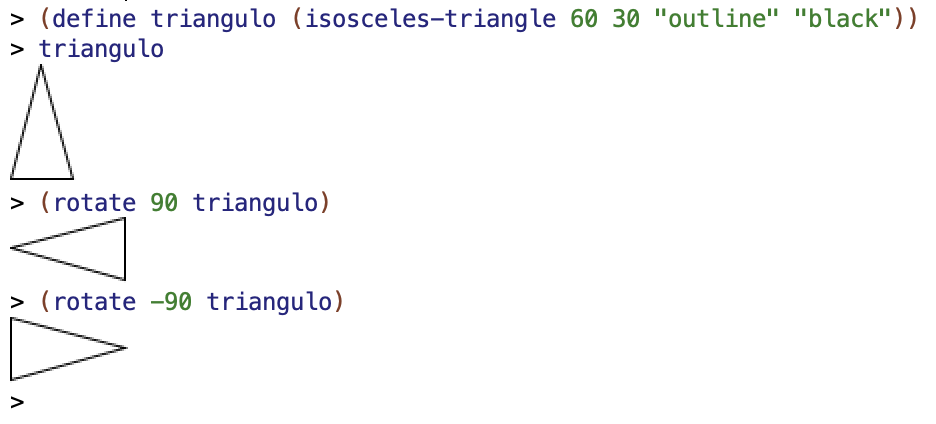
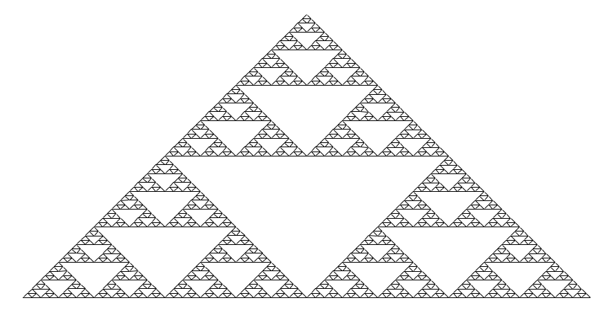
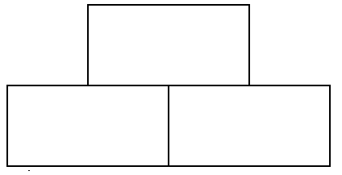

<!-- _class: cover institutional-cover -->
<!-- _paginate: false -->
<!-- _footer: "" -->
<div class="system-week">Semana 5</div>

# Procesos recursivos<br>e iterativos

<div class="system-topics">Coste, recursión por la cola y memoización<br>Figuras recursivas</div>
<div class="system-author">Cristina Pomares Puig</div>
<div class="institutional-logos">


</div>
<div class="mascot-figure cover-mascot wizard"></div>

<!-- Fuente: notas-clase/semana05/semana05.md. Diseño: semana 1, tema lpp-light. -->

---

## Veremos hoy

1. Pila y coste de la recursión.
2. Procesos iterativos y recursión por la cola.
3. Memoización.
4. Construcción de imágenes.
5. Triángulo de Sierpinski y curvas de Hilbert.

<!--
Marcas institucionales: https://imagenycomunicacion.ua.es/es/identidad-visual-corporativa-y-logotipos-ua.html
Logo DCCIA: https://web.ua.es/es/dccia/imagenes/gestadm/logotipos/logodccia.jpg
-->

<!--
Fuente: Veremos hoy. Notas de clase de la semana 5.

-->

---

<!-- _class: section topic-opening -->

<div class="mascot-figure section-mascot wizard"></div>
<div class="eyebrow">Semana 5</div>

# El coste de la recursión

<p class="lead">Ahora sí analizamos las llamadas y las operaciones que quedan pendientes.</p>

---

<!-- _class: lesson-code -->

## La pila de la recursión

```racket
(define (mi-length items)
    (if (null? items)
        0
        (+ 1 (mi-length (rest items)))))
```

Cada llamada deja pendiente una suma hasta recibir el resultado de la llamada siguiente.

<!--
Fuente: ejemplo del bloque de código que comienza en la línea 31. Notas de clase de la semana 5.

-->

---

<!-- _class: lesson-code -->

## Traza de `mi-length`

```text
(mi-length '(a b c d))
(+ 1 (mi-length '(b c d)))
(+ 1 (+ 1 (mi-length '(c d))))
(+ 1 (+ 1 (+ 1 (mi-length '(d)))))
(+ 1 (+ 1 (+ 1 (+ 1 (mi-length '())))))
(+ 1 (+ 1 (+ 1 (+ 1 0))))
(+ 1 (+ 1 (+ 1 1)))
(+ 1 (+ 1 2))
(+ 1 3)
4
```

Primero se acumulan operaciones pendientes. Después se resuelven al volver de las llamadas.

<!--
Fuente: ejemplo del bloque de código que comienza en la línea 43. Notas de clase de la semana 5.

-->

---

## Coste espacial y temporal

Para una lista de longitud `n`, la versión recursiva de `mi-length`:

- Visita los `n` elementos.
- Mantiene un número de operaciones pendientes proporcional a `n`.

En el modelo habitual, su tiempo y su espacio auxiliar son **O(n)**.

<!--
Fuente: Coste espacial y temporal. Notas de clase de la semana 5.
Se cuenta espacio auxiliar, sin incluir la lista de entrada. Las cotas usan operaciones elementales de coste unitario.
-->

---

<!-- _class: lesson-code -->

## Fibonacci recursivo

```racket
(define (fib n)
    (cond ((= n 0) 0)
        ((= n 1) 1)
        (else (+ (fib (- n 1))
                 (fib (- n 2))))))
```

Cada caso general calcula dos Fibonacci menores. Muchas llamadas repiten los mismos problemas.

<!--
Fuente: ejemplo del bloque de código que comienza en la línea 99. Notas de clase de la semana 5.

-->

---

<!-- _class: lesson-figure -->

## Repetición de llamadas


<!--
Fuente: Coste de Fibonacci. Notas de clase de la semana 5.
Localizar llamadas con el mismo argumento. No confundir el número total de nodos con la profundidad del árbol.
-->

---

## Tiempo y espacio no crecen igual

- El número de llamadas de Fibonacci crece exponencialmente. **O(2ⁿ)** es una cota superior del tiempo.
- La profundidad máxima de llamadas crece linealmente: el espacio auxiliar de pila es **O(n)**.

Dos llamadas recursivas no implican por sí solas coste espacial exponencial.

<!--
Fuente: Tiempo y espacio no crecen igual. Notas de clase de la semana 5.
Se corrige la afirmación de las notas que atribuye coste espacial exponencial a esta implementación. El número exacto de llamadas tampoco es 2^n.
-->

---

<!-- _class: section topic-opening -->

<div class="mascot-figure section-mascot wizard"></div>
<div class="eyebrow">Semana 5</div>

# Procesos iterativos

<p class="lead">Un procedimiento recursivo puede generar un proceso sin operaciones pendientes.</p>

---

## Procedimiento y proceso

Un **procedimiento** describe el algoritmo. Un **proceso** es lo que ocurre al ejecutarlo.

En la **recursión por la cola**, la llamada recursiva es el resultado que se devuelve: no queda una operación por realizar después.

Los parámetros adicionales conservan los resultados parciales.

<!--
Fuente: Procedimiento y proceso. Notas de clase de la semana 5.

-->

---

<!-- _class: lesson-code -->

## Versión iterativa de `mi-length`

```racket
(define (mi-length lista)
   (mi-length-iter lista 0))
(define (mi-length-iter lista result)
   (if (null? lista)
      result
      (mi-length-iter (rest lista) (+ result 1))))
```

`result` cuenta los elementos ya procesados. La función comienza con `0`.

<!--
Fuente: ejemplo del bloque de código que comienza en la línea 148. Notas de clase de la semana 5.

-->

---

<!-- _class: lesson-code -->

## Traza del proceso iterativo

```text
(mi-length '(a b c d)) =>
(mi-length-iter '(a b c d) 0) =>
(mi-length-iter '(b c d) 1) =>
(mi-length-iter '(c d) 2) =>
(mi-length-iter '(d) 3) =>
(mi-length-iter '() 4) =>
4
```

En cada paso cambia el estado descrito por los parámetros. Al llegar a la lista vacía, la longitud ya está calculada.

<!--
Fuente: ejemplo del bloque de código que comienza en la línea 160. Notas de clase de la semana 5.

-->

---

## Qué coste se reduce

La llamada por la cola no necesita conservar una suma pendiente por elemento. Scheme garantiza el tratamiento adecuado de las llamadas por la cola.

Para `mi-length`, el espacio auxiliar de control es constante y el tiempo sigue siendo lineal.

<!--
Fuente: Qué coste se reduce. Notas de clase de la semana 5.
La recursión por la cola no vuelve constante cualquier memoria del programa: pueden crecer los datos construidos o el tamaño de los números.
-->

---

<!-- _class: lesson-code -->

## Máximo de una lista

```racket
(define (max lista)
    (max-iter (rest lista) (first lista)))
(define (max-iter lista result)
    (if (null? lista)
        result
        (max-iter (rest lista) (if (> result (first lista))
                                   result
                                   (first lista)))))
```

`result` conserva el máximo visto hasta el momento. La lista de entrada debe ser no vacía.

<!--
Fuente: ejemplo del bloque de código que comienza en la línea 190. Notas de clase de la semana 5.

-->

---

<!-- _class: lesson-code -->

## Inversión con un acumulador

```racket
(define (mi-reverse lista)
    (reverse-iter lista '()))
 (define (reverse-iter lista result)
    (if (null? lista)
        result
        (reverse-iter (rest lista) (cons (first lista) result))))
```

El primer elemento se añade a la cabeza de `result`. Al terminar, el acumulador es la lista invertida.

<!--
Fuente: ejemplo del bloque de código que comienza en la línea 212. Notas de clase de la semana 5.
El control es constante, pero la nueva lista ocupa espacio lineal.
-->

---

<!-- _class: lesson-code -->

## Fibonacci iterativo

```racket
(define (fib n)
    (fib-iter 1 0 n))
(define (fib-iter a b count)
    (if (= count 0)
        b
        (fib-iter (+ a b) a (- count 1))))
```

Los parámetros `a` y `b` conservan dos valores consecutivos. `count` indica cuántos pasos faltan.

<!--
Fuente: ejemplo del bloque de código que comienza en la línea 232. Notas de clase de la semana 5.
Para n=0 devuelve 0; para n=1 devuelve 1. Tiempo lineal en pasos, con un número fijo de parámetros.
-->

---

<!-- _class: section topic-opening -->

<div class="mascot-figure section-mascot wizard"></div>
<div class="eyebrow">Semana 5</div>

# Triángulo de Pascal

<p class="lead">Comparar una definición recursiva por casillas con la construcción sucesiva de filas.</p>

---

<!-- _class: lesson-code -->

## Filas del triángulo

```text
1
1   1
1   2   1
1   3   3   1
1   4   6   4   1
1   5  10   10  5   1
1   6  15  20   15  6   1
1   7  21  35   35  21  7   1
             ...
```

<!--
Fuente: Triángulo de Pascal. Notas de clase de la semana 5.
Identificar bordes con valor 1 y cada interior como suma de los dos valores superiores.
-->

---

<!-- _class: lesson-code -->

## Definición recursiva de Pascal

```racket
(define (pascal row col)
    (cond ((= col 0) 1)
          ((= col row) 1)
          (else (+ (pascal (- row 1) (- col 1))
                   (pascal (- row 1) col) ))))
(pascal 4 2)
(pascal 8 4)
(pascal 27 13)
```

Los bordes son casos base. Una casilla interior depende de dos casillas de la fila anterior.

<!--
Fuente: ejemplo del bloque de código que comienza en la línea 268. Notas de clase de la semana 5.

-->

---

## Construir una fila a partir de la anterior

```racket
(pascal-sig-fila '(1 3 3 1))
; ⇒ (1 4 6 4 1)
```

La siguiente fila comienza y termina en `1`. En el interior se suman elementos consecutivos de la fila anterior.

<!--
Fuente: Triángulo de Pascal versión iterativa. Notas de clase de la semana 5.
Comparar la lista de la fila 3 con la fila 4.
-->

---

<!-- _class: lesson-code -->

## Recorrido iterativo de las filas

```racket
(define (pascal fila col)
   (list-ref (pascal-fila '(1) fila) col))
(define (pascal-fila lista-fila n)
   (if (= 0 n)
      lista-fila
      (pascal-fila (pascal-sig-fila lista-fila) (- n 1))))
```

<!--
Fuente: Triángulo de Pascal versión iterativa. Notas de clase de la semana 5.
lista-fila conserva la fila actual; n indica cuántas filas quedan por construir.
-->

---

<!-- _class: lesson-code -->

## Construcción de la fila siguiente

```racket
(define (pascal-sig-fila lista-fila)
   (append '(1)
           (pascal-suma-dos-a-dos lista-fila)
           '(1)))
(define (pascal-suma-dos-a-dos lista-fila)
   (if (null? (rest lista-fila))
      '()
      (cons (+ (first lista-fila) (second lista-fila))
            (pascal-suma-dos-a-dos (rest lista-fila)))))
```

<!--
Fuente: Triángulo de Pascal versión iterativa. Notas de clase de la semana 5.
La función pascal-suma-dos-a-dos es recursiva y construye una lista. No afirmar que todo el código tiene espacio constante.
-->

---

<!-- _class: section topic-opening -->

<div class="mascot-figure section-mascot wizard"></div>
<div class="eyebrow">Semana 5</div>

# Memoización

<p class="lead">Guardar los resultados de subproblemas para evitar volver a calcularlos.</p>

---

## Reutilizar un resultado calculado

Una función pura devuelve el mismo valor para el mismo argumento.

1. Comprobar si el resultado ya está guardado.
2. Si existe, recuperarlo.
3. Si no existe, calcularlo y almacenarlo.

La versión de las notas usa un diccionario mutable.

<!--
Fuente: Reutilizar un resultado calculado. Notas de clase de la semana 5.

-->

---

<!-- _class: lesson-code -->

## Operaciones del diccionario

```racket
(define mi-dic (make-dic))
(put 1 10 mi-dic) ; ⇒ 10
(get 1 mi-dic) ; ⇒ 10
(key-exists? 2 mi-dic) ; ⇒ #f
```

`make-dic`, `put`, `get` y `key-exists?` están definidos en `src/lpp.rkt`.

<!--
Fuente: ejemplo del bloque de código que comienza en la línea 366. Notas de clase de la semana 5.
Se corrige dic por mi-dic en la consulta del ejemplo.
-->

---

<!-- _class: lesson-code -->

## Fibonacci con memoización

```racket
(require "lpp.rkt")
(define (fib-memo n dic)
  (cond ((= n 0) 0)
        ((= n 1) 1)
        ((key-exists? n dic) (get n dic))
        (else (put n (+ (fib-memo (- n 1) dic)
                        (fib-memo (- n 2) dic)) dic))))
```

La consulta precede al cálculo recursivo. Cada argumento nuevo se calcula una vez.

<!--
Fuente: ejemplo del bloque de código que comienza en la línea 381. Notas de clase de la semana 5.
La búsqueda del diccionario de lpp.rkt recorre una lista de asociación. No se garantiza tiempo total O(n): depende del coste de las operaciones del diccionario. El require debe apuntar al fichero lpp.rkt disponible en el entorno de trabajo.
-->

---

## Qué evita la memoización

La mejora consiste en evitar la expansión repetida de los mismos subproblemas.

El número de valores de Fibonacci calculados es lineal. El tiempo total también depende de la implementación del diccionario y del coste de la aritmética.

<!--
Fuente: Qué evita la memoización. Notas de clase de la semana 5.
La guía distingue número de subproblemas de tiempo total; las notas simplifican el coste a O(n).
-->

---

<!-- _class: section topic-opening -->

<div class="mascot-figure section-mascot wizard"></div>
<div class="eyebrow">Semana 5</div>

# Figuras recursivas

<p class="lead">Construir imágenes complejas mediante la composición de imágenes más pequeñas.</p>

---

## Construcción de imágenes básicas

<div class="columns equal">
<div>

```racket
#lang racket
(require 2htdp/image)
(circle 30 "solid" "blue")
(square 30 "outline" "black")
(rectangle 80 40 "solid" "gray")
(triangle 40 "solid" "red")
```

</div>
<div>


</div>
</div>

Usamos la biblioteca `2htdp/image` de Racket.

<!--
Fuente: Construcción de imágenes básicas. Notas de clase de la semana 5.

-->

---

<!-- _class: lesson-code -->

## Rotación de imágenes

```racket
(define triangulo (isosceles-triangle 60 30 "outline" "black"))
(rotate 90 triangulo) 
; ⇒ imagen rotada 90 grados en sentido contrario a las agujas del reloj
(rotate -90 triangulo)
; ⇒ imagen rotada 90 grados en sentido de las agujas del reloj
```

<!--
Fuente: Rotación de imágenes. Notas de clase de la semana 5.

-->

---

<!-- _class: lesson-code -->

## Rotación de imágenes (continuación)



Los ángulos positivos rotan en sentido contrario a las agujas del reloj.

<!--
Fuente: Rotación de imágenes. Notas de clase de la semana 5.

-->

---

<!-- _class: lesson-code -->

## Composición vertical y horizontal

```racket
(above (ellipse 70 20 "solid" "gray")
       (ellipse 50 20 "solid" "darkgray")
       (ellipse 30 20 "solid" "dimgray")
       (ellipse 10 20 "solid" "black"))
```

<!--
Fuente: Composición vertical y horizontal. Notas de clase de la semana 5.

-->

---

<!-- _class: lesson-code -->

## Composición vertical y horizontal (continuación)

```racket
(beside (ellipse 20 70 "solid" "gray")
        (ellipse 20 50 "solid" "darkgray")
        (ellipse 20 30 "solid" "dimgray")
        (ellipse 20 10 "solid" "black"))
```

`above` coloca imágenes una encima de otra. `beside` las coloca una junto a otra.

<!--
Fuente: Composición vertical y horizontal. Notas de clase de la semana 5.

-->

---

<!-- _class: lesson-code -->

## Alineación de las imágenes

```racket
(above/align "left"
               (ellipse 70 20 "solid" "yellowgreen")
               (ellipse 50 20 "solid" "olivedrab")
               (ellipse 30 20 "solid" "darkolivegreen")
               (ellipse 10 20 "solid" "darkgreen"))
```

<!--
Fuente: Alineación de las imágenes. Notas de clase de la semana 5.

-->

---

<!-- _class: lesson-code -->

## Alineación de las imágenes (continuación)

```racket
(beside/align "top"
                (ellipse 20 70 "solid" "mediumorchid")
                (ellipse 20 50 "solid" "darkorchid")
                (ellipse 20 30 "solid" "purple")
                (ellipse 20 10 "solid" "indigo"))
```

`above/align` y `beside/align` permiten elegir la alineación. Prueba también `right` y `bottom`.

<!--
Fuente: Alineación de las imágenes. Notas de clase de la semana 5.

-->

---

<!-- _class: lesson-code -->

## Componer operaciones

```racket
(rotate 45
        (above (triangle 40 "solid" "orange")
               (beside (rectangle 40 30 "solid" "black")
                       (rectangle 40 30 "solid" "olivedrab"))))
```

<!--
Fuente: Componer operaciones. Notas de clase de la semana 5.

-->

---

<!-- _class: lesson-code -->

## Componer operaciones (continuación)


El resultado de cada operación es una imagen que puede usarse en otra operación.

<!--
Fuente: Componer operaciones. Notas de clase de la semana 5.

-->

---

<!-- _class: lesson-figure -->

## Triángulo de Sierpinski



¿Qué partes más pequeñas reconoces? ¿Qué parámetro controla su tamaño?

<!--
Fuente: Triángulo de Sierpinski. Notas de clase de la semana 5.
Identificar tres copias de menor anchura.
-->

---

## Algoritmo recursivo

<div class="columns equal">
<div>



</div>
<div>

1. Construir una figura de anchura `ancho / 2`.
2. Colocar dos copias una junto a otra.
3. Colocar otra copia encima.

Caso base: una figura elemental de anchura pequeña.

</div>
</div>


<!--
Fuente: Algoritmo recursivo. Notas de clase de la semana 5.

-->

---

<!-- _class: lesson-code -->

## Triángulo elemental

```racket
(define (hipotenusa x)
  (* x (sqrt 2)))
```

```racket
(define (sierpinski-elem base)
  (isosceles-triangle (hipotenusa (/ base 2)) 90 "outline" "black"))
```

<!--
Fuente: Triángulo elemental. Notas de clase de la semana 5.

-->

---

<!-- _class: lesson-code -->

## Triángulo elemental (continuación)


La hipotenusa de dos catetos iguales de longitud `x` mide `x * √2`.

<!--
Fuente: Triángulo elemental. Notas de clase de la semana 5.

-->

---

<!-- _class: lesson-code -->

## Definición recursiva de Sierpinski

```racket
(define (sierpinski ancho)
  (if (< ancho 10)
      (sierpinski-elem ancho)
      (above (sierpinski (/ ancho 2))
             (beside (sierpinski (/ ancho 2))
                     (sierpinski (/ ancho 2))))))
```

La composición utiliza tres veces el mismo resultado de tamaño menor.

<!--
Fuente: ejemplo del bloque de código que comienza en la línea 628. Notas de clase de la semana 5.

-->

---

<!-- _class: lesson-code -->

## Evitar llamadas repetidas

```racket
(define (componer-sierpinski figura)
    (above figura
           (beside figura figura)))
(define (sierpinski ancho)
  (if (< ancho 10)
      (sierpinski-elem ancho)
      (componer-sierpinski (sierpinski (/ ancho 2)))))
```

Calculamos una sola figura pequeña y la reutilizamos en la función de composición.

<!--
Fuente: ejemplo del bloque de código que comienza en la línea 646. Notas de clase de la semana 5.

-->

---

<!-- _class: lesson-figure -->

## Curvas de Hilbert


<!--
Fuente: Otra figura recursiva: curvas de Hilbert. Notas de clase de la semana 5.
La curva de nivel i se obtiene componiendo y rotando la curva de nivel i-1. Las aproximaciones finitas ilustran la curva límite.
-->

---

<!-- _class: lesson-code -->

## Trazos para la composición

```racket
(define (trazo-horizontal long)
  (line long 0 "black"))
(define (trazo-vertical long)
  (rotate 90 (trazo-horizontal long)))
```

Construimos un trazo horizontal y obtenemos el vertical por rotación.

<!--
Fuente: Curvas de Hilbert. Notas de clase de la semana 5.
Funciones auxiliares para componer-hilbert.
-->

---

<!-- _class: lesson-code -->

## Composición de una curva de Hilbert

```racket
(define (componer-hilbert imagen long-trazo)
  (beside (above/align "left"
                       (beside/align "bottom" imagen (trazo-horizontal long-trazo))
                       (trazo-vertical long-trazo)
                       (rotate -90 imagen))
          (above/align "right"
                       imagen
                       (trazo-vertical long-trazo)
                       (rotate 90 imagen))))
```

<!--
Fuente: Función componer-hilbert. Notas de clase de la semana 5.
Relacionar las rotaciones y las alineaciones con la figura de las notas.
-->

---

<!-- _class: lesson-code -->

## Definición de `hilbert`

```racket
(define (hilbert nivel long-trazo)
  (if (= 1 nivel)
      (beside/align "top"
                    (trazo-vertical long-trazo)
                    (trazo-horizontal long-trazo)
                    (trazo-vertical long-trazo))
      (componer-hilbert (hilbert (- nivel 1) long-trazo) long-trazo)))
```

El caso base construye el primer nivel. El caso general compone la curva del nivel anterior.

<!--
Fuente: ejemplo del bloque de código que comienza en la línea 697. Notas de clase de la semana 5.

-->
