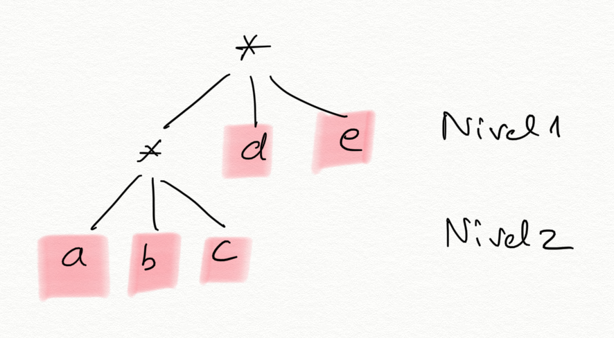
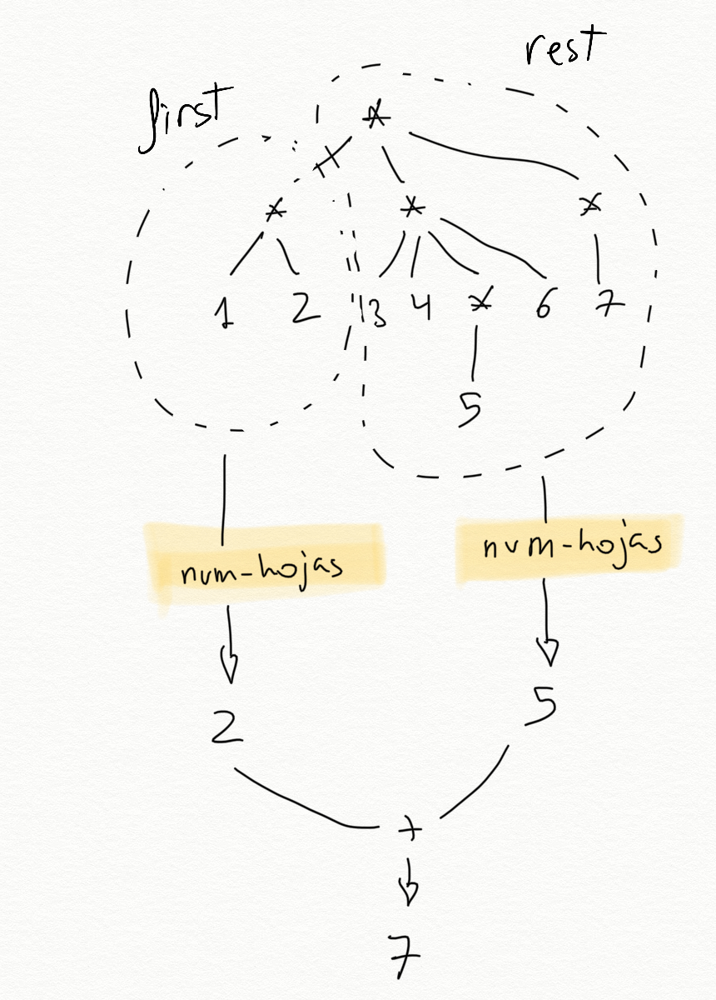
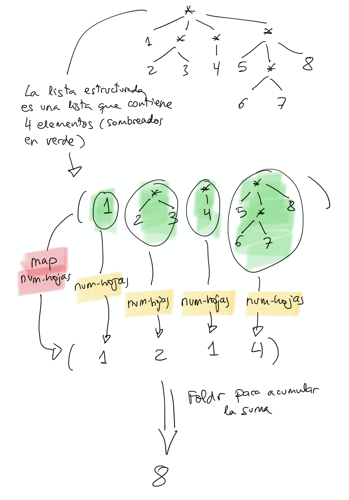

<!-- _class: cover institutional-cover -->
<!-- _paginate: false -->
<!-- _footer: "" -->
<div class="system-week">Semana 6</div>

# Listas estructuradas

<div class="system-topics">Hojas, sublistas y niveles<br>Recursión y funciones de orden superior</div>
<div class="system-author">Cristina Pomares Puig</div>
<div class="institutional-logos">


</div>
<div class="mascot-figure cover-mascot wizard"></div>

<!-- Fuente: notas-clase/semana06/semana06.md. Diseño: semana 1, tema lpp-light. -->

---

## Veremos hoy

1. Listas planas, listas estructuradas y hojas.
2. Predicados sobre la estructura.
3. Contar, aplanar y buscar hojas.
4. Transformar conservando la estructura.
5. Altura y nivel de una hoja.

<!--
Marcas institucionales: https://imagenycomunicacion.ua.es/es/identidad-visual-corporativa-y-logotipos-ua.html
Logo DCCIA: https://web.ua.es/es/dccia/imagenes/gestadm/logotipos/logodccia.jpg
-->

<!--
Fuente: Veremos hoy. Notas de clase de la semana 6.

-->

---

<!-- _class: section topic-opening -->

<div class="mascot-figure section-mascot wizard"></div>
<div class="eyebrow">Semana 6</div>

# Listas que contienen listas

<p class="lead">El primer elemento puede ser una hoja o, a su vez, otra lista.</p>

---

## Lista plana y lista estructurada

- Una **lista plana** contiene únicamente hojas.
- Una **lista estructurada** contiene alguna sublista.
- Una **hoja** es un dato que no es una lista.

Por ejemplo, `'(a b (c d e) (f (g h)))` tiene cuatro elementos exteriores, dos de ellos sublistas.

<!--
Fuente: Lista plana y lista estructurada. Notas de clase de la semana 6.

-->

---

## Parejas como hojas

<div class="columns equal">
<div>

```racket
    ((a . 3) (b . 5) (c . 12))
```

</div>
<div>

Una pareja que no es una lista también es una hoja según nuestra definición.

Esta lista de asociación es plana: sus tres elementos son parejas, no sublistas.

</div>
</div>


<!--
Fuente: Parejas como hojas. Notas de clase de la semana 6.

-->

---

<!-- _class: lesson-code -->

## Predicado `hoja?`

```racket
    (define (hoja? dato)
        (not (list? dato)))
```

La definición distingue listas de otros datos. Una lista vacía tampoco es una hoja.

<!--
Fuente: ejemplo del bloque de código que comienza en la línea 78. Notas de clase de la semana 6.

-->

---

<!-- _class: lesson-code -->

## Reconocer las hojas de una lista

```racket
    (define lista '((1 2) 3 4 (5 6)))
    (hoja? (first lista)) ; ⇒ #f
    (hoja? (second lista)) ; ⇒ #t
    (hoja? (third lista)) ; ⇒ #t
    (hoja? (fourth lista)) ; ⇒ #f
```

Distingue el número de elementos exteriores del número total de hojas.

<!--
Fuente: ejemplo del bloque de código que comienza en la línea 93. Notas de clase de la semana 6.

-->

---

<!-- _class: lesson-code -->

## Predicado `plana?`

```racket
    (define (plana? lista)
       (or (null? lista)
           (and (hoja? (first lista))
                (plana? (rest lista)))))
```

La lista vacía es plana. En el caso general, el primero debe ser hoja y el resto debe ser plano.

<!--
Fuente: ejemplo del bloque de código que comienza en la línea 132. Notas de clase de la semana 6.

-->

---

## Predicados con funciones de orden superior

<div class="columns equal">
<div>

```racket
(define (plana-fos? lista)
  (for-all? hoja? lista))
```

</div>
<div>

```racket
(define (estructurada-fos? lista)
  (exists? list? lista))
```

</div>
</div>

Una lista es plana si todos sus elementos son hojas. Es estructurada si alguno de sus elementos es una lista.

<!--
Fuente: Predicados con funciones de orden superior. Notas de clase de la semana 6.

-->

---

<!-- _class: lesson-code -->

## Predicado `estructurada?`

```racket
    (define (estructurada? lista)
       (and (not (null? lista))
            (or (list? (first lista))
                (estructurada? (rest lista)))))
```

La presencia de una sublista vacía ya hace estructurada a una lista.

<!--
Fuente: ejemplo del bloque de código que comienza en la línea 166. Notas de clase de la semana 6.
Ejemplos: (a () b) es estructurada; () es plana. estructurada? también puede definirse como la negación de plana?.
-->

---

## Representación por niveles

<div class="columns equal">
<div>



</div>
<div>

La lista exterior define el nivel `1`. Cada sublista añade un nivel.

En `'((a b c) d e)`, `d` y `e` están en el nivel `1`; `a`, `b` y `c`, en el nivel `2`.

</div>
</div>


<!--
Fuente: Representación por niveles. Notas de clase de la semana 6.

-->

---

## Listas estructuradas y árboles

En las listas estructuradas de esta unidad, los datos se sitúan en las hojas.

En los árboles de la semana siguiente, cada nodo tiene un dato y una lista de hijos.

Ambas estructuras se definen recursivamente, pero usamos operaciones y barreras de abstracción distintas.

<!--
Fuente: Listas estructuradas y árboles. Notas de clase de la semana 6.

-->

---

<!-- _class: section topic-opening -->

<div class="mascot-figure section-mascot wizard"></div>
<div class="eyebrow">Semana 6</div>

# Recursión sobre la estructura

<p class="lead">Combinar el resultado del primer elemento con el resultado del resto de la lista.</p>

---

## Dos casos base

- **Lista vacía:** ya no quedan elementos por recorrer.
- **Hoja:** hemos llegado a un dato.

En el caso general llamamos a la recursión con `first` y con `rest`. La función debe aceptar tanto listas como hojas.

<!--
Fuente: Dos casos base. Notas de clase de la semana 6.
Scheme tiene tipado dinámico. No equiparar esta posibilidad con «tipado débil» ni afirmar que sea imposible representar estos datos con tipos estáticos.
-->

---

## Contar las hojas

<div class="columns equal">
<div>



</div>
<div>

El número de hojas es la suma de las hojas del primer elemento y de las del resto.

Lista vacía: `0`.
Hoja: `1`.

</div>
</div>


<!--
Fuente: Contar las hojas. Notas de clase de la semana 6.

-->

---

<!-- _class: lesson-code -->

## Definición de `num-hojas`

```racket
    (define (num-hojas lisdat)
       (cond
          ((null? lisdat) 0)
          ((hoja? lisdat) 1)
          (else (+ (num-hojas (first lisdat))
                   (num-hojas (rest lisdat))))))
```

Las dos llamadas recorren partes distintas de la estructura. Dos llamadas recursivas no implican automáticamente trabajo exponencial.

<!--
Fuente: ejemplo del bloque de código que comienza en la línea 326. Notas de clase de la semana 6.

-->

---

<!-- _class: lesson-code -->

## Contar con `map` y `foldr`

```racket
(define (num-hojas-fos ld)
    (if (hoja? ld)
        1
        (foldr + 0 (map num-hojas-fos ld))))
```

`map` obtiene el número de hojas de cada elemento. `foldr` suma esos números, con base `0`.

<!--
Fuente: ejemplo del bloque de código que comienza en la línea 364. Notas de clase de la semana 6.

-->

---

<!-- _class: lesson-figure -->

## Resultados parciales de `map`



<!--
Fuente: Versión con funciones de orden superior. Notas de clase de la semana 6.
Identificar la lista de números que produce map antes de sumarla.
-->

---

<!-- _class: lesson-code -->

## La alternativa con `apply`

```racket
(define (num-hojas-fos ld)
    (if (hoja? ld)
        1
        (apply + (map num-hojas-fos ld))))
```

`apply` pasa los resultados de `map` como argumentos individuales de `+`. La suma sin argumentos es `0`.

<!--
Fuente: ejemplo del bloque de código que comienza en la línea 376. Notas de clase de la semana 6.

-->

---

<!-- _class: lesson-code -->

## Aplanar una lista estructurada

```racket
(define (aplana ld)
  (cond
    ((null? ld) '())
    ((hoja? ld) (list ld))
    (else 
     (append (aplana (first ld))
             (aplana (rest ld))))))
```

Una hoja produce una lista de un elemento. El caso general concatena las hojas del primero y del resto.

<!--
Fuente: ejemplo del bloque de código que comienza en la línea 397. Notas de clase de la semana 6.

-->

---

<!-- _class: lesson-code -->

## Aplanar con funciones de orden superior

```racket
(define (aplana-fos ld)
  (if (hoja? ld)
    (list ld)
    (foldr append '() (map aplana-fos ld))))
```

<!--
Fuente: Aplanar con funciones de orden superior. Notas de clase de la semana 6.

-->

---

<!-- _class: lesson-code -->

## Aplanar con funciones de orden superior (continuación)

```racket
(define (aplana-fos ld)
  (if (hoja? ld)
    (list ld)
    (apply append (map aplana-fos ld))))
```

Las dos versiones combinan listas de hojas con `append`. La lista vacía produce la lista vacía.

<!--
Fuente: Aplanar con funciones de orden superior. Notas de clase de la semana 6.

-->

---

<!-- _class: lesson-code -->

## Buscar una hoja

```racket
(define (pertenece-estruct? dato ld)
  (cond 
    ((null? ld) #f)
    ((hoja? ld) (equal? dato ld))
    (else (or (pertenece-estruct? dato (first ld))
              (pertenece-estruct? dato (rest ld))))))
```

En una hoja comparamos el dato. En una lista combinamos las búsquedas mediante `or`.

<!--
Fuente: ejemplo del bloque de código que comienza en la línea 458. Notas de clase de la semana 6.

-->

---

<!-- _class: lesson-code -->

## Búsqueda con `exists?`

```racket
(define (pertenece-fos? dato ld)
  (if (hoja? ld)
    (equal? dato ld)
    (exists? (lambda (elem)
               (pertenece-fos? dato elem)) ld)))
```

La expresión lambda fija el dato buscado y aplica la búsqueda a cada elemento.

<!--
Fuente: ejemplo del bloque de código que comienza en la línea 470. Notas de clase de la semana 6.

-->

---

<!-- _class: section topic-opening -->

<div class="mascot-figure section-mascot wizard"></div>
<div class="eyebrow">Semana 6</div>

# Transformar y medir

<p class="lead">Conservar la estructura o resumirla según el resultado que necesitamos.</p>

---

<!-- _class: lesson-code -->

## Elevar las hojas al cuadrado

```racket
(define (cuadrado-estruct ld)
  (cond ((null? ld) '())
        ((hoja? ld) (* ld ld ))
        (else (cons (cuadrado-estruct (first ld))
                    (cuadrado-estruct (rest ld))))))
```

`cons` reconstruye la estructura original. El cálculo numérico ocurre únicamente en el caso hoja.

<!--
Fuente: ejemplo del bloque de código que comienza en la línea 493. Notas de clase de la semana 6.

-->

---

<!-- _class: lesson-code -->

## Cuadrados con `map`

```racket
(define (cuadrado-estruct-fos ld)
  (if (hoja? ld)
      (* ld ld)
      (map cuadrado-estruct-fos ld)))
```

El `map` exterior recorre un nivel. La llamada recursiva continúa en las sublistas.

<!--
Fuente: ejemplo del bloque de código que comienza en la línea 504. Notas de clase de la semana 6.

-->

---

<!-- _class: lesson-code -->

## Generalizar con `map-estruct`

```racket
(define (map-estruct f ld)
  (cond ((null? ld) '())
        ((hoja? ld) (f ld))
        (else (cons (map-estruct f (first ld))
                    (map-estruct f (rest ld))))))
```

La función `f` recibe cada hoja. El resultado conserva los mismos niveles de listas.

<!--
Fuente: ejemplo del bloque de código que comienza en la línea 525. Notas de clase de la semana 6.

-->

---

<!-- _class: lesson-code -->

## `map-estruct` con funciones de orden superior

```racket
(define (map-estruct-fos f ld)
  (if (hoja? ld)
      (f ld)
      (map (lambda (elem)
             (map-estruct-fos f elem)) ld)))
```

La expresión lambda conserva el parámetro `f` al aplicar la recursión a cada elemento.

<!--
Fuente: ejemplo del bloque de código que comienza en la línea 536. Notas de clase de la semana 6.

-->

---

## Altura de una lista estructurada

<div class="columns equal">
<div>


</div>
<div>

La altura es el número máximo de niveles.

Una lista plana no vacía tiene altura `1`.

En esta unidad, la lista vacía y una hoja tienen altura `0`.

</div>
</div>


<!--
Fuente: Altura de una lista estructurada. Notas de clase de la semana 6.

-->

---

<!-- _class: lesson-code -->

## Definición de `altura`

```racket
(define (altura ld)
   (cond 
      ((null? ld) 0)
      ((hoja? ld) 0)
      (else (max (+ 1 (altura (first ld)))
                 (altura (rest ld))))))
```

Al descender al primer elemento sumamos un nivel. Al recorrer el resto seguimos en el mismo nivel.

<!--
Fuente: ejemplo del bloque de código que comienza en la línea 571. Notas de clase de la semana 6.

-->

---

<!-- _class: lesson-code -->

## Altura con `map` y `foldr`

```racket
(define (altura-fos ld)
   (if (or (hoja? ld) (null? ld))
       0
       (+ 1 (foldr max 0 (map altura-fos ld)))))
```

Se toma el máximo de las alturas de los elementos y se suma el nivel exterior.

<!--
Fuente: ejemplo del bloque de código que comienza en la línea 586. Notas de clase de la semana 6.
Se añade el caso de lista vacía para respetar altura () = 0 y coincidir con la versión recursiva. En las notas altura-fos devolvía 1 con ().
-->

---

<!-- _class: lesson-code -->

## Nivel de una hoja

```racket
    (nivel-hoja 'b '(a b (c))) ; ⇒ 1
    (nivel-hoja 'b '(a (b) c)) ; ⇒ 2
    (nivel-hoja 'b '(a (b) d ((b)))) ; ⇒ 3
    (nivel-hoja 'b '(a c d ((e)))) ; ⇒ -1
```

Si el dato aparece varias veces, devolvemos el nivel mayor. Si no aparece, devolvemos `-1`.

<!--
Fuente: ejemplo del bloque de código que comienza en la línea 602. Notas de clase de la semana 6.

-->

---

<!-- _class: lesson-code -->

## Conservar el resultado de búsqueda fallida

```racket
    (define (suma-1-si-mayor-igual-que-0 x)
      (if (>= x 0)
          (+ x 1)
          x))
```

Solo incrementamos los niveles válidos. El valor `-1` debe seguir indicando que no se ha encontrado el dato.

<!--
Fuente: ejemplo del bloque de código que comienza en la línea 623. Notas de clase de la semana 6.

-->

---

<!-- _class: lesson-code -->

## Definición de `nivel-hoja`

```racket
(define (nivel-hoja dato ld)
  (cond
    ((null? ld) -1)
    ((hoja? ld) (if (equal? ld dato) 0 -1))
    (else (max (suma-1-si-mayor-igual-que-0 
                    (nivel-hoja dato (first ld)))
               (nivel-hoja dato (rest ld))))))
```

La búsqueda en el primer elemento desciende de nivel. La búsqueda en el resto permanece en el mismo nivel.

<!--
Fuente: ejemplo del bloque de código que comienza en la línea 611. Notas de clase de la semana 6.

-->

---

<!-- _class: lesson-code -->

## Nivel con funciones de orden superior

```racket
(define (nivel-hoja-fos dato ld)
  (if (hoja? ld)
      (if (equal? ld dato) 0 -1)
      (suma-1-si-mayor-igual-que-0
       (foldr max -1 (map (lambda (elem)
                           (nivel-hoja-fos dato elem)) ld)))))
```

`map` obtiene los niveles de cada elemento; el plegado selecciona el mayor. La función auxiliar añade el nivel exterior.

<!--
Fuente: ejemplo del bloque de código que comienza en la línea 632. Notas de clase de la semana 6.

-->
