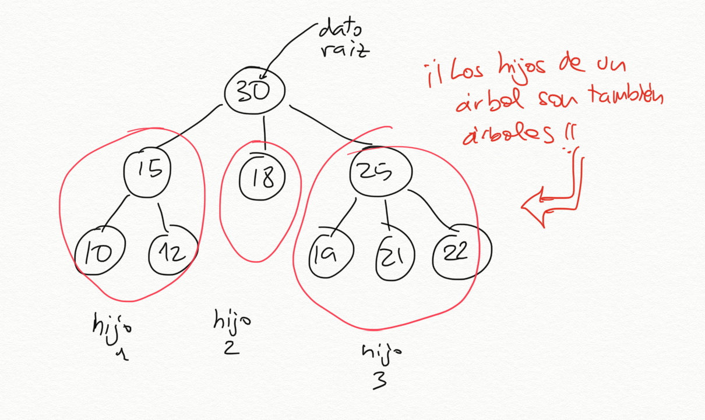
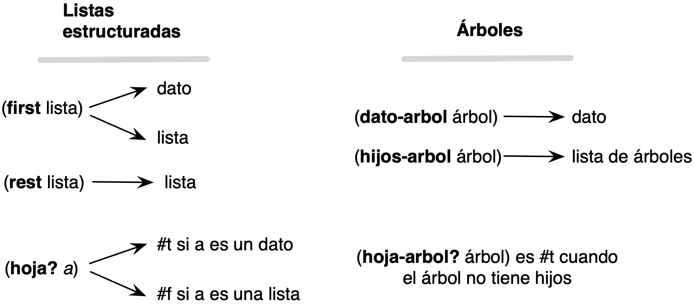

<!-- _class: cover institutional-cover -->
<!-- _paginate: false -->
<!-- _footer: "" -->
<div class="system-week">Semana 7</div>

# Árboles y árboles binarios

<div class="system-topics">Barreras de abstracción<br>Recursión mutua y transformación de árboles</div>
<div class="system-author">Cristina Pomares Puig</div>
<div class="institutional-logos">


</div>
<div class="mascot-figure cover-mascot wizard"></div>

<!-- Fuente: notas-clase/semana07/semana07.md. Diseño: semana 1, tema lpp-light. -->

---

## Veremos hoy

1. Representación de árboles con listas.
2. Constructores y selectores.
3. Recursión mutua entre árbol y bosque.
4. Funciones de orden superior sobre hijos.
5. Árboles binarios y sus operaciones.

<!--
Marcas institucionales: https://imagenycomunicacion.ua.es/es/identidad-visual-corporativa-y-logotipos-ua.html
Logo DCCIA: https://web.ua.es/es/dccia/imagenes/gestadm/logotipos/logodccia.jpg
-->

<!--
Fuente: Veremos hoy. Notas de clase de la semana 7.

-->

---

<!-- _class: section topic-opening -->

<div class="mascot-figure section-mascot wizard"></div>
<div class="eyebrow">Semana 7</div>

# Definición de árbol

<p class="lead">Un dato en la raíz y una lista de árboles hijos.</p>

---

## Raíz, hijos y hojas

<div class="columns equal">
<div>



</div>
<div>

Cada hijo es otro árbol.

Una hoja es un árbol sin hijos: tiene un dato y una lista de hijos vacía.

</div>
</div>


<!--
Fuente: Raíz, hijos y hojas. Notas de clase de la semana 7.

-->

---

## Representación mediante listas

```text
arbol -> (dato hijo-1 hijo-2 ... hijo-n)
```

```text
Nodo hoja -> (dato)
```

El primer elemento guarda el dato. Los restantes representan los árboles hijos.

<!--
Fuente: Representación mediante listas. Notas de clase de la semana 7.
Una hoja se representa como (dato), no como un dato aislado.
-->

---

<!-- _class: lesson-code -->

## Un árbol representado en Scheme

```racket
(define arbol1 '(30 (15 (10) (12)) (18) (25 (19) (21) (22))))
```

<!--
Fuente: Un árbol representado en Scheme. Notas de clase de la semana 7.

-->

---

<!-- _class: lesson-code -->

## Un árbol representado en Scheme (continuación)


Identifica los tres hijos de la raíz y sus subárboles.

<!--
Fuente: Un árbol representado en Scheme. Notas de clase de la semana 7.

-->

---

## La barrera de abstracción

Un conjunto de operaciones permite trabajar con el tipo **árbol** ocultando su representación.

- **Selectores:** obtener el dato y los hijos.
- **Predicados:** reconocer casos especiales.
- **Constructores:** crear árboles.

Los nombres terminan en `-arbol` para expresar el tipo de dato con el que trabajamos.

<!--
Fuente: La barrera de abstracción. Notas de clase de la semana 7.

-->

---

<!-- _class: lesson-code -->

## Selectores y predicado de hoja

```racket
(define (dato-arbol arbol) 
    (first arbol))
(define (hijos-arbol arbol) 
    (rest arbol))
(define (hoja-arbol? arbol) 
   (null? (hijos-arbol arbol)))
```

`dato-arbol` devuelve un dato. `hijos-arbol` devuelve una lista de árboles: un bosque.

<!--
Fuente: ejemplo del bloque de código que comienza en la línea 141. Notas de clase de la semana 7.

-->

---

<!-- _class: lesson-code -->

## Usar los selectores

```racket
(dato-arbol arbol1) ; ⇒ 30
(hijos-arbol arbol1) ; ⇒ ((15 (10) (12)) (18) (25 (19) (21) (22)))
(hoja-arbol? (first (hijos-arbol arbol1))) ; ⇒ #f
(hoja-arbol? (second (hijos-arbol arbol1))) ; ⇒ #t
```

Sobre un árbol usamos operaciones de árbol; sobre la lista de hijos usamos operaciones de lista.

<!--
Fuente: ejemplo del bloque de código que comienza en la línea 168. Notas de clase de la semana 7.

-->

---

<!-- _class: lesson-code -->

## Combinar los dos niveles de abstracción

```racket
(dato-arbol (second (hijos-arbol (first (hijos-arbol arbol1)))))
; ⇒ 12
```

La expresión obtiene el dato del segundo hijo del primer hijo de `arbol1`.

<!--
Fuente: ejemplo del bloque de código que comienza en la línea 202. Notas de clase de la semana 7.
Resultado: 12. Pedir que se identifique el tipo del resultado intermedio de cada llamada.
-->

---

<!-- _class: lesson-figure -->

## Árbol, lista de árboles y dato



<!--
Fuente: Barreras de abstracción. Notas de clase de la semana 7.
Recordar que first de un bosque devuelve un árbol y rest devuelve otro bosque.
-->

---

<!-- _class: lesson-code -->

## Constructor `construye-arbol`

```racket
(define (construye-arbol dato lista-arboles)
   (cons dato lista-arboles))
```

Recibe un dato y una lista de árboles. Devuelve un nuevo árbol con esa raíz y esos hijos.

<!--
Fuente: ejemplo del bloque de código que comienza en la línea 233. Notas de clase de la semana 7.

-->

---

<!-- _class: lesson-code -->

## Construir una hoja y un árbol

```racket
(define arbol3 (construye-arbol 2 '()))
```

<!--
Se corrige el paréntesis de cierre que falta en arbol4 en las notas.
Fuente: Construir una hoja y un árbol. Notas de clase de la semana 7.

-->

---

<!-- _class: lesson-code -->

## Construir una hoja y un árbol (continuación)

```racket
(define arbol4 (construye-arbol 10 (list (construye-arbol 2 '())
                                         (construye-arbol 5 '()) 
                     (construye-arbol 9 '()))))
```

El constructor evita que las funciones cliente dependan de la representación concreta con `cons`.

<!--
Se corrige el paréntesis de cierre que falta en arbol4 en las notas.
Fuente: Construir una hoja y un árbol. Notas de clase de la semana 7.

-->

---

<!-- _class: section topic-opening -->

<div class="mascot-figure section-mascot wizard"></div>
<div class="eyebrow">Semana 7</div>

# Recursión entre árbol y bosque

<p class="lead">Una función procesa un árbol y otra procesa la lista de sus hijos.</p>

---

<!-- _class: lesson-code -->

## Suma de datos: dos funciones

```racket
(define (suma-datos-arbol arbol)
    (+ (dato-arbol arbol)
       (suma-datos-bosque (hijos-arbol arbol))))
```

<!--
Fuente: Suma de datos: dos funciones. Notas de clase de la semana 7.

-->

---

<!-- _class: lesson-code -->

## Suma de datos: dos funciones (continuación)

```racket
(define (suma-datos-bosque bosque)
   (if (null? bosque)
       0
       (+ (suma-datos-arbol (first bosque)) 
          (suma-datos-bosque (rest bosque)))))
```

Una función llama a la otra: es **recursión mutua**. La lista de hijos vacía cierra el recorrido.

<!--
Fuente: Suma de datos: dos funciones. Notas de clase de la semana 7.

-->

---

<!-- _class: lesson-figure -->

## Recorrido del bosque


<!--
Fuente: Función suma-datos-arbol. Notas de clase de la semana 7.
Separar el dato raíz, el primer hijo y el resto del bosque.
-->

---

<!-- _class: lesson-code -->

## Suma con funciones de orden superior

```racket
(define (suma-datos-arbol-fos arbol)
    (foldr + (dato-arbol arbol) 
        (map suma-datos-arbol-fos (hijos-arbol arbol))))
```

`map` suma cada árbol hijo. `foldr` combina esas sumas con el dato de la raíz.

<!--
Fuente: ejemplo del bloque de código que comienza en la línea 359. Notas de clase de la semana 7.

-->

---

<!-- _class: lesson-code -->

## Resultados de las llamadas a los hijos

```racket
(suma-datos-arbol-fos '(1 (2 (3) (4)) (5) (6 (7)))) ;⇒
(foldr + 1 (map suma-datos-arbol-fos '((2 (3) (4)) 
                                                (5)
                                                (6 (7))))) ; ⇒
(foldr + 1 '(9 5 13)) ;⇒
28
```

El recorrido sobre la lista de hijos produce `(9 5 13)`. Al añadir el dato raíz, el resultado es `28`.

<!--
Fuente: ejemplo del bloque de código que comienza en la línea 371. Notas de clase de la semana 7.

-->

---

<!-- _class: lesson-code -->

## Obtener los datos en preorden

```racket
(define (to-list-arbol arbol)
   (cons (dato-arbol arbol)
         (to-list-bosque (hijos-arbol arbol))))
(define (to-list-bosque bosque)
   (if (null? bosque)
       '()
       (append (to-list-arbol (first bosque))
               (to-list-bosque (rest bosque)))))
```

Primero aparece la raíz; después, los datos de cada subárbol, de izquierda a derecha.

<!--
Fuente: ejemplo del bloque de código que comienza en la línea 398. Notas de clase de la semana 7.

-->

---

<!-- _class: lesson-code -->

## Preorden con `map` y `foldr`

```racket
(define (to-list-arbol-fos arbol)
    (cons (dato-arbol arbol)
          (foldr append '() 
               (map to-list-arbol-fos (hijos-arbol arbol)))))
```

`map` obtiene una lista de listas. `foldr append` las concatena. `cons` añade el dato raíz.

<!--
Fuente: ejemplo del bloque de código que comienza en la línea 417. Notas de clase de la semana 7.

-->

---

<!-- _class: lesson-code -->

## Elevar los datos al cuadrado

```racket
; Construye un árbol nuevo elevado al cuadrado el que se pasa como parámetro
(define (cuadrado-arbol arbol) 
   (construye-arbol (cuadrado (dato-arbol arbol))
              (cuadrado-bosque (hijos-arbol arbol))))  
; Devuelve una lista de árboles elevados al cuadrado
(define (cuadrado-bosque bosque) 
   (if (null? bosque)
       '()
       (cons (cuadrado-arbol (first bosque))
             (cuadrado-bosque (rest bosque)))))
```

Construimos un árbol nuevo. Cada dato se transforma y el bosque de hijos conserva su estructura.

<!--
Fuente: ejemplo del bloque de código que comienza en la línea 442. Notas de clase de la semana 7.

-->

---

<!-- _class: lesson-code -->

## Cuadrados con funciones de orden superior

```racket
(define (cuadrado-arbol-fos arbol)
   (construye-arbol (cuadrado (dato-arbol arbol))
                     (map cuadrado-arbol-fos (hijos-arbol arbol))))
```

La recursión se aplica a cada hijo con `map`. Es necesaria la función auxiliar `cuadrado`.

<!--
Fuente: ejemplo del bloque de código que comienza en la línea 460. Notas de clase de la semana 7.

-->

---

<!-- _class: lesson-code -->

## Generalizar la transformación: `map-arbol`

```racket
(define (map-arbol f arbol)
   (construye-arbol (f (dato-arbol arbol))
              (map-bosque f (hijos-arbol arbol))))  
(define (map-bosque f bosque)
   (if (null? bosque)
       '()
       (cons (map-arbol f (first bosque))
             (map-bosque f (rest bosque)))))
```

El parámetro `f` se aplica a cada dato. `map-bosque` transforma la lista de hijos.

<!--
Fuente: ejemplo del bloque de código que comienza en la línea 483. Notas de clase de la semana 7.

-->

---

<!-- _class: lesson-code -->

## Versión con `map`

```racket
(define (map-arbol-fos f arbol)
  (construye-arbol (f (dato-arbol arbol))
                   (map (lambda (x)
                          (map-arbol-fos f x)) (hijos-arbol arbol))))
```

El `map` de listas transforma los hijos; `map-arbol-fos` transforma cada árbol completo.

<!--
Fuente: ejemplo del bloque de código que comienza en la línea 499. Notas de clase de la semana 7.

-->

---

<!-- _class: lesson-code -->

## Altura de un árbol

```racket
(altura-arbol '(2)) ;  ⇒ 0
(altura-arbol '(4 (9 (16) (25)) (36))) ; ⇒ 2
```

En esta unidad, la altura de una hoja es `0`. Una arista hasta un hijo añade un nivel.

<!--
Fuente: ejemplo del bloque de código que comienza en la línea 516. Notas de clase de la semana 7.

-->

---

<!-- _class: lesson-code -->

## Altura mediante recursión mutua

```racket
(define (altura-arbol arbol)
   (if (hoja-arbol? arbol)
       0
       (+ 1 (altura-bosque (hijos-arbol arbol)))))  
(define (altura-bosque bosque)
    (if (null? bosque)
        0
        (max (altura-arbol (first bosque))
             (altura-bosque (rest bosque)))))
```

El bosque proporciona la altura máxima de sus árboles. Un árbol no hoja añade `1`.

<!--
Fuente: ejemplo del bloque de código que comienza en la línea 521. Notas de clase de la semana 7.

-->

---

<!-- _class: lesson-code -->

## Altura con funciones de orden superior

```racket
(define (altura-arbol-fos arbol)
  (if (hoja-arbol? arbol)
      0
      (+ 1 (foldr max 0
                  (map altura-arbol-fos (hijos-arbol arbol))))))
```

El caso hoja mantiene el convenio de altura `0`. El plegado obtiene el máximo de las alturas de los hijos.

<!--
Fuente: ejemplo del bloque de código que comienza en la línea 541. Notas de clase de la semana 7.

-->

---

<!-- _class: section topic-opening -->

<div class="mascot-figure section-mascot wizard"></div>
<div class="eyebrow">Semana 7</div>

# Árboles binarios

<p class="lead">Cada nodo distingue una posición para el hijo izquierdo y otra para el derecho.</p>

---

## Dos posiciones para los hijos

<div class="columns equal">
<div>


</div>
<div>

Cada nodo tiene cero, uno o dos hijos.

El hijo izquierdo y el derecho son posiciones distintas, aunque solo una esté ocupada.

</div>
</div>


<!--
Fuente: Dos posiciones para los hijos. Notas de clase de la semana 7.

-->

---

## Representación de un árbol binario

<div class="columns equal">
<div>

```racket
'(10 () ())
```

</div>
<div>

```racket
'(40 (18 (3 () ())
         (23 ()
         (29 () ())))
     (52 (47 () ())
       ()))
```

</div>
</div>

Cada nodo se representa mediante dato, hijo izquierdo e hijo derecho. `'()` representa el árbol vacío.

<!--
Fuente: Representación de un árbol binario. Notas de clase de la semana 7.

-->

---

<!-- _class: lesson-code -->

## Selectores y árbol vacío

```racket
(define (dato-arbolb arbol)
   (first arbol))
(define (hijo-izq-arbolb arbol)
   (second arbol))
(define (hijo-der-arbolb arbol)
   (third arbol))
(define (vacio-arbolb? x)
   (null? x))
(define arbolb-vacio '())
```

El sufijo `-arbolb` identifica la barrera de abstracción del árbol binario.

<!--
Fuente: ejemplo del bloque de código que comienza en la línea 605. Notas de clase de la semana 7.

-->

---

<!-- _class: lesson-code -->

## Constructor de árboles binarios

```racket
(define (construye-arbolb dato hijo-izq hijo-der)
    (list dato hijo-izq hijo-der))
```

Los dos argumentos de hijos son árboles binarios, que también pueden estar vacíos.

<!--
Fuente: ejemplo del bloque de código que comienza en la línea 623. Notas de clase de la semana 7.

-->

---

<!-- _class: lesson-code -->

## Construir un árbol de tres nodos

```racket
(define arbolb1
   (construye-arbolb 10 (construye-arbolb 8 arbolb-vacio arbolb-vacio)
                        (construye-arbolb 15 arbolb-vacio arbolb-vacio)))
```

Cada hoja se construye con los dos hijos iguales a `arbolb-vacio`.

<!--
Fuente: ejemplo del bloque de código que comienza en la línea 632. Notas de clase de la semana 7.

-->

---

<!-- _class: lesson-code -->

## Sumar los datos del árbol binario

```racket
(define (suma-datos-arbolb arbol)
   (if (vacio-arbolb? arbol)
      0
      (+ (dato-arbolb arbol)
         (suma-datos-arbolb (hijo-izq-arbolb arbol))
         (suma-datos-arbolb (hijo-der-arbolb arbol)))))
(suma-datos-arbolb arbolb2) ; ⇒ 212
```

El árbol vacío aporta `0`. En cada nodo sumamos su dato y los resultados de ambos hijos.

<!--
Fuente: ejemplo del bloque de código que comienza en la línea 672. Notas de clase de la semana 7.

-->

---

<!-- _class: lesson-code -->

## Preorden de un árbol binario

```racket
(define (to-list-arbolb arbol)
   (if (vacio-arbolb? arbol)
      '()
      (cons (dato-arbolb arbol)
            (append (to-list-arbolb (hijo-izq-arbolb arbol))
                    (to-list-arbolb (hijo-der-arbolb arbol))))))
(to-list-arbolb arbolb2) ; ⇒ (40 18 3 23 29 52 47)
```

El resultado coloca primero el dato, después el recorrido izquierdo y finalmente el derecho.

<!--
Fuente: ejemplo del bloque de código que comienza en la línea 689. Notas de clase de la semana 7.

-->

---

<!-- _class: lesson-code -->

## Construir un árbol binario transformado

```racket
(define (cuadrado-arbolb arbol)
   (if (vacio-arbolb? arbol)
      arbolb-vacio
      (construye-arbolb (cuadrado (dato-arbolb arbol))
                        (cuadrado-arbolb (hijo-izq-arbolb arbol))
                        (cuadrado-arbolb (hijo-der-arbolb arbol)))))
(cuadrado-arbolb arbolb1) ; ⇒ (100 (64 () ()) (225 () ()))
```

El caso vacío devuelve `arbolb-vacio`. El caso general construye el nuevo nodo con los dos hijos transformados.

<!--
Fuente: ejemplo del bloque de código que comienza en la línea 703. Notas de clase de la semana 7.

-->
