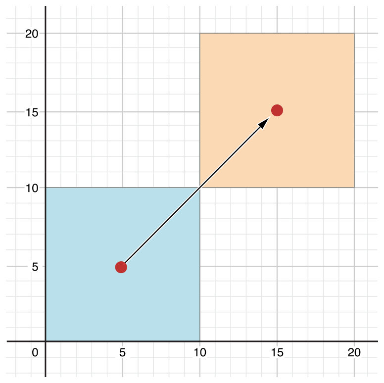

<!-- _class: cover institutional-cover -->
<!-- _paginate: false -->
<!-- _footer: "" -->
<div class="system-week">Semana 10</div>

# Clases y estructuras<br>en Swift

<div class="system-topics">Propiedades, métodos e inicialización<br>Herencia y sobreescritura</div>
<div class="system-author">Cristina Pomares Puig</div>
<div class="institutional-logos">


</div>
<div class="mascot-figure cover-mascot wizard"></div>

<!-- Fuente: notas-clase/semana10/semana10.md. Diseño: semana 1, tema lpp-light. -->

---

## Veremos hoy

1. Clases, estructuras e instancias.
2. Tipos valor y tipos referencia.
3. Propiedades almacenadas y calculadas.
4. Métodos de instancia y del tipo.
5. Inicializadores.
6. Herencia y sobreescritura.

<!--
Marcas institucionales: https://imagenycomunicacion.ua.es/es/identidad-visual-corporativa-y-logotipos-ua.html
Logo DCCIA: https://web.ua.es/es/dccia/imagenes/gestadm/logotipos/logodccia.jpg
-->

<!--
Fuente: Veremos hoy. Notas de clase de la semana 10.
La historia y las características generales de POO se estudian en los apuntes, tal como indican las notas.
-->

---

<!-- _class: section topic-opening -->

<div class="mascot-figure section-mascot wizard"></div>
<div class="eyebrow">Semana 10</div>

# Clases y estructuras

<p class="lead">Definir datos, operaciones e inicialización mediante tipos propios.</p>

---

## Características comunes y diferencias

Clases y estructuras pueden definir propiedades, métodos e inicializadores, ajustarse a protocolos y ampliarse mediante extensiones.

Las **estructuras** tienen semántica de valor.
Las **clases** tienen semántica de referencia y admiten herencia.

<!--
Fuente: Características comunes y diferencias. Notas de clase de la semana 10.
El casting no se limita a clases; los protocolos y Any se estudian en la siguiente semana.
-->

---

<!-- _class: lesson-code -->

## Ejemplo: coordenadas y ventana

```swift
struct CoordsPantalla {
    var posX = 0
    var posY = 0
}
class Ventana {
    var esquina = CoordsPantalla()
    var altura = 0
    var anchura = 0
    var visible = true
    var etiqueta: String?
}
```

`CoordsPantalla` es una estructura. `Ventana` es una clase que contiene unas coordenadas.

<!--
Fuente: ejemplo del bloque de código que comienza en la línea 97. Notas de clase de la semana 10.

-->

---

## Crear instancias y acceder a propiedades

<div class="columns equal">
<div>

```swift
var unasCoordsPantalla = CoordsPantalla()
var unaVentana = Ventana()
```

</div>
<div>

```swift
// Accedemos a la propiedad
unasCoordsPantalla.posX // Devuelve 0
// Actualizamos la propiedad
unasCoordsPantalla.posX = 100
unaVentana.esquina.posY = 100
```

</div>
</div>

La sintaxis de punto permite consultar y actualizar propiedades.

<!--
Fuente: Crear instancias y acceder a propiedades. Notas de clase de la semana 10.

-->

---

<!-- _class: lesson-code -->

## Inicialización de una estructura por propiedades

```swift
let coords = CoordsPantalla(posX: 200, posY: 400)
```

<!--
Fuente: Inicialización de una estructura por propiedades. Notas de clase de la semana 10.

-->

---

<!-- _class: lesson-code -->

## Inicialización de una estructura por propiedades (continuación)

```swift
let coords1 = CoordsPantalla(posX: 200)
print(coords1.posX, coords1.posY)
// Imprime 200 0
```

El inicializador por propiedades, o `memberwise`, pertenece a las estructuras. Puede utilizar valores por defecto.

<!--
Fuente: Inicialización de una estructura por propiedades. Notas de clase de la semana 10.

-->

---

<!-- _class: lesson-code -->

## Las estructuras son tipos valor

```swift
var coords1 = CoordsPantalla(posX: 600, posY: 600)
var coords2 = coords1
coords2.posX = 1000
coords1.posX // devuelve 600
```

La modificación de `coords2` no cambia las coordenadas de `coords1`.

<!--
Fuente: ejemplo del bloque de código que comienza en la línea 198. Notas de clase de la semana 10.

-->

---

<!-- _class: lesson-code -->

## Las clases son tipos referencia

```swift
var ventana1 = Ventana()
ventana1.esquina = coords1
ventana1.altura = 800
ventana1.anchura = 800
ventana1.etiqueta = "Finder"
var ventana2 = ventana1
ventana2.anchura = 1000
ventana1.anchura // devuelve 1000
```

`ventana1` y `ventana2` designan la misma instancia. El cambio de anchura se observa a través de ambos nombres.

<!--
Fuente: ejemplo del bloque de código que comienza en la línea 213. Notas de clase de la semana 10.

-->

---

<!-- _class: lesson-code -->

## ¿Qué significa `let` en cada caso?

```swift
let coords3 = CoordsPantalla(posX: 400, posY: 400)
coords3.posX = 800
// error: cannot assign to property: 'coords3' is a 'let' constant
```

<!--
Fuente: ¿Qué significa `let` en cada caso?. Notas de clase de la semana 10.

-->

---

<!-- _class: lesson-code -->

## ¿Qué significa `let` en cada caso? (continuación)

```swift
let ventana3 = Ventana()
// Sí que podemos modificar una propiedad de la instancia:
ventana3.etiqueta = "Listado"
// Pero no podemos reasignar la variable:
ventana3 = ventana1
// error: cannot assign to value: 'ventana3' is a 'let' constant
```

Los fragmentos incluyen errores intencionados. Una referencia constante impide reasignarla, pero permite cambiar propiedades mutables del objeto.

<!--
Fuente: ¿Qué significa `let` en cada caso?. Notas de clase de la semana 10.

-->

---

<!-- _class: lesson-code -->

## Identidad de instancias

```swift
ventana1 === ventana2 // devuelve true
ventana1 === ventana3 // devuelve false
```

`===` comprueba si dos referencias designan la misma instancia. La igualdad de valores, `==`, es una operación diferente.

<!--
Fuente: ejemplo del bloque de código que comienza en la línea 274. Notas de clase de la semana 10.

-->

---

<!-- _class: lesson-code -->

## Pasar una instancia de clase

```swift
func mueve(ventana: Ventana, incX: Int, incY: Int) {
    var nuevaPos = CoordsPantalla()
    nuevaPos.posX = ventana.esquina.posX + incX
    nuevaPos.posY = ventana.esquina.posY + incY
    ventana.esquina = nuevaPos
}
var ventana1 = Ventana()
mueve(ventana: ventana1, incX: 500, incY: 500)
print(ventana1.esquina)
// Imprime: CoordsPantalla(posX: 500, posY: 500)
```

El parámetro no se reasigna. El cuerpo modifica el objeto compartido a través de su referencia.

<!--
Fuente: ejemplo del bloque de código que comienza en la línea 304. Notas de clase de la semana 10.

-->

---

<!-- _class: lesson-code -->

## Devolver una estructura nueva

```swift
func mueve(coordsPantalla: CoordsPantalla, incX: Int, incY: Int) -> CoordsPantalla {
    var nuevaCoord = CoordsPantalla()
    nuevaCoord.posX = coordsPantalla.posX + incX
    nuevaCoord.posY = coordsPantalla.posY + incY
    return nuevaCoord
}
let coord1 = CoordsPantalla()
let coord2 = mueve(coordsPantalla: coord1, incX: 100, incY: 100)
print(coord2)
// Imprime CoordsPantalla(posX: 100, posY: 100)
```

La función mantiene el valor recibido y devuelve otras coordenadas. Es el enfoque funcional del ejemplo.

<!--
Fuente: ejemplo del bloque de código que comienza en la línea 336. Notas de clase de la semana 10.

-->

---

## Elegir entre estructuras y clases

Las estructuras ayudan a razonar sobre valores independientes.

Las clases son útiles cuando necesitamos identidad compartida o relaciones de herencia.

Los parámetros ordinarios son nombres inmutables. Los parámetros `inout` permiten otro contrato de modificación, que debe declararse explícitamente.

<!--
Fuente: Elegir entre estructuras y clases. Notas de clase de la semana 10.
No confundir inmutabilidad del nombre con inmutabilidad de una instancia de clase.
-->

---

<!-- _class: section topic-opening -->

<div class="mascot-figure section-mascot wizard"></div>
<div class="eyebrow">Semana 10</div>

# Propiedades

<p class="lead">Almacenar datos o calcular un valor a partir de otros datos.</p>

---

<!-- _class: lesson-code -->

## Propiedades almacenadas

```swift
struct RangoLongitudFija {
    var primerValor: Int
    let longitud: Int
}
var rangoTresItems = RangoLongitudFija(primerValor: 0, 
                                       longitud: 3)
// el rango representa ahora 0, 1, 2
rangoTresItems.primerValor = 6
// el rango representa ahora 6, 7, 8
```

`primerValor` puede cambiar. `longitud` se fija al construir el rango.

<!--
Fuente: ejemplo del bloque de código que comienza en la línea 400. Notas de clase de la semana 10.

-->

---

## Propiedades calculadas

Una propiedad calculada proporciona un **getter** y, opcionalmente, un **setter**.

El getter obtiene el valor a partir del estado existente.
El setter actualiza ese estado a partir del valor recibido.

La propiedad `centro` de un rectángulo puede calcularse a partir del origen y del tamaño.

<!--
Fuente: Propiedades calculadas. Notas de clase de la semana 10.

-->

---

<!-- _class: lesson-code -->

## Datos que utiliza el rectángulo

```swift
struct Punto {
    var x = 0.0, y = 0.0
}
struct Tamaño {
    var ancho = 0.0, alto = 0.0
}
```

`Rectangulo` almacena un `origen: Punto` y un `tamaño: Tamaño`.

<!--
Fuente: Propiedades calculadas. Notas de clase de la semana 10.
Contexto para el getter y el setter mostrados a continuación.
-->

---

<!-- _class: lesson-code -->

## Getter de `centro`

```swift
        get {
            let centroX = origen.x + (tamaño.ancho / 2)
            let centroY = origen.y + (tamaño.alto / 2)
            return Punto(x: centroX, y: centroY)
        }
```

Se encuentra dentro de la propiedad `centro: Punto` de `Rectangulo`.

<!--
Fuente: Propiedades calculadas: getter. Notas de clase de la semana 10.
Sumar la mitad de cada dimensión a la coordenada del origen. Fragmento de la propiedad de las notas.
-->

---

<!-- _class: lesson-code -->

## Setter de `centro`

```swift
        set(centroNuevo) {
            origen.x = centroNuevo.x - (tamaño.ancho / 2)
            origen.y = centroNuevo.y - (tamaño.alto / 2)
        }
```

Cambiar el centro desplaza el origen. El tamaño se mantiene.

<!--
Fuente: Propiedades calculadas: setter. Notas de clase de la semana 10.
El setter sin nombre explícito dispone de newValue.
-->

---

<!-- _class: lesson-figure -->

## Efecto de actualizar el centro



<!--
Fuente: Propiedades calculadas. Notas de clase de la semana 10.
Rectángulo de tamaño 10 por 10, origen (0,0). Centro inicial (5,5). Al fijar el centro a (15,15), el origen pasa a (10,10).
-->

---

<!-- _class: lesson-code -->

## Propiedad calculada de solo lectura

```swift
struct Cuboide {
    var ancho = 0.0, alto = 0.0, profundo = 0.0
    var volumen: Double {
        return ancho * alto * profundo
    }
}
let cuatroPorCincoPorDos = Cuboide(ancho: 4.0, alto: 5.0, 
                                   profundo: 2.0)
print("el volumen de cuatroPorCincoPorDos es \(cuatroPorCincoPorDos.volumen)")
// Imprime "el volumen de cuatroPorCincoPorDos es 40.0"
```

Sin setter, `volumen` se consulta pero no se asigna. Podemos omitir `get` y sus llaves.

<!--
Fuente: ejemplo del bloque de código que comienza en la línea 485. Notas de clase de la semana 10.

-->

---

## Observadores de propiedades

- **`willSet`:** se ejecuta antes de almacenar el nuevo valor.
- **`didSet`:** se ejecuta después de la actualización.

`newValue` y `oldValue` son los nombres implícitos. Los observadores se ejecutan incluso si se asigna el mismo valor.

<!--
Fuente: Observadores de propiedades. Notas de clase de la semana 10.
Distinguir observación de una asignación de inicialización: no prometer el mismo comportamiento durante la inicialización.
-->

---

<!-- _class: lesson-code -->

## Ejemplo: `ContadorPasos`

```swift
class ContadorPasos {
    var totalPasos: Int = 0 {
        willSet(nuevoTotalPasos) {
            print("Voy a actualizar totalPasos a \(nuevoTotalPasos)")
        }
        didSet {
            if totalPasos > oldValue  {
                print("Añadidos \(totalPasos - oldValue) pasos")
            }
        }
    }
}
```

<!--
Fuente: Observadores de propiedades. Notas de clase de la semana 10.
Identificar el valor entrante de willSet y el valor anterior de didSet.
-->

---

<!-- _class: lesson-code -->

## Cambios del contador de pasos

```swift
let contadorPasos = ContadorPasos()
contadorPasos.totalPasos = 200
// Imprime: "Voy a actualizar totalPasos a 200"
// Imprime: "Añadidos 200 pasos"
contadorPasos.totalPasos = 360
// Imprime: "Voy a actualizar totalPasos a 360"
// Imprime: "Añadidos 160 pasos"
contadorPasos.totalPasos = 896
// Imprime: "Voy a actualizar totalPasos a 896"
// Imprime: "Añadidos 536 pasos"
```

<!--
Fuente: Observadores: ejemplo de uso. Notas de clase de la semana 10.
La diferencia se calcula respecto al valor anterior, no respecto a cero.
-->

---

<!-- _class: lesson-code -->

## Recuperar un valor no admitido

```swift
        didSet {
            if totalPasos < 0 {
                totalPasos = oldValue
            }
            if totalPasos > oldValue  {
                print("Añadidos \(totalPasos - oldValue) pasos")
            }
        }
```

Este `didSet` devuelve la propiedad a `oldValue` cuando el nuevo total es negativo.

<!--
Fuente: Observadores de propiedades: validación. Notas de clase de la semana 10.
Fragmento alternativo dentro de totalPasos. La asignación dentro de didSet no dispara otra vez el mismo observador.
-->

---

## Variables locales y globales

Las variables locales y globales también pueden tener valores calculados y observadores.

En el ejemplo de las notas, `z` calcula `x + y`; su setter distribuye el valor recibido entre `x` e `y`.

<!--
Fuente: Variables locales y globales. Notas de clase de la semana 10.
Pizarra: con x=10 e y=20, z devuelve 30. Asignar z=100 deja x=50 e y=50.
-->

---

<!-- _class: lesson-code -->

## Propiedades del tipo

```swift
struct UnaEstructura {
    static var almacenada = "A"
    static var calculada : Int {
        return 1
    }
}
```

```swift
UnaEstructura.almacenada // devuelve "A"
UnaEstructura.almacenada = "B" 
UnaEstructura.calculada // devuelve 1
```

<!--
Fuente: Propiedades del tipo. Notas de clase de la semana 10.
Las propiedades static pertenecen al tipo, no a cada instancia. Las enumeraciones también pueden tener propiedades almacenadas del tipo.
-->

---

<!-- _class: section topic-opening -->

<div class="mascot-figure section-mascot wizard"></div>
<div class="eyebrow">Semana 10</div>

# Métodos

<p class="lead">Funciones asociadas a una instancia o al propio tipo.</p>

---

<!-- _class: lesson-code -->

## Métodos de instancia: `Contador`

```swift
class Contador {
    var veces = 0
    func incrementa() {
        veces += 1
    }
    func incrementa(en cantidad: Int) {
        veces += cantidad
    }
    func reset() {
        veces = 0
    }
}
```

Los métodos usan y modifican las propiedades de la instancia sobre la que se llaman.

<!--
Fuente: ejemplo del bloque de código que comienza en la línea 702. Notas de clase de la semana 10.

-->

---

<!-- _class: lesson-code -->

## Invocar métodos de instancia

```swift
let contador = Contador()
// el valor inicial del contador es 0
contador.incrementa()
// el valor del contador es ahora 1
contador.incrementa(en: 5)
// el valor del contador es ahora 6
contador.reset()
// el valor del contador es ahora 0
```

El objeto conserva su estado entre llamadas: `0`, `1`, `6` y de nuevo `0`.

<!--
Fuente: ejemplo del bloque de código que comienza en la línea 719. Notas de clase de la semana 10.

-->

---

<!-- _class: lesson-code -->

## Etiquetas y nombres locales

```swift
class Contador {
    var veces = 0
    func incrementa(en cantidad: Int, numeroDeVeces: Int) {
        veces += cantidad * numeroDeVeces
    }
}
```

<!--
Fuente: Etiquetas y nombres locales. Notas de clase de la semana 10.

-->

---

<!-- _class: lesson-code -->

## Etiquetas y nombres locales (continuación)

```swift
let contador = Contador()
contador.incrementa(en: 5, numeroDeVeces: 3)
// el valor del contador es ahora 15
```

En la llamada usamos `en:`. Dentro del cuerpo, el nombre del parámetro es `cantidad`.

<!--
Fuente: Etiquetas y nombres locales. Notas de clase de la semana 10.

-->

---

<!-- _class: lesson-code -->

## La referencia a la instancia: `self`

```swift
struct Punto {
    var x = 0.0, y = 0.0
    func estaAlaDerecha(de x: Double) -> Bool {
        return self.x > x
    }
}
let unPunto = Punto(x: 4.0, y: 5.0)
if unPunto.estaAlaDerecha(de: 1.0) {
    print("Este punto está a la derecha de la línea donde x == 1.0")
}
// Imprime "Este punto está a la derecha de la línea donde x == 1.0"
```

`self.x` identifica la propiedad. `x` identifica el parámetro que tiene el mismo nombre.

<!--
Fuente: ejemplo del bloque de código que comienza en la línea 788. Notas de clase de la semana 10.

-->

---

<!-- _class: lesson-code -->

## Un método que devuelve un valor nuevo

```swift
struct Punto {
    var x = 0.0, y = 0.0
    func incrementado(incX: Double, incY: Double) -> Punto {
        return Punto(x: x+incX, y: y+incY)
    }
}
let unPunto = Punto(x: 1.0, y: 1.0)
var puntoMovido = unPunto.incrementado(incX: 2.0, incY: 3.0)
print("Hemos movido el punto a (\(puntoMovido.x), \(puntoMovido.y))")
// Imprime "Hemos movido el punto a (3.0, 4.0)"
```

`incrementado` devuelve otro punto. La instancia original conserva su valor.

<!--
Fuente: ejemplo del bloque de código que comienza en la línea 814. Notas de clase de la semana 10.

-->

---

<!-- _class: lesson-code -->

## Método mutador de una estructura

```swift
struct Punto {
    var x = 0.0, y = 0.0
    mutating func incrementa(incX: Double, incY: Double) {
        x += incX
        y += incY
    }
}
var unPunto = Punto(x: 1.0, y: 1.0)
unPunto.incrementa(incX: 2.0, incY: 3.0)
print("El punto está ahora en (\(unPunto.x), \(unPunto.y))")
// Imprime "El punto está ahora en (3.0, 4.0)"
```

`mutating` permite cambiar el valor de la instancia. La variable sobre la que se llama debe ser mutable.

<!--
Fuente: ejemplo del bloque de código que comienza en la línea 839. Notas de clase de la semana 10.

-->

---

<!-- _class: lesson-code -->

## Un método mutador sobre una constante

```swift
let puntoFijo = Punto(x: 3.0, y: 3.0)
puntoFijo.incrementa(incX: 2.0, incY: 3.0)
// esto provocará un error
```

Es un error intencionado: no podemos invocar el método mutador sobre un punto declarado con `let`.

<!--
Fuente: ejemplo del bloque de código que comienza en la línea 856. Notas de clase de la semana 10.

-->

---

<!-- _class: lesson-code -->

## Asignar un nuevo valor a `self`

```swift
struct Punto {
    var x = 0.0, y = 0.0
    mutating func incrementa(incX: Double, incY: Double) {
        self = Punto(x: x + incX, y: y + incY)
    }
}
```

Un método mutador puede reemplazar el valor completo de la instancia.

<!--
Fuente: ejemplo del bloque de código que comienza en la línea 869. Notas de clase de la semana 10.

-->

---

<!-- _class: lesson-code -->

## Mutación en una enumeración

```swift
enum InterruptorTriEstado {
    case apagado, medio, alto
    mutating func siguiente() {
        switch self {
        case .apagado:
            self = .medio
        case .medio:
            self = .alto
        case .alto:
            self = .apagado
        }
    }
}
```

<!--
Fuente: Asignación a self en un método mutador. Notas de clase de la semana 10.
siguiente cambia self al caso que corresponde: apagado, medio, alto y de nuevo apagado.
-->

---

<!-- _class: lesson-code -->

## Métodos del tipo

```swift
class NuevaClase {
    static func unMetodoDelTipo() {
        print("Hola desde el tipo")
    }
}
NuevaClase.unMetodoDelTipo()
```

Se invocan en el nombre del tipo, sin crear una instancia para la llamada.

<!--
Fuente: ejemplo del bloque de código que comienza en la línea 916. Notas de clase de la semana 10.

-->

---

<!-- _class: lesson-code -->

## Registrar instancias en el tipo

```swift
class Ventana {
    // Propiedades
    static var ventanas: [Ventana] = []
    static func registrar(ventana: Ventana) {
        ventanas.append(ventana)
    }
}
```

<!--
Fuente: Registrar instancias en el tipo. Notas de clase de la semana 10.

-->

---

<!-- _class: lesson-code -->

## Registrar instancias en el tipo (continuación)

```swift
let v1 = Ventana()
Ventana.registrar(ventana: v1)
print("Se han registrado \(Ventana.ventanas.count) ventanas")
// Imprime "Se han registrado 1 ventanas"
```

El array `ventanas` y el método `registrar` pertenecen a `Ventana`. El ejemplo añade funcionalidad a la clase presentada antes.

<!--
Fuente: Registrar instancias en el tipo. Notas de clase de la semana 10.

-->

---

<!-- _class: section topic-opening -->

<div class="mascot-figure section-mascot wizard"></div>
<div class="eyebrow">Semana 10</div>

# Inicialización

<p class="lead">Preparar todas las propiedades almacenadas antes de usar una instancia.</p>

---

## Inicializador por defecto y por propiedades

<div class="columns equal">
<div>

```swift
struct Punto2D {
    var x = 0.0
    var y = 0.0
}
class Segmento {
    var p1 = Punto2D()
    var p2 = Punto2D()
}
var s = Segmento()
```

</div>
<div>

```swift
var p = Punto2D(x: 10.0, y: 10.0)
```

</div>
</div>

Las estructuras pueden recibir un inicializador `memberwise` sintetizado si cumplen las condiciones necesarias.

<!--
Fuente: Inicializador por defecto y por propiedades. Notas de clase de la semana 10.

-->

---

## Inicializadores personalizados

Un inicializador se escribe con `init` y prepara el estado inicial.

Todas las propiedades almacenadas deben tener un valor válido al completar la inicialización. Las propiedades opcionales variables sin valor explícito se inicializan a `nil`.

Definir inicializadores en el cuerpo de una estructura puede impedir la síntesis de sus inicializadores por defecto.

<!--
Fuente: Inicializadores personalizados. Notas de clase de la semana 10.
Evitar la afirmación absoluta: los inicializadores añadidos en extensiones tienen otras reglas de síntesis.
-->

---

<!-- _class: lesson-code -->

## Valor inicial explícito o por defecto

```swift
struct Fahrenheit {
    var temperatura: Double
    init() {
        temperatura = 32.0
    }
}
var f = Fahrenheit()
print("La temperatura por defecto es \(f.temperatura) Fahrenheit")
// Imprime "La temperatura por defecto es 32.0° Fahrenheit"
```

<!--
Fuente: Valor inicial explícito o por defecto. Notas de clase de la semana 10.

-->

---

<!-- _class: lesson-code -->

## Valor inicial explícito o por defecto (continuación)

```swift
struct Fahrenheit {
    var temperatura = 32.0
}
```

Las dos versiones inicializan la temperatura a `32.0`. Son definiciones alternativas.

<!--
Fuente: Valor inicial explícito o por defecto. Notas de clase de la semana 10.

-->

---

<!-- _class: lesson-code -->

## Inicializadores con parámetros

```swift
struct Celsius {
    var temperaturaEnCelsius: Double
    init(desdeFahrenheit fahrenheit: Double) {
        temperaturaEnCelsius = (fahrenheit - 32.0) / 1.8
    }
    init(desdeKelvin kelvin: Double) {
        temperaturaEnCelsius = kelvin - 273.15
    }
}
let puntoDeEbullicionDelAgua = Celsius(desdeFahrenheit: 212.0)
// puntoDeEbullicionDelAgua.temperaturaEnCelsius es 100.0
let puntoDeCongelacionDelAgua = Celsius(desdeKelvin: 273.15)
// puntoDeCongelacionDelAgua.temperaturaEnCelsius is 0.0
```

Las etiquetas distinguen la conversión desde Fahrenheit y desde Kelvin.

<!--
Fuente: ejemplo del bloque de código que comienza en la línea 1059. Notas de clase de la semana 10.

-->

---

<!-- _class: lesson-code -->

## Un parámetro sin etiqueta

```swift
struct Celsius {
   var temperaturaEnCelsius: Double
   init(desdeFahrenheit fahrenheit: Double) {
      temperaturaEnCelsius = (fahrenheit - 32.0) / 1.8
   }
   init(desdeKelvin kelvin: Double) {
      temperaturaEnCelsius = kelvin - 273.15
   }
   init(_ celsius: Double) {
      temperaturaEnCelsius = celsius
   }
}
let temperaturaCuerpo = Celsius(37.0)
// temperaturaCuerpo.temperaturaEnCelsius es 37.0
```

<!--
El inicializador init(_:) permite escribir Celsius(37.0).
Fuente: ejemplo del bloque de código que comienza en la línea 1100. Notas de clase de la semana 10.
Es una definición alternativa de Celsius. No sumar todas las versiones en un mismo fichero sin adaptarlas.
-->

---

<!-- _class: lesson-code -->

## Propiedad opcional en una clase

```swift
class PreguntaEncuesta {
    let texto: String
    var respuesta: String?
    init(texto: String) {
        self.texto = texto
    }
    func pregunta() {
        print(texto)
    }
}
let preguntaQueso = PreguntaEncuesta(texto: "¿Te gusta el queso?")
preguntaQueso.pregunta()
// Imprime "¿Te gusta el queso?
preguntaQueso.respuesta = "Sí, me gusta el queso."
```

<!--
texto se fija en el inicializador. La respuesta comienza en nil y puede asignarse después.
Fuente: ejemplo del bloque de código que comienza en la línea 1123. Notas de clase de la semana 10.

-->

---

<!-- _class: lesson-code -->

## Delegar en otro inicializador

```swift
struct Rectangulo {
    var origen = Punto()
    var tamaño = Tamaño()
    init() {}
    init(origen: Punto, tamaño: Tamaño) {
        self.origen = origen
        self.tamaño = tamaño
    }
    init(centro: Punto, tamaño: Tamaño) {
        let origenX = centro.x - (tamaño.ancho / 2)
        let origenY = centro.y - (tamaño.alto / 2)
        self.init(origen: Punto(x: origenX, y: origenY), tamaño: tamaño)
    }
}
```

<!--
Fuente: Inicializadores personalizados: Rectangulo. Notas de clase de la semana 10.
Se corrige origenY para restar tamaño.alto / 2; las notas repiten ancho.
-->

---

<!-- _class: section topic-opening -->

<div class="mascot-figure section-mascot wizard"></div>
<div class="eyebrow">Semana 10</div>

# Herencia

<p class="lead">Una subclase conserva características de su superclase y puede ampliarlas o sobreescribirlas.</p>

---

<!-- _class: lesson-code -->

## Definir una clase base

```swift
class Vehiculo {
    var velocidadActual = 0.0
    var descripcion: String {
        return "viajando a \(velocidadActual) kilómetros por hora"
    }
    func hazRuido() -> String {
        // devuelve una cadena vacía - un vehículo arbitrario no hace
        // ruido necesariamente
        return ""
    }
}
```

`Vehiculo` reúne velocidad, descripción y un comportamiento común. Swift no impone una superclase universal.

<!--
Fuente: ejemplo del bloque de código que comienza en la línea 1200. Notas de clase de la semana 10.

-->

---

<!-- _class: lesson-code -->

## Construir una subclase

```swift
class Bicicleta: Vehiculo {
    var tieneCesta = false
}
```

<!--
Fuente: Construir una subclase. Notas de clase de la semana 10.
Para ejecutar el uso, crear antes la constante bicicleta del ejemplo de las notas.
-->

---

<!-- _class: lesson-code -->

## Construir una subclase (continuación)

```swift
let bicicleta = Bicicleta()
bicicleta.velocidadActual = 10.0
print("Bicicleta: \(bicicleta.descripcion)")
// Bicicleta: viajando a 10.0 kilómetros por hora
```

`Bicicleta` añade una propiedad y hereda `velocidadActual` y `descripcion`.

<!--
Fuente: Construir una subclase. Notas de clase de la semana 10.
Para ejecutar el uso, crear antes la constante bicicleta del ejemplo de las notas.
-->

---

<!-- _class: lesson-code -->

## Una subclase de otra subclase

```swift
class Tandem: Bicicleta {
    var numeroActualDePasajeros = 0
}
```

<!--
Fuente: Una subclase de otra subclase. Notas de clase de la semana 10.

-->

---

<!-- _class: lesson-code -->

## Una subclase de otra subclase (continuación)

```swift
let tandem = Tandem()
tandem.tieneCesta = true
tandem.numeroActualDePasajeros = 2
tandem.velocidadActual = 18.0
print("Tandem: \(tandem.descripcion)")
// Tandem: viajando a 18.0 kilómetros por hora
```

`Tandem` hereda a través de `Bicicleta` las características de `Vehiculo`.

<!--
Fuente: Una subclase de otra subclase. Notas de clase de la semana 10.

-->

---

## Sobreescribir un método

<div class="columns equal">
<div>

```swift
class Tren: Vehiculo {
    override func hazRuido() -> String {
        return "Chuu Chuu"
    }
}
```

</div>
<div>

```swift
let tren = Tren()
print(tren.hazRuido())
// Imprime "Chuu Chuu"
```

</div>
</div>

`override` indica que la subclase reemplaza una implementación heredada.

<!--
Fuente: Sobreescribir un método. Notas de clase de la semana 10.

-->

---

<!-- _class: lesson-code -->

## Ampliar una propiedad heredada

```swift
class Coche: Vehiculo {
    var marcha = 1
    override var descripcion: String {
        return super.descripcion + " con la marcha \(marcha)"
    }
}
```

<!--
Fuente: Ampliar una propiedad heredada. Notas de clase de la semana 10.

-->

---

<!-- _class: lesson-code -->

## Ampliar una propiedad heredada (continuación)

```swift
let coche = Coche()
coche.velocidadActual = 50.0
coche.marcha = 3
print("Coche: \(coche.descripcion)")
// Coche: viajando a 50.0 kilómetros por hora con la marcha 3
```

`super.descripcion` obtiene la implementación de la superclase para completar la nueva descripción.

<!--
Fuente: Ampliar una propiedad heredada. Notas de clase de la semana 10.

-->

---

<!-- _class: lesson-code -->

## Observar una propiedad heredada

```swift
class CocheAutomatico: Coche {
    override var velocidadActual: Double {
        didSet {
            marcha = min(Int(velocidadActual / 25.0) + 1, 5)
        }
    }
}
```

<!--
Fuente: Observar una propiedad heredada. Notas de clase de la semana 10.

-->

---

<!-- _class: lesson-code -->

## Observar una propiedad heredada (continuación)

```swift
let automatico = CocheAutomatico()
automatico.velocidadActual = 100.0
print("CocheAutomatico: \(automatico.descripcion)")
// CocheAutomatico: viajando a 100.0 kilómetros por hora con la marcha 5
```

El observador ajusta la marcha cuando cambia la velocidad.

<!--
Fuente: Observar una propiedad heredada. Notas de clase de la semana 10.

-->

---

<!-- _class: lesson-code -->

## Inicializador de la clase base

```swift
class Vehiculo {
    var velocidadActual = 0.0
    // Resto de código de la clase
    init(velocidad: Double) {
        self.velocidadActual = velocidad
    }
}
```

Es una versión alternativa de `Vehiculo`, con un parámetro obligatorio de velocidad.

<!--
Fuente: ejemplo del bloque de código que comienza en la línea 1400. Notas de clase de la semana 10.

-->

---

<!-- _class: lesson-code -->

## Inicializar la subclase

```swift
class Bicicleta: Vehiculo {
    var tieneCesta = false
    init(tieneCesta: Bool, velocidad: Double) {
        self.tieneCesta = tieneCesta
        super.init(velocidad: velocidad)
    }
}
```

Primero se inicializan las propiedades propias y después se llama al inicializador de la superclase.

<!--
Fuente: ejemplo del bloque de código que comienza en la línea 1424. Notas de clase de la semana 10.
No afirmar que todos los inicializadores se heredan siempre. En el ejemplo previo, con valores por defecto y sin inicializadores propios, se cumplen las reglas de herencia automática.
-->
